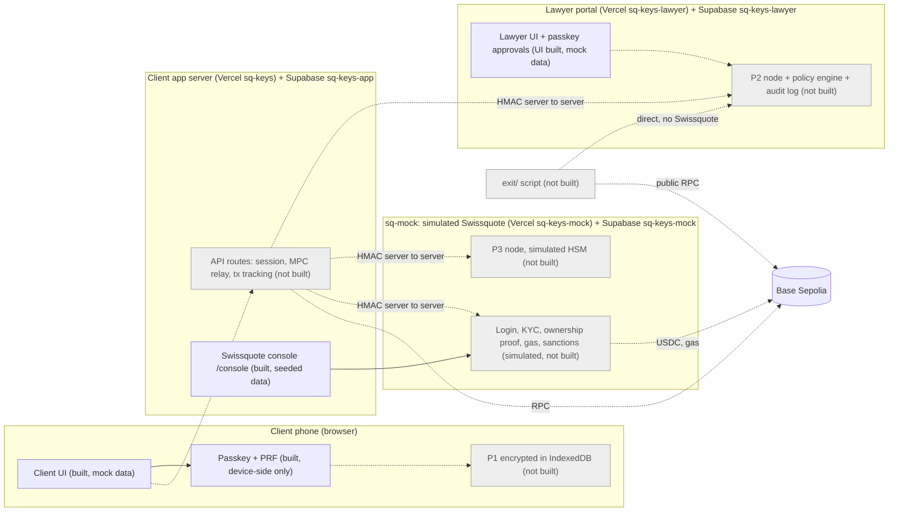

# SQ Keys

**A self-custody wallet that Swissquote could launch: the client signs with their phone and face, a lawyer of their choice protects large or unusual moves, and Swissquote can never act alone.** The private key is split into three shares (MPC 2-of-3): the client's phone (P1), the client's lawyer (P2) and Swissquote (P3). Any two can sign; no single holder can. There is no seed phrase.

> **Student prototype. Not an official Swissquote product. Testnet only (Base Sepolia): no real funds.**
> Made for the Swissquote track of the BSA x EPFL hackathon (10-11 October 2026).

| | URL | Status |
|---|---|---|
| Client app | https://sq-keys.vercel.app | `[TO VERIFY]` deployment may be older than this branch |
| Lawyer portal (and P2 node, planned) | https://sq-keys-lawyer.vercel.app | `[TO VERIFY]` same |
| Swissquote console (inside the client app) | https://sq-keys.vercel.app/console | `[TO VERIFY]` password gate is real, data is seeded |
| Swissquote mock service and P3 node | `sq-keys-mock` (Vercel) | **Not built yet**, see section 3 |
| Source | https://github.com/teo-creativ/swissquote-wallet | |

**Read this first, honestly.** Today the repository contains a complete client app, a lawyer portal and a Swissquote console that run on **in-browser mocks**. The MPC key generation, MPC signing, on-chain transactions, the server-side policy engine and the exit script are **designed (see `docs/CDC_v3.1.md`) but not built in this branch**. Section 3 says, row by row, what is real and what is simulated. Every simulated screen carries a "Simulated" pill in the product. The `[TO VERIFY]` marker means we have not confirmed the statement; some items may exist on branches this README's author could not see (`aaron/logic`, `theotime/sq`).

Contents: [1 Tour](#2-60-second-tour) · [3 Real vs simulated](#3-what-is-real-and-what-is-simulated) · [4 Architecture](#4-architecture) · [5 Custody and threats](#5-custody-model-decision) · [6 Wallet creation](#6-wallet-creation) · [7 Authentication](#7-authentication) · [8 Recovery](#8-recovery) · [9 Legal](#9-legal-feasibility) · [10 Business](#10-business-case) · [11 Bonus topics](#11-bonus-topics) · [12 Run locally](#12-run-it-locally) · [13 Deploy](#13-deployment) · [14 Tests](#14-test-plan-and-results) · [15 Limits](#15-known-limitations-and-next-steps) · [16 AI tools](#16-ai-tools-used) · [17 Team, repo, licences](#17-team-roles-repository-map-licences)

---

## 2. 60-second tour

All steps are in a phone-width browser window (or on a phone). Everything marked "Simulated" is simulated.

1. Open the client app, **Sign in**. In mock mode the demo account is shown on the login screen.
2. Identity check (simulated KYC), read and accept the four documents.
3. **Invite your lawyer.** Copy the link. In mock mode press **"Simulate lawyer accepting"** (Simulated) or wait about 8 seconds.
4. **Create my key.** This runs a **real passkey ceremony** on your device (Face ID, fingerprint or device code). The wallet that follows is simulated.
5. **Three shares are created together**: "You, on this phone", "Your lawyer", "Swissquote". You land on a wallet address (random in mock mode).
6. **Send** 2 USDC to the pre-approved demo recipient: instant. Send 8 USDC: "Waiting for your lawyer". Open the lawyer portal to see the request shape (data is seeded, see section 3).
7. **Security** > Create exit kit; **I've lost access to my wallet** on the login screen starts the recovery flow with its 2-minute demo delay.
8. Swissquote console: `/console`, demo-only password `<given on the demo day>`.
9. Phone diagnostics for passkeys (not linked in the UI): `/dev/passkey`.

Screenshots: see [`docs/screenshots/`](docs/screenshots/README.md).

| Client | Lawyer | Console |
|---|---|---|
|  |  |  |

*(Images are added by the team; a missing image here means it has not been added yet.)*

---

## 3. What is real and what is simulated

Status values: **Real** works against real infrastructure or a real browser API. **Simulated** runs on in-browser or in-memory mocks. **Partly** some of it is real. **Not built** specified, no code.
This table describes the code on branch `teo/ui`. `[TO VERIFY]` by Aaron and Théotime against their branches.

| Component / journey | Status | Where in the repo | How to verify |
|---|---|---|---|
| Client screens C1-C20 | Real UI, **Simulated** data | `app/(mobile)/`, `components/ui/` | `npm run dev`, open :3000 |
| Wallet creation (3 shares, address) | **Simulated** | `lib/sqkeys.mock.ts` `createWallet` (timed steps, random address) | Create a wallet; the address is not derived from any key |
| Client passkey (WebAuthn + PRF) | **Partly**: real ceremony on the device, not bound to a server account or to P1 | `lib/passkey/`, `app/(mobile)/key/page.tsx`, `/dev/passkey` | Open `/dev/passkey` on a phone over HTTPS. **Not verified on phones yet** `[TO VERIFY]` |
| Reduced-protection fallback (no PRF) | **Partly**: code path exists, off unless `ALLOW_NO_PRF=true` | `lib/passkey/webauthn.ts`, `app/api/public-config/route.ts` | Set `ALLOW_NO_PRF=true`, use a device without PRF; amber "Reduced protection" pill shows |
| MPC key generation (DKLs23) | **Not built**; the WASM package only loads | `lib/mpc/client.ts` (7-line loader) | `GET lawyer /api/node/health` proves the package resolves, nothing more |
| MPC signing, on-chain transactions | **Not built**; hash and explorer links in the mock are fake | `lib/sqkeys.mock.ts` | Send a transfer: the hash does not exist on Basescan |
| Policy engine | **Partly**: pure function, faithful to CDC vectors T1-T13 (T10, T12 need a DB lock), **no server enforcement** | `lib/sqkeys.mock.policy.ts`, `lawyer/lib/policy.ts` | `npm test` |
| Lawyer approval with passkey | **Simulated** (timer); WebAuthn code exists, server routes do not | `lawyer/lib/lawyerApi.mock.ts`, `lawyer/lib/passkey.ts` | Lawyer portal :3001 |
| Lawyer portal screens L1-L10 | Real UI, **Simulated** data (seeded, lost on reload) | `lawyer/app/` | `cd lawyer && npm run dev` |
| Invitation between client and lawyer | **Simulated**: the link points to `localhost:3001`, the lawyer portal accepts any token | `lib/sqkeys.mock.ts` `inviteLawyer` | Compare the two apps' state: they do not share any |
| Recovery (lost phone) | **Simulated** (timers, address swap) | `lib/sqkeys.mock.ts`, `app/(mobile)/recovery/` | Login screen > "I've lost access" |
| Exit without Swissquote (`exit/`) | **Not built**; the exit kit in the app is a JSON stub with no key material | `exit/README.md`, `createExitKit` in the mock | `exit/` has no script |
| Gasless transactions | **Not built**; design only (section 11) | `docs/CDC_v3.1.md` 3.6 | n/a |
| Swissquote console C21 | **Partly**: password gate is real (server-side, fails closed); data is seeded server memory | `app/console/`, `lib/console.auth.ts` | `/console` with `CONSOLE_PASSWORD` |
| Swissquote login, KYC, selfie, bank balance | **Simulated** by design (single demo client) | `lib/sqkeys.mock.ts` | Sign in |
| `sq-mock/` service and P3 node | **Not built** | `sq-mock/` (SQL schema and constants only) | n/a |
| Database | **Not used**: three Supabase schemas written, nothing reads or writes them | `sql/`, `lawyer/sql/`, `sq-mock/sql/` | grep for `supabase` in app code |
| Legal documents (terms, risk, recovery, privacy, cookies, notice) | **Real** text, English, Swiss law framing; in mock mode the acceptance time and version are stored | `content/legal/` | `/legal/terms` |
| Secret scanning | **Real** | `scripts/check-secrets.sh` | `npm run check-secrets` |

---

## 4. Architecture

Target architecture (CDC 3.2). Dashed arrows and the grey nodes are **not built yet**; the client app and the lawyer portal run on mocks.



What each arrow is meant to carry (CDC 3.10):
- **Browser to client app**: the browser only talks to its own app server. Session is a JWT cookie (`HttpOnly; Secure; SameSite=Lax`, 8 h) and state-changing routes also check a CSRF header. *Not built.*
- **Client app to P2 node, P3 node and Swissquote service**: server-to-server requests, signed with HMAC-SHA256 over method, path, timestamp, nonce and body hash; 60-second clock window; replayed nonces rejected; one secret per pair of services (`APP_TO_LAWYER_SECRET`, `APP_TO_SQ_SECRET`). The client app relays MPC messages but never sees a share. *Not built.*
- **Lawyer UI to P2 node**: the lawyer's own session plus a WebAuthn assertion whose challenge is bound to the request (`SHA-256("sqkeys-approval-v1" || requestId || intentHash || decision)`), so the lawyer cannot approve something other than what they saw. *Not built; the passkey client code exists.*
- **Nodes and services to the chain**: RPC reads for balances and nonces; the gas account funds new wallets. *Not built.*
- **`exit/` to the P2 node**: directly, with a one-time exit token approved by the lawyer. No Swissquote, no client app. *Not built.*

Separation rules (enforced by folder and by `scripts/check-secrets.sh`): the client app never touches P2 or P3; the lawyer portal never touches P1 or P3; sq-mock never touches P1 or P2; the `service_role` key is never in a `NEXT_PUBLIC_` variable.

---

## 5. Custody model decision

**Chosen: MPC threshold 2-of-3** (DKLs23 as implemented by Silence Laboratories' Silent Shard). The whole key never exists, at creation, signing or recovery.

| Holder | Share | Lives | Used for |
|---|---|---|---|
| Client | P1 | Their phone, encrypted with a key derived from their passkey (PRF) | Everyday signing |
| Client's lawyer | P2 | The lawyer's node (server), released by a policy engine or by the lawyer's passkey | Co-signing, recovery |
| Swissquote | P3 | sq-mock (simulated HSM) | Recovery only |

| Pair | Use |
|---|---|
| P1 + P2 | All client transactions, small and large |
| P2 + P3 | Recovery when the phone is lost |
| P1 + P3 | Emergency path without the lawyer: optional, **off by default** |
| Any single share | Can never sign, not even 1 USDC |

**Pros:** no seed phrase to lose; no single point of theft; tolerates the loss of any one share; three independent parties watch each other; same curve as Bitcoin (a path to Bitcoin, not built). **Cons:** interactive protocol (parties must be online to create a key and sign); two simultaneous failures lock funds; depends on a reachable lawyer for large amounts; the MPC library is under a non-commercial licence (section 17); the recovery part of the library is not marked audited.

**Compared with the other models in the brief** (CDC 2.1):

| Model | Why not (for this prototype) |
|---|---|
| Plain self-custody with a seed phrase | Clients lose or leak phrases; no help possible |
| Custodial (Swissquote holds keys) | That is the existing Wallet; it is custody with bank rules |
| Smart-contract wallet with social guardians (Safe) | More friction for a bank client, attack delay of several days, EVM only. **Kept as plan B** (CDC 3.9) if MPC cannot be delivered |

### Threat model

| Question | Answer |
|---|---|
| Who could steal funds? | Nobody alone: two shares are needed. A phone thief holds one share and is limited by the policy to 5 USDC per transaction, 10 USDC per 24 h, 3 transactions per hour, 6 per day, and only to recipients the lawyer already approved. Residual risk we state: up to 10 USDC per 24 h to approved recipients. |
| Who could lock the client out? | No single failure. Lost phone: P2 + P3. Lawyer unreachable: small transfers continue while the lawyer's node is up, large ones wait. Swissquote gone: P1 + P2 through the exit kit. **Two failures at once lock funds**, for example lost phone and Swissquote gone without an exit kit. |
| Can Swissquote alone move funds? | No. It holds one share. |
| Swissquote with a partner? | **With the lawyer, yes: P2 + P3 are two shares.** That is exactly the recovery path, and it is the grey zone Swissquote flagged. What bounds it: an independent lawyer the client chose; a recorded identity check; a new wallet created by a fresh key generation whose destination the nodes compute themselves; the lawyer's passkey approval bound to (recovery, old address, new address); a delay (24 h in production, 2 minutes in the demo) that **each node enforces independently**; the client can cancel; alerts by channels other than e-mail; a verifiable audit log. What is left is **collusion of two independent professionals**, comparable to a two-key safe. |
| Compromised lawyer server? | Holds one share, cannot move funds alone. With a phone thief, the caps are gone. This is the price of automatic release under the threshold. |
| Compromised client app server? | Holds no share and cannot sign. It could refuse service or ship tampered code to the browser (the classic web-app limit); mitigated by showing transaction details computed in the browser, and by nodes recomputing what they sign. |
| Phone and e-mail both stolen? | E-mail holds no share. Login uses Swissquote credentials. A recovery attempt fails the identity check, the lawyer is alerted, nothing moves. |

*None of this has been audited or formally proven. Today most of it is design, not code (section 3).*

---

## 6. Wallet creation

**Onboarding order (changed by team decision): documents, then invite the lawyer, then create the phone key, then the three shares are created together.**

1. Sign in with Swissquote credentials (simulated). Identity check (simulated). Accept four documents (consents are not yet stored).
2. **Invite your lawyer** (C5): optional lawyer name, one-time link valid 7 days, copy and share, status refreshed every 5 seconds, new link on demand. The client cannot go on until the invitation is accepted. Opening `/key` or `/creating` before that redirects to `/lawyer`. Reloading resumes at the right step from the account status.
3. **Create my key** (C4): one button, one sentence about Face ID / fingerprint / device code. It creates the passkey (section 7) and registers the device.
4. **Three shares together** (C6): three cards, "You, on this phone", "Your lawyer", "Swissquote", each *waiting, generating, stored*, and a one-line honest description of where that share lives. Then the wallet address with a copy button and a Basescan link.

Where each share is generated and kept (CDC 3.3) *(target; not built)*:

| Share | Born | Kept | At rest |
|---|---|---|---|
| P1 | In the client's browser during key generation | Browser IndexedDB, encrypted | AES-256-GCM, key from HKDF-SHA256 over the passkey PRF output |
| P2 | In the lawyer's node | Table `shares` in `sq-keys-lawyer` | AES-256-GCM, `LAWYER_SHARE_ENC_KEY` (simulated HSM) |
| P3 | In sq-mock | Table `shares` in `sq-keys-mock` | AES-256-GCM, `SQ_SHARE_ENC_KEY` (simulated HSM) |

**Link to the Swissquote identity.** sq-mock alone keeps `client number <-> sq_ref <-> wallet address` (the bank-secrecy-sensitive link). The client app and the lawyer portal only see the pseudonymous `sq_ref` and the address. Ownership of the wallet is proven by a message signature checked by sq-mock (section 9). *Not built.*

The contract change this order needs is written up in [`docs/CONTRACT_CHANGE.md`](docs/CONTRACT_CHANGE.md). The mock already follows the new order.

---

## 7. Authentication

| Action | Proof |
|---|---|
| Open the app | Swissquote login (simulated) |
| Unlock P1 | The client's passkey with user verification (biometric or device code) and the PRF output |
| Sign | P1 unlocked and P2 released |
| Lawyer approves | The lawyer's passkey; the challenge is bound to the request |
| Change the policy | The lawyer's passkey only |

**Passkey and PRF on the phone (built, device-side).** `lib/passkey/` creates a platform passkey (ES256 and RS256, resident key and user verification required, attestation none, random 16-byte user id, `rpId` = the page hostname, 60 s timeout, existing credentials excluded) and asks for the WebAuthn **PRF** extension. The wrapping key for P1 is `HKDF-SHA256(PRF output, fixed label)` used as an AES-256-GCM key through WebCrypto (no homemade cryptography).
- iOS needs the call to start directly in the tap, so the challenge is prepared when the screen opens and no `await` sits between the tap and `create()`.
- Some platforms only report `prf.enabled` at creation. Then the screen shows **"Confirm once more to protect your key"** and a second, separate tap runs `get()` with the PRF input. It is never chained automatically.
- In-app browsers and webviews (Facebook, Instagram, LinkedIn, WhatsApp, WeChat, MIUI Browser, Android WebView) get a full-screen "open this page in Safari / Chrome" instruction with a copy-link button.
- Errors are mapped to short English messages with a retry action (`NotAllowedError`, `SecurityError`, `NotSupportedError`, `InvalidStateError`).
- **Status:** written and unit-tested for the pure parts; **not yet verified on an iPhone or on a Redmi** `[TO VERIFY]`. Use `/dev/passkey` for that.

**Reduced protection.** If PRF is unavailable and the server sets `ALLOW_NO_PRF=true`, the app can instead keep a non-extractable AES-GCM key in IndexedDB, gated at app level by a user-verification assertion. This is **weaker** (the key sits on the device and the gate is enforced by our code, not the authenticator). It is never silent: an amber **"Reduced protection"** pill appears on the key screen and on the Security screen. Without `ALLOW_NO_PRF`, a phone without PRF is refused with a clear message.

**Small versus large transactions.** The cryptographic path is the same (two shares). What changes is **who releases P2**: under the thresholds the policy engine releases it automatically and the lawyer is not bothered; above them, or for a new recipient, an unknown app or an unlimited approval, the lawyer sees the request and approves with a passkey. If nobody answers within 48 hours (3 minutes in the demo), the request is dropped and nothing is written on the chain. *(Policy logic is real code; enforcement and the lawyer round-trip are simulated, section 3.)*

---

## 8. Recovery

**Lost phone (P2 + P3), default path (design; the screens and timers exist as a simulation).**
1. On the new phone the client signs in and chooses "I lost my phone". No e-mail is involved.
2. Alerts go to the lawyer portal, to the client's registered devices and to a simulated Swissquote call.
3. Swissquote verifies identity (document, selfie, banking question). On success, the lawyer's node refuses new decisions for the old wallet, so funds cannot move during the delay.
4. The new phone creates a passkey and a **new** three-party key. **The address changes**; the old history stays on the chain. (Keeping the same address needs the library's share-recovery feature, which is not marked audited.)
5. The lawyer checks the client through another channel and approves with a passkey bound to (recovery, old address, new address).
6. A delay runs (24 h in production, 2 minutes in the demo), enforced independently by both nodes. The client or the lawyer can cancel.
7. P2 + P3 sign the transfer of the whole balance. The nodes compute destination and amount themselves; the caller cannot choose them.

**Why an attacker with the stolen phone and e-mail is refused.** The e-mail has no share and cannot start a recovery. A recovery needs the Swissquote identity check (face and banking answer), which the attacker fails; the lawyer is alerted and no recovery key is created. The stolen phone alone is held to the spending caps and cannot change the policy.

**Exit without Swissquote (P1 + P2).** The client keeps an exit kit (P1 encrypted with a passphrase of at least 12 characters, scrypt + AES-256-GCM) outside the phone. The `exit/` script asks the lawyer's node directly for a manual approval and signs a transfer of the whole balance to an address the client chooses. One share alone never signs, so the kit does not bypass the lawyer or the caps. **Status: the screen exists and produces a stub file with no key material; the script is not built.**

Limits we state: a thief with the old unlocked phone can cancel a legitimate recovery (the lawyer can restart it); a lost phone plus a vanished Swissquote and no exit kit loses the funds.

---

## 9. Legal feasibility

Prepared by students from public texts; **not legal advice**. Statuses follow CDC section 9. Items still to check are `[TO VERIFY]`.

- **Custody or software.** The test is who can move the funds. Our position `[hypothesis]`: software, not custody, because Swissquote holds one of three shares and cannot sign alone. The grey zone is Swissquote plus the lawyer (section 5). Qualification by FINMA `[TO VERIFY]`. FINMA guidance of 2026 on crypto safekeeping and the status of the financial-institutions-act revision `[TO VERIFY]`.
- **Lawyer or notary role.** They approve, they do not hold funds. They might qualify as a financial intermediary under the anti-money-laundering act, with a self-regulatory-organisation affiliation `[TO VERIFY]`. Professional secrecy `[TO VERIFY]`. In the prototype the lawyer is played by a team member, and we say so.
- **Travel Rule and proof of ownership.** FINMA's article 10 of the AML ordinance requires originator and beneficiary data, with no exception for unhosted wallets `[verified in source]`. A bank therefore pays to or from an external wallet only if it belongs to its own client, proven by an appropriate technical measure. Our answer: an **automatic message signature** (P1 + P2) checked by an ordinary ECDSA address recovery and recorded against the client. When the client pays a third party from their own wallet, we hold that Swissquote is not the sending institution `[hypothesis]`; the nuance is that Swissquote funds gas, so it refuses gas to sanctioned addresses. The 1,000 CHF threshold of the ordinance `[TO VERIFY]`. *Not built.*
- **"Sole holder of the private key"** (Swissquote's deposit wording) `[hypothesis]`: the full key never exists; the client controls the share that triggers every ordinary signature. To be defended as exclusive control of ordinary signing. `[TO VERIFY]` with the jury.
- **Sanctions.** Swiss lists name persons and entities, we found no wallet addresses `[TO VERIFY]`; the prototype uses a simulated local list. The app warns and never forbids, except for sanctions.
- **Data protection.** Biometrics never leave the device. The KYC selfie would be sensitive data requiring consent and an impact assessment; simulated here, nothing stored. The lawyer sees a display name, the address and request history, never the Swissquote client number. The blockchain is public and cannot be erased, which the privacy policy states.
- **Bank secrecy and outsourcing.** The address-to-client link lives only in sq-mock. Use of Vercel and Supabase as processors, and the lawyer's node as an outsourced function, need qualification `[TO VERIFY]`.

Third-party services and libraries (provider, role, data, country, terms): [`docs/THIRD_PARTIES.md`](docs/THIRD_PARTIES.md). Unknown countries are marked `[TO VERIFY]`. Licence notices: [`NOTICE`](NOTICE).

20-point compliance checklist (consents unticked by default, no dark patterns, no hidden fees, no invented testimonials, no unproven claims): see CDC 9.9. The product never says "unbreakable", "100% secure" or "FINMA compliant". The Swissquote logo is used only from `public/brand/swissquote-logo.svg` (team decision).

---

## 10. Business case

- **Problem.** A client who wants self-custody or DeFi leaves Swissquote today, with their assets. (The claim that most crypto clients hold only Bitcoin was relayed orally and is `[TO VERIFY]`.)
- **Position.** Next to the custodial Wallet, SQ Keys keeps the client in the Swissquote ecosystem, one step from their account, without Swissquote holding the funds.
- **What Swissquote gains.** Retention of clients and assets; revenue on the account-to-wallet gateway (exchange, transfers); a premium "trusted lawyer" service; lower compliance cost than custody; less support for lost access and address checks.
- **The lawyer's economics.** The lawyer can charge the client a supervision subscription; Swissquote can list partner firms without a commission that would make it a prescriber. For the client it is a trusted third party instead of a 12-word phrase.
- **Costs.** Sponsored gas (cost per operation on Base `[TO SOURCE]`), node infrastructure, support, a **commercial licence from Silence Laboratories** in production or an alternative library, and legal qualification of the lawyer's role.
- **Caution.** We do not build "recommended DeFi with commission" into the model: Swissquote would become a prescriber.

No figure is attributed to Swissquote without a source. Revenue and retention numbers are **not estimated here**; Théotime owns this section `[TEAM TO COMPLETE with sourced figures]`.

---

## 11. Bonus topics

**Gasless transactions (design, not built).** Swissquote funds the gas: sq-mock sends a small amount of test ETH to a wallet at activation and tops up below a threshold. Payer: sq-mock's gas account (`SQ_GAS_PRIVATE_KEY`, stored only in sq-mock). Abuse prevention: known addresses only (confirmed by the ownership proof), one top-up per address per 24 h, fixed amount (0.0003 ETH), top-up only below 0.0001 ETH, 5 account creations per IP per hour, no gas to sanctioned addresses, a global daily cap. It is **pre-funded gas, not an ERC-4337 paymaster**, and we say so.

**Compliant dApp interaction (partly designed).** The client can authorise an application to spend USDC. Before signing, the app shows a plain-language simulation ("This lets [app] spend up to X USDC from your wallet") and warns on unlimited approvals; it warns and does not forbid (Swissquote's instruction). Unknown apps or unlimited approvals go through the lawyer. **What exists:** the screens and a simulation with two fake apps (`app/(mobile)/apps/allow`), and the policy rule. **What does not exist:** a real approval transaction, a real app registry, any DeFi integration.

---

## 12. Run it locally

Prerequisites: **Node 22** (`.nvmrc`), npm, Git. Windows: use **Git Bash** (the `check-secrets` script is bash). Git may warn about LF/CRLF line endings; that is harmless.

```bash
npm ci                          # root (client app). Use ci: exact locked versions
(cd lawyer && npm ci)           # lawyer portal
npm run setup-env               # creates .env.local files and fills generated secrets without printing them
npm run doctor                  # checks that your setup matches everyone else's; expect READY
npm run dev                     # client app  http://localhost:3000
(cd lawyer && npm run dev)      # lawyer      http://localhost:3001
```

Ports: client **3000**, lawyer **3001**, sq-mock **3002** (planned; the folder has no code yet).

Variables to fill **by hand** (names only, never commit values): `SUPABASE_URL`, `SUPABASE_SERVICE_ROLE_KEY` (and `SQ_SUPABASE_URL`, `SQ_SUPABASE_SERVICE_ROLE_KEY` for sq-mock), `RPC_URL`. Generated by `setup-env`: `SESSION_SECRET`, `APP_TO_LAWYER_SECRET`, `APP_TO_SQ_SECRET`, `LAWYER_SHARE_ENC_KEY`, `SQ_SHARE_ENC_KEY`, `CONSOLE_PASSWORD`. Mode switches: `NEXT_PUBLIC_SQKEYS_MODE` (`mock` default; `live` is not implemented and every call throws "Not implemented yet") and `NEXT_PUBLIC_LAWYER_MODE`. Optional: `ALLOW_NO_PRF=true` to allow the reduced-protection fallback. Full list: `.env.example` of each folder and `docs/CDC_v3.1.md` annex C.

Passkeys on a phone need **HTTPS on a real hostname**: `localhost` and LAN IPs do not work from a phone. Test on the deployed URL or through an HTTPS tunnel, then open `/dev/passkey`.

```bash
npm test                        # unit tests (vitest)
npm run typecheck
npm run build                   # next build --webpack (the MPC WASM needs webpack)
npm run check-secrets           # scans for keys and service_role
npm run check-shared            # shared/ copies in sync (run sync-shared after editing shared/)
npm run check-chain             # Base Sepolia RPC and USDC contract check
```

`docs/SETUP.md` has the step-by-step setup including testnet faucets. Mock mode has a dev control panel at `/dev/mock`.

---

## 13. Deployment

Three Vercel projects and three Supabase projects, one per party, so that the separation rules are physical:

| Folder | Vercel project | Supabase project | Owner |
|---|---|---|---|
| `/` | `sq-keys` | `sq-keys-app` | Aaron |
| `lawyer/` | `sq-keys-lawyer` | `sq-keys-lawyer` | Téo |
| `sq-mock/` | `sq-keys-mock` | `sq-keys-mock` | Théotime |

Region: Vercel functions `fra1` (`vercel.json`), Supabase Frankfurt. Deploy from each folder with `npx vercel --prod`; project names matter because passkeys are bound to the domain (`sq-keys.vercel.app`, `sq-keys-lawyer.vercel.app`). `NEXT_PUBLIC_*` variables are inlined at build time, so changing them requires a new deploy.

Variables per project (names only; see CDC annex C):
- **Client app:** `NEXT_PUBLIC_CHAIN_ID`, `NEXT_PUBLIC_EXPLORER_URL`, `NEXT_PUBLIC_SQKEYS_MODE`, `RPC_URL`, `USDC_ADDRESS`, `SUPABASE_URL`, `SUPABASE_SERVICE_ROLE_KEY`, `SESSION_SECRET`, `LAWYER_URL`, `SQ_URL`, `APP_TO_LAWYER_SECRET`, `APP_TO_SQ_SECRET`, `ALLOW_NO_PRF`, `EMERGENCY_PATH_ENABLED`, `CONSOLE_PASSWORD`.
- **Lawyer portal:** `NEXT_PUBLIC_CHAIN_ID`, `LAWYER_ORIGIN`, `APP_URL`, `RPC_URL`, `USDC_ADDRESS`, `SUPABASE_URL`, `SUPABASE_SERVICE_ROLE_KEY`, `SESSION_SECRET`, `LAWYER_SHARE_ENC_KEY`, `LAWYER_SHARE_ENC_KEY_VERSION`, `APP_TO_LAWYER_SECRET`, `REQUEST_TTL_SECONDS`, `LAWYER_DECISION_TTL_SECONDS`, `AUTO_DECISION_TTL_SECONDS`, `RECOVERY_DELAY_SECONDS`, `EXIT_DELAY_SECONDS`.
- **sq-mock:** `SQ_SUPABASE_URL`, `SQ_SUPABASE_SERVICE_ROLE_KEY`, `APP_TO_SQ_SECRET`, `SQ_SHARE_ENC_KEY`, `SQ_SHARE_ENC_KEY_VERSION`, `SQ_GAS_PRIVATE_KEY`, `SQ_DEMO_WALLET_PRIVATE_KEY`, `RPC_URL`, `CHAIN_ID`, `USDC_ADDRESS`, `RECOVERY_DELAY_SECONDS`, `GAS_DRIP_WEI`, `GAS_DRIP_MIN_BALANCE_WEI`, `GAS_DRIP_DAILY_CAP`, `CONSOLE_PASSWORD`.

Secrets are never committed or printed; pair secrets are exchanged in person. Production URLs: see the table at the top `[TO VERIFY]` that the deployed build matches this branch.

---

## 14. Test plan and results

**Run:** `npm test` (root) and `cd lawyer && npm test`. At the time of writing: 68 passing tests in the root project and 55 in the lawyer project, all against mocks.

**Covered:**
- Policy engine against CDC vectors **T1-T9, T11, T13** (default caps, cumulative cap, velocity, daily count, sanctions, unlimited approval, zero cap, zero amount, new-recipient toggle). **T10 (concurrent requests) and T12 (burst of 100) are not tested**: they need a database lock.
- Amount conversion (`toBase` / `fromBase`).
- The mock contract state machine (onboarding, transfers, recovery, device revocation).
- Onboarding order and redirects (`lib/onboarding.ts`), including `/key` and `/creating` closed until the lawyer accepted.
- Passkey helpers: error mapping, in-app-browser detection, capability interpretation, creation options, PRF plan, frozen HKDF and salt labels.
- Lawyer portal: API mock, countdown, formatting, legal texts, Markdown, passkey client code, policy.
- Console logic and password gate behaviour.
- Secret scanning: `npm run check-secrets`.

**Not tested (honestly):** any real WebAuthn ceremony (needs a device; manual checklist in the pull request notes); MPC (not built); signing and broadcasting; HMAC and nonce replay (U7); the audit hash chain (U3); transaction parsing in a node (U5); row-level security of the databases (S-3); end-to-end scenarios E1-E15 of CDC annex E on the production URLs; cross-origin flows between client, lawyer and Swissquote; accessibility beyond the design rules.

---

## 15. Known limitations and next steps

- **No backend.** Client, lawyer and console state live in the browser tab or in server memory. Two devices cannot share a flow today. This is the main gap.
- **No MPC and no on-chain signing.** The M0 spike result (three-party key generation over HTTP, pairwise signing, latency on Vercel) is not in this branch `[TO VERIFY]`. If it does not hold, the documented plan B is a Safe 2-of-3 with the same roles (CDC 3.9).
- Passkey ceremony not yet verified on an iPhone or a Redmi; PRF support differs by platform and OS version.
- The mock addresses, transaction hashes and explorer links are fake and carry a "Simulated" pill.
- The live implementation of the contract `lib/sqkeys.ts` is not written; proposed changes are in `docs/CONTRACT_CHANGE.md`.
- Recovery changes the wallet address. Single lawyer per client; changing lawyer or adding a second device is out of scope.
- No audit, no formal proof. The library's share-recovery feature is not marked audited.
- MPC messages would pass through the app server without end-to-end encryption in the prototype.
- Non-commercial library licence (section 17).

Next steps, in order: shared state backend for the two-device flows; M0 decision (MPC or Safe); live contract bodies; server-side policy engine and audit chain; passkey approvals on the lawyer side; sq-mock and the gas flow; `exit/`; end-to-end tests on the production URLs.

---

## 16. AI tools used

| Tool | Used for |
|---|---|
| Claude (Anthropic), conversation | Specification (the CDC), legal checking, architecture choices, review |
| Claude Code (Anthropic) | Planning, code generation and tests for the client app, the lawyer portal front, the passkey layer and this README, under the rules in `CLAUDE.md` |

`[TEAM TO CONFIRM: other AI tools]`. The CDC mentions Google Stitch for screen mockups and DeepSeek for exploring MPC options (its proposals were checked and partly rejected). Each member completes their own line.

---

## 17. Team, roles, repository map, licences

| Person | Role | Branch |
|---|---|---|
| Téo | Design and front: `components/ui/`, `app/console/`, client screens C1-C21, lawyer screens L1-L10 | `teo/ui` |
| Aaron | Logic: MPC, nodes, policy engine, legal section, client app backend | `main` |
| Théotime | `sq-mock/`, `exit/`, business case, the lawyer role in the demo | `theotime/sq` |

```
/                  client app (Next.js)       Vercel: sq-keys
  app/(mobile)/    client screens, 430px column
  app/console/     Swissquote console (simulated back office)
  app/api/         public-config (booleans only); other routes not built
  components/ui/   design system
  lib/             sqkeys.ts (front contract), sqkeys.mock.ts, onboarding.ts, passkey/, mpc/ (loader stub)
lawyer/            lawyer portal              Vercel: sq-keys-lawyer
sq-mock/           Swissquote mock + P3       Vercel: sq-keys-mock       (schema only)
exit/              exit script                                          (README only)
shared/            source of shared code, copied by `npm run sync-shared`
sql/ lawyer/sql/ sq-mock/sql/   database schemas with RLS (unused by code today)
docs/              CDC_v3.1.md, CONTRACT_CHANGE.md, SETUP.md, AUDIT.md, THIRD_PARTIES.md, LEGAL_TO_VERIFY.md, screenshots/
```

Key documents: `docs/CDC_v3.1.md` (specification, in French), `docs/CONTRACT_CHANGE.md` (proposals for the front/logic contract), `docs/AUDIT.md` (what is mocked), `design.md`, `CLAUDE.md`.

**Licences.** The MPC packages `@silencelaboratories/dkls-wasm-ll-web` and `-node` (1.2.0, DKLs23 / Silent Shard) are under the **Silence Laboratories Non-Commercial Use License Agreement**. Commercial use needs a commercial licence from Silence Laboratories. See [`NOTICE`](NOTICE) for the required notice and [`licenses/`](licenses/) for the full licence text, and [`docs/THIRD_PARTIES.md`](docs/THIRD_PARTIES.md) for the services. Other dependencies are open-source packages pinned to exact versions in `package.json`. This repository has no `LICENSE` file yet `[TEAM TO DECIDE]`.
