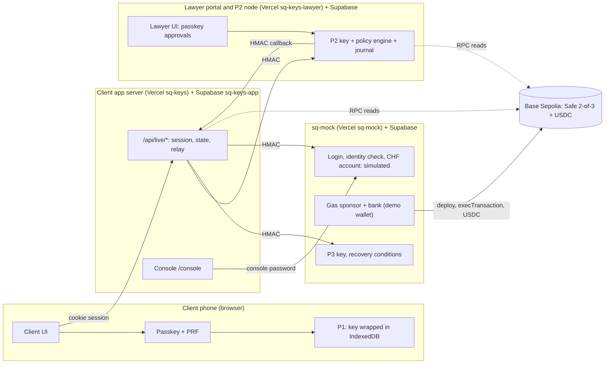

# SQ Keys

**A self-custody wallet that Swissquote could launch: the client signs with their phone and face, a lawyer of their choice protects large or unusual moves, and Swissquote can never act alone.** The wallet is a **Safe 2-of-3 smart account** on Base Sepolia with three owner keys: the client's phone (P1), the client's lawyer (P2) and Swissquote (P3). Any two can sign; no single holder can. There is no seed phrase.

> **It is a Safe smart account, not MPC.** MPC (DKLs23) was our first design and is documented as the target, but it is **not implemented**. Everything below that says "key" means one of three ordinary owner keys of a Safe.
> **Student prototype. Not an official Swissquote product. Testnet only (Base Sepolia): no real funds.**
> Made for the Swissquote track of the BSA x EPFL hackathon (10-11 October 2026).

| | URL | Notes |
|---|---|---|
| Client app | https://sq-keys-iota.vercel.app | `[TO VERIFY]` the deployed build must be rebuilt in live mode (section 13) |
| Lawyer portal and P2 node | https://sq-keys-lawyer.vercel.app | `[TO VERIFY]` same |
| Swissquote mock, P3 node, gas sponsor, bank | the URL in `SQ_URL` (Vercel project `sq-mock`, team `teo-creativs-projects`) | never hard-coded |
| Swissquote console (inside the client app) | `<client app>/console` | password gate; reads the real sq-mock state |
| Source | https://github.com/teo-creativ/swissquote-wallet | branch `teo/ui` |

**Read this first, honestly.** In live mode (`NEXT_PUBLIC_SQKEYS_MODE=live`) the wallet, the passkeys, the three owner keys, the sponsored gas, the lawyer's decisions, the transfers, the recovery and the console state are **real** and verified end to end on Base Sepolia (section 14). Only **three things are simulated, and each says so on screen with a "Simulated" pill: the Swissquote login, the identity check (KYC) and the bank account (CHF balance and rate)**. Mock mode still exists for design work and unit tests (`/dev/mock`). Section 3 lists every component. The `[TO VERIFY]` marker means we have not confirmed the statement.

Contents: [2 Tour](#2-the-demo-script) · [3 Real vs simulated](#3-what-is-real-and-what-is-simulated) · [4 Architecture](#4-architecture) · [5 Custody and threats](#5-custody-model-decision) · [6 Wallet creation](#6-wallet-creation) · [7 Authentication](#7-authentication) · [8 Recovery and exit](#8-recovery-and-exit) · [9 Legal](#9-legal-feasibility) · [10 Business](#10-business-case) · [11 Gas and bonus topics](#11-gas-sponsoring-and-bonus-topics) · [12 Run locally](#12-run-it-locally) · [13 Deploy](#13-deployment) · [14 Tests](#14-test-plan-and-results) · [15 Limits](#15-known-limitations-and-next-steps) · [16 AI tools](#16-ai-tools-used) · [17 Team, repo, licences](#17-team-roles-repository-map-licences)

---

## 2. The demo script

Live mode, two devices: **the client on a phone** (iPhone or Android, over HTTPS) and **the lawyer on a laptop**. `npm run test:live` plays the same script with two virtual authenticators (section 14).

1. **Client:** open the client app, sign in with the Swissquote demo account (**Simulated** login), pass the identity check (**Simulated**), accept the four documents.
2. **Client:** *Invite your lawyer*. Copy the link `https://<lawyer portal>/invite/<token>` and send it.
3. **Lawyer (laptop):** open the link, enter name and firm, *Create passkey and accept*. This is a real WebAuthn registration on the laptop. The client's screen switches to "Your lawyer accepted." by itself.
4. **Client:** *Create my key*: one passkey tap (Face ID, fingerprint or device code). The phone generates its key P1 and wraps it with the passkey; the lawyer node and Swissquote create P2 and P3; the sponsor deploys the Safe. The screen shows three share cards, the real wallet address and the Basescan link of the creation transaction. The owners hold no ETH.
5. **Client:** *From Swissquote*: the bank mock sends real test USDC to the wallet (the CHF account is **Simulated**). *Receive* shows the address, a QR code and the balance read on chain, plus faucet instructions.
6. **Client:** *Send* 1 USDC to a **new recipient**: "Waiting for your lawyer". **Lawyer:** opens the request, ticks "Add this recipient", *Approve with passkey*. The transfer executes; the client sees "Sent" and the Basescan link.
7. **Client:** send 1 USDC to the same (now known) recipient: **instant**, no lawyer.
8. **Client:** send 5.50 USDC (limit 5.00): the lawyer must approve. A transfer to another new recipient that the lawyer **declines** sends nothing.
9. **Attacker case:** in the Swissquote console set the next identity check to *fail*; on a second phone sign in and start a recovery. The identity check fails, the recovery ends refused, and the real owner keeps sending.
10. **Recovery:** on a new phone: start recovery, identity check, a new passkey and key on the new phone, the lawyer approves, the safety delay runs (2 minutes in the demo, 8 seconds in the automated test), then the Safe's `swapOwner` replaces the old key. **The wallet address and the funds do not change.** The old phone is then refused; the new one sends.
11. **Console** (`/console`, demo password given on the day): recoveries, identity outcome switch, wallets created.

Screenshots: see [`docs/screenshots/`](docs/screenshots/README.md).

| Client | Lawyer | Console |
|---|---|---|
|  |  |  |

*(Images are added by the team; a missing image means it has not been added yet.)*

---

## 3. What is real and what is simulated

**Real** = works against real infrastructure or a real browser API. **Simulated** = labelled "Simulated" on screen. This table describes live mode on branch `teo/ui`.

| Component / journey | Status | Where in the repo | How to verify |
|---|---|---|---|
| Swissquote login | **Simulated** (single demo client, pill on screen) | `sq-mock/lib/services.ts` | Sign in |
| Identity check (KYC, and the identity check of a recovery) | **Simulated** (pill on screen); its result is real state: the console switch really changes it | `sq-mock/lib/recovery.ts`, `app/console/` | Console: set "check fails" |
| Bank account (CHF balance, rate) | **Simulated**; the USDC it sends is **real** | `sq-mock/lib/bank.ts` | *From Swissquote*, then Basescan |
| Safe 2-of-3 wallet on Base Sepolia | **Real**: counterfactual address from the account, deployed on chain | `shared/safe.ts`, `sq-mock/lib/sponsor.ts` | The Basescan link on the creating screen |
| Client key P1 | **Real**: generated in the browser, kept wrapped (AES-256-GCM) in IndexedDB, never sent | `lib/live/p1.ts` | DevTools > IndexedDB `sqkeys-p1` holds only ciphertext |
| Client passkey with PRF | **Real** ceremony; wraps P1. Tested with virtual authenticators; **iPhone and Redmi to be verified by hand** `[TO VERIFY]` | `lib/passkey/`, `lib/live/` | `/dev/passkey` on a phone |
| Reduced-protection fallback (no PRF) | **Real**, off unless `ALLOW_NO_PRF=true`, always labelled | `lib/passkey/webauthn.ts` | amber pill |
| Lawyer account and sign-in | **Real**: WebAuthn (`@simplewebauthn`), user verification required, session cookie | `lawyer/lib/server/` | Open an invitation link |
| Lawyer key P2 | **Real**: generated on the lawyer node, stored AES-256-GCM encrypted | `lawyer/lib/server/keys.ts` | table `shares` holds ciphertext only |
| Swissquote key P3 | **Real** (a plain key in the mock Swissquote), same encryption | `sq-mock/lib/owner.ts` | table `shares` |
| Policy engine T1-T13 | **Real**, run by the lawyer node on the server | `shared/policy.ts`, `lawyer/lib/server/nodes.ts` | `cd lawyer && npm test` |
| Lawyer approvals | **Real**: passkey assertion whose challenge the server recomputes from the request | `lawyer/lib/server/portal.ts` | Approve a request |
| Per-client thresholds | **Real**: edited with a passkey, versioned, journaled | `lawyer/lib/server/portal.ts` | Policy page |
| Transfers | **Real**: P1 signs in the browser, P2 by the node, executed by the sponsor, USDC on chain | `lib/server/live.ts`, `lib/live/index.ts` | Basescan |
| Gas sponsoring | **Real**: a sponsor wallet relays; **not** an ERC-4337 paymaster | `sq-mock/lib/chain.ts` | Owners hold 0 ETH |
| Recovery | **Real**: `swapOwner` signed by P2 and P3, same address; P3 signs only if identity, delay and lawyer approval hold | `sq-mock/lib/safe-recovery.ts` | `npm run test:live` |
| Audit journal | **Real**: hash-chained, verifiable | `lawyer/lib/server/audit.ts`, `sq-mock/lib/audit.ts` | Journal page, *Verify* |
| Console | **Real** state of sq-mock; the password gate is server-side and fails closed | `lib/console.live.ts` | `/console` |
| Exit kit | **Partly**: the file is real (P1 encrypted with a passphrase + public facts); the lawyer's exit endpoints exist; **no screen or script runs the exit yet** | `lib/live/index.ts`, `lawyer/lib/server/nodes.ts` | Security > Create exit kit |
| Connecting apps (spend approvals) | **Not built in live mode** (hidden) | | |
| MPC (DKLs23) | **Not implemented**; documented target only | `docs/CDC_v3.1.md` | n/a |
| Legal documents | **Real** text, English, Swiss law framing; acceptance time and version are stored | `content/legal/` | `/legal/terms` |
| Secret scanning | **Real** | `scripts/check-secrets.sh` | `npm run check-secrets` |
| Mock mode | Kept for design and unit tests | `lib/sqkeys.mock.ts`, `/dev/mock` | `NEXT_PUBLIC_SQKEYS_MODE=mock` |

---

## 4. Architecture



What each arrow carries:
- **Browser to client app:** only the app's own server. Session = signed cookie (jose, HttpOnly, SameSite=Strict, `__Host-` and Secure on https), plus a same-origin check on every POST. The browser sends **public addresses and signatures only**, never P1.
- **Client app to the lawyer node and to Swissquote:** server-to-server HMAC-SHA256 over method, path with query, timestamp, nonce and body hash; 60 s clock window; replayed nonces rejected (table `seen_nonces`); one secret per pair (`APP_TO_LAWYER_SECRET`, `APP_TO_SQ_SECRET`).
- **Lawyer browser to the lawyer node:** the lawyer's session cookie plus a **WebAuthn assertion whose challenge is `SHA-256("sqkeys-approval-v1" | requestId | intentHash | decision)`**, recomputed by the server from the stored request, so a decision cannot be replayed on another request. Policy changes bind `(client, new version, canonical policy)`.
- **Nodes to the chain:** reads only. All gas is paid by the sponsor in sq-mock.
- **The node signs only what it built:** for a transfer the lawyer node rebuilds the Safe transaction from `{safe, to, amount, nonce}`, compares its hash with the client's, checks on chain that it is the second owner of a 2-of-3 Safe and that the nonce is current. For a recovery P3 rebuilds the `swapOwner` from the chain itself.

Separation rules (enforced by folders and `scripts/check-secrets.sh`): the client app never touches P2 or P3; the lawyer portal never touches P1 or P3; sq-mock never touches P1 or P2; the `service_role` key is never in a `NEXT_PUBLIC_` variable. Shared pure code is in `shared/` (copied by `npm run sync-shared`).

---

## 5. Custody model decision

**Chosen: a Safe 2-of-3 smart account** (CDC plan B, section 3.9). The brief allows Safe. It gives a real address, real USDC, gas sponsoring and a recovery that keeps the same address. **MPC DKLs23 was the first choice and is not implemented**: we could not prove it in the time; it stays documented as the target design.

| Holder | Key | Lives | Used for |
|---|---|---|---|
| Client | P1 | Their phone: generated in the browser, wrapped with a key derived from the passkey (PRF) | Every client transaction |
| Client's lawyer | P2 | The lawyer node: encrypted at rest (`LAWYER_SHARE_ENC_KEY`) | Co-signing (automatic under the thresholds, with a passkey approval above), recovery |
| Swissquote | P3 | sq-mock: encrypted at rest (`SQ_SHARE_ENC_KEY`), a simulated HSM | Recovery only |

| Pair | Use |
|---|---|
| P1 + P2 | All client transactions |
| P2 + P3 | Recovery (`swapOwner`) when the phone is lost |
| P1 + P3 | Possible on chain, **but the Swissquote node never signs a transfer**, so this path does not exist in the product |
| Any single key | Can never move funds |

**Pros:** real on-chain address and history, audited Safe contracts, same-address recovery, standard tooling, no seed phrase. **Cons:** EVM only; the owner addresses and the 2-of-3 structure are public on chain; each key is a normal key (the rules "who may sign what" are enforced by our nodes, not by the contract: a modified P2 and P3 could together sign anything); a Safe is heavier than a plain account.

| Model in the brief | Why not |
|---|---|
| Plain self-custody with a seed phrase | Clients lose or leak phrases |
| Custodial | That is the existing Swissquote Wallet |
| MPC threshold signatures | Our first design; not proven in time, not implemented |

### Threat model (Safe 2-of-3)

| Question | Answer |
|---|---|
| Who could steal funds? | Nobody alone: two owners are needed. A phone thief holds P1 only; the lawyer node signs automatically only within the policy (default 5 USDC per transaction, 10 USDC per 24 h, 3 per hour, 6 per day) and only to recipients the lawyer approved. Residual risk we state: up to 10 USDC per 24 h to approved recipients. |
| Who could lock the client out? | No single failure. Lost phone: recovery with P2 + P3. Lawyer unreachable: transfers wait or time out; recovery needs the lawyer too. Swissquote gone: the exit kit (P1) plus the lawyer (P2), exit endpoints exist but no script runs the exit yet. **Two failures at once lock funds**, for example a lost phone and an unreachable lawyer. |
| Can Swissquote alone move funds? | No: one owner. |
| Swissquote with the lawyer? | **Yes: P2 + P3 are two owners.** The product only uses them for `swapOwner` (recovery), but a deliberately modified pair of nodes could sign any transaction. What bounds it in the product: an independent lawyer chosen by the client; the identity check; the lawyer's passkey approval bound to the exact recovery; a delay (24 h in production, 2 minutes in the demo) that **P3 enforces by itself**; the client can cancel during the delay; the hash-chained journals. What is left is **collusion of two independent parties**. |
| Compromised lawyer server? | Holds P2 only. With a phone thief, the thresholds are gone. This is the price of automatic release. |
| Compromised client app server? | Holds no key and cannot sign. It could refuse service or ship tampered code to the browser (the classic web-app limit); mitigated because the browser **rebuilds the Safe hash itself and refuses to sign anything that differs from what was typed**, and the nodes rebuild what they sign. |
| Phone and e-mail stolen? | E-mail holds no key. A recovery needs the Swissquote identity check, which the attacker fails; P3 will not sign; the old phone keeps control. Tested end to end. |
| Sponsor abuse? | Section 11. |

*None of this has been audited or formally proven.*

---

## 6. Wallet creation

**Onboarding order: documents, then invite the lawyer, then the key, then the wallet.**

1. Sign in with Swissquote credentials (**Simulated**). Identity check (**Simulated**). Accept four documents (stored with version and time).
2. **Invite your lawyer.** The link is `https://<lawyer portal>/invite/<token>`, built from `NEXT_PUBLIC_LAWYER_URL` (a production build without it shows an error, never a localhost link). The token is single-use, valid 7 days, only its SHA-256 is stored. The client app polls until the lawyer accepted (and the lawyer node also calls back). `/key` and `/creating` stay closed until then.
3. **Create my key:** one tap. The passkey is created and the PRF secret wraps a **new P1 generated in the browser**; only its public address is sent.
4. **The wallet:** the server asks the lawyer node and Swissquote for the P2 and P3 addresses, computes the counterfactual Safe address (a salt derived from the account), and asks sq-mock to deploy it. The sponsor pays the gas. The screen shows the three share cards, the real address and the Basescan link of the creation transaction.

| Key | Born | Kept | At rest |
|---|---|---|---|
| P1 | The client's browser | IndexedDB | AES-256-GCM, key from HKDF-SHA256 over the passkey PRF output (or the labelled fallback) |
| P2 | The lawyer node | table `shares` (`sq-keys-lawyer`) | AES-256-GCM, `LAWYER_SHARE_ENC_KEY`, bound to the client by the additional authenticated data |
| P3 | sq-mock | table `shares` (`sq-mock`) | AES-256-GCM, `SQ_SHARE_ENC_KEY` |

Link to the Swissquote identity: sq-mock keeps `client <-> sq_ref <-> wallet address`. The client app and the lawyer portal only see the pseudonymous `sq_ref` and the address.

---

## 7. Authentication

| Action | Proof |
|---|---|
| Open the app | Swissquote login (**Simulated**), then a signed session cookie |
| Sign a transfer | The client's passkey unlocks P1 (user verification + PRF); the browser signs the Safe hash |
| Release P2 | Automatic under the policy, otherwise the lawyer's passkey assertion bound to the request |
| Lawyer signs in | The lawyer's passkey (resident key, user verification required), session cookie |
| Change the policy | The lawyer's passkey, bound to the new version |

**Passkey and PRF on the phone.** `lib/passkey/` creates a platform passkey (ES256 and RS256, resident key and user verification required, attestation none, `rpId` = the page hostname, existing credentials excluded) and asks for the WebAuthn **PRF** extension. The wrapping key for P1 is `HKDF-SHA256(PRF output, fixed label)` used as an AES-256-GCM key through WebCrypto (no homemade cryptography).
- iOS needs the call inside the tap: the challenge is prepared on screen load, and signing starts the passkey prompt **first**, while the server prepares the transaction.
- Some platforms only report `prf.enabled` at creation: the screen then asks for a second tap ("Confirm once more"), never chained automatically. The recovery has the same second tap.
- In-app browsers and webviews get a "open this page in Safari / Chrome" screen.
- **Verified with Chrome virtual authenticators; not yet on an iPhone or a Redmi** `[TO VERIFY]`. Use `/dev/passkey` for that.

**Reduced protection.** If PRF is unavailable and the server sets `ALLOW_NO_PRF=true`, the app keeps a non-extractable AES-GCM key in IndexedDB, gated by a user-verification assertion. It is **weaker** and always shown as an amber **"Reduced protection"** pill.

**Small versus large transactions.** The cryptographic path is the same (two owners). What changes is who releases P2: under the thresholds the policy engine does it automatically; above them, or for a new recipient, the lawyer sees the request and approves with a passkey. An unanswered request expires (3 to 15 minutes in the demo, 48 hours in production) and nothing is written on chain.

---

## 8. Recovery and exit

**Lost phone: same address, funds stay put (`swapOwner`).**
1. On the new phone the client signs in and chooses recovery. The wallet exists already; nothing is created on chain yet.
2. Swissquote's (simulated) identity check runs; the console switch decides its result. On failure the recovery is refused and the account is active again.
3. The new phone creates a passkey and a **new key P1'**. Swissquote and the lawyer node are told the new owner address.
4. The lawyer approves with a passkey bound to (recovery, wallet, old owner read from the chain, new owner).
5. The safety delay runs (24 h in production, 2 minutes in the demo). **P3 enforces it by itself**; the client can cancel during it.
6. The server rebuilds the `swapOwner` transaction. **P3 signs only if** the identity check passed, the delay elapsed, the recovery was not cancelled **and** P2's signature over that exact hash proves the lawyer approved. P2 + P3 sign, the sponsor executes. The old key is no longer an owner; the **wallet address is unchanged**.

**Why an attacker with the stolen phone and e-mail is refused.** The e-mail holds no key and cannot start anything. Swissquote's identity check fails, so P3 never signs, whatever the lawyer does. Even a lawyer who approved cannot complete it alone. Tested: `npm run test:live` step 13.

**Exit without Swissquote (P1 + P2).** *Security > Create exit kit* downloads a file: P1 encrypted with a passphrase you choose (PBKDF2-SHA256 600,000 rounds + AES-256-GCM, WebCrypto), plus the wallet address, the owners and instructions. The lawyer node has exit endpoints (always manual approval, signature released after an exit delay). **No screen or script runs the exit yet** (`exit/` is Théotime's). The kit alone cannot move anything.

Limits we state: a thief with the old unlocked phone can cancel a legitimate recovery (the client restarts it); a cancelled recovery does not revoke a signature already handed out, the delay is the protection; a lost phone plus an unreachable lawyer and no kit loses the funds.

---

## 9. Legal feasibility

Prepared by students from public texts; **not legal advice**. Statuses follow CDC section 9. Items still to check are `[TO VERIFY]`.

- **Custody or software.** The test is who can move the funds. Our position `[hypothesis]`: software, not custody, because Swissquote holds one of three keys and cannot sign alone. The grey zone is Swissquote plus the lawyer (section 5). Qualification by FINMA `[TO VERIFY]`. FINMA guidance of 2026 on crypto safekeeping and the status of the financial-institutions-act revision `[TO VERIFY]`.
- **Lawyer or notary role.** They approve, they do not hold funds. They might qualify as a financial intermediary under the anti-money-laundering act, with a self-regulatory-organisation affiliation `[TO VERIFY]`. Professional secrecy `[TO VERIFY]`. In the demo the lawyer account is operated by a team member (the portal says so only when `NEXT_PUBLIC_LAWYER_DEMO_OPERATED=true`).
- **Travel Rule and proof of ownership.** FINMA's article 10 of the AML ordinance requires originator and beneficiary data, with no exception for unhosted wallets `[verified in source]`. A bank may pay to an external wallet only if it belongs to its own client. In the live demo the bank pays **only to the Safe it helped create for that client** (the address is registered at creation); a signature-based proof for wallets created elsewhere is not built. When the client pays a third party from their own wallet, we hold that Swissquote is not the sending institution `[hypothesis]`; Swissquote funds gas, so it refuses gas to sanctioned addresses. The 1,000 CHF threshold `[TO VERIFY]`.
- **"Sole holder of the private key"** (Swissquote's deposit wording) `[hypothesis]`: no single key controls the wallet; the client controls the key that triggers every ordinary signature. To be defended as exclusive control of ordinary signing. `[TO VERIFY]` with the jury.
- **Sanctions.** Swiss lists name persons and entities, we found no wallet addresses `[TO VERIFY]`; the prototype uses a simulated local list (the lawyer node refuses such recipients). The app warns and never forbids, except for sanctions.
- **Data protection.** Biometrics never leave the device. The KYC selfie would be sensitive data requiring consent and an impact assessment; simulated here, nothing stored. The lawyer sees a display name, the address and request history, never the Swissquote client number. The blockchain is public and cannot be erased, which the privacy policy states.
- **Bank secrecy and outsourcing.** The address-to-client link lives only in sq-mock. Use of Vercel and Supabase as processors, and the lawyer's node as an outsourced function, need qualification `[TO VERIFY]`.

Third-party services and libraries: [`docs/THIRD_PARTIES.md`](docs/THIRD_PARTIES.md). Licence notices: [`NOTICE`](NOTICE).

The product never says "unbreakable", "100% secure" or "FINMA compliant". The Swissquote logo is used only from `public/brand/swissquote-logo.svg` (team decision).

---

## 10. Business case

- **Problem.** A client who wants self-custody or DeFi leaves Swissquote today, with their assets. (The claim that most crypto clients hold only Bitcoin was relayed orally and is `[TO VERIFY]`.)
- **Position.** Next to the custodial Wallet, SQ Keys keeps the client in the Swissquote ecosystem, one step from their account, without Swissquote holding the funds.
- **What Swissquote gains.** Retention of clients and assets; revenue on the account-to-wallet gateway; a premium "trusted lawyer" service; lower compliance cost than custody; less support for lost access.
- **The lawyer's economics.** A supervision subscription paid by the client; Swissquote can list partner firms without a commission that would make it a prescriber.
- **Costs.** Sponsored gas on Base (a few cents per operation on testnet, `[TO SOURCE]` for mainnet), node infrastructure, support, legal qualification of the lawyer's role. A Safe needs no commercial licence; the MPC library of the first design did.
- **Caution.** We do not build "recommended DeFi with commission" into the model.

No figure is attributed to Swissquote without a source. Revenue and retention numbers are **not estimated here**; Théotime owns this section `[TEAM TO COMPLETE with sourced figures]`.

---

## 11. Gas sponsoring and bonus topics

**Gasless transactions (real).** The three owners hold **no ETH**. A sponsor wallet (`SQ_GAS_PRIVATE_KEY`, stored only in sq-mock) pays for the Safe deployment and for every `execTransaction`. **It is an EOA relay, not an ERC-4337 paymaster**: Candide's sponsored user operations were considered first and not used, because they need the ERC-4337 variant of the Safe (another factory and signature format) and the deadline did not allow it (`spike/RESULT.md`). The sponsor signs nothing on behalf of an owner; it only submits transactions the owners signed.

Abuse limits (all enforced in `sq-mock/lib/sponsor.ts`, tested): only wallets of this bank's clients; the third owner of a sponsored Safe must be Swissquote's own key; a deployment needs a salt derived from the account (one wallet per account); plain calls only, no ETH value; the call is **simulated first**, so a bad signature set costs no gas; per-wallet daily cap (40), global daily caps (30 deployments, 300 executions), a minimum sponsor balance (calls are refused below it); bank transfers capped at 10 USDC each and per day per client; everything recorded in `sponsor_actions` and the audit chain.

**Compliant dApp interaction (designed, not built in live mode).** The policy rule for unknown apps and unlimited approvals exists in `shared/policy.ts` (vectors T7). The screens run on the mock only; they are hidden in live mode.

---

## 12. Run it locally

Prerequisites: **Node 22** (`.nvmrc`), npm, Git. Windows: use **Git Bash**.

```bash
npm ci                          # root (client app)
(cd lawyer && npm ci)           # lawyer portal
(cd sq-mock && npm ci)          # Swissquote mock
npm run setup-env               # creates .env.local files and fills generated secrets without printing them
npm run doctor                  # expect READY
npm run dev                     # client app  http://localhost:3000
(cd lawyer && npm run dev)      # lawyer      http://localhost:3001
(cd sq-mock && npm run dev)     # Swissquote  http://localhost:3002
```

Without Supabase variables each project uses an **in-memory store** (state is lost on restart). Mock mode: `NEXT_PUBLIC_SQKEYS_MODE=mock` (default) and `NEXT_PUBLIC_LAWYER_MODE=mock`; live mode needs `live` in both, plus the variables of section 13.

Passkeys on a phone need **HTTPS on a real hostname**; `localhost` works for desktop Chrome. Test on the deployed URL, then open `/dev/passkey`.

```bash
npm test                        # unit tests (vitest), in each of the three projects
npm run typecheck
npm run build                   # next build --webpack
npm run check-secrets           # scans for keys and service_role
npm run check-shared            # shared/ copies in sync (run sync-shared after editing shared/)
npm run check-chain -- <addr>   # Base Sepolia RPC, USDC contract and balances
npm run check-live              # env names, Supabase tables, pair secrets, chain, sponsor balance (prints no value)
npm run test:e2e                # mock-mode walk in Chrome, mobile viewport
npm run test:live               # the full live demo script (section 14)
npm run check-routes -- <url>   # after every deploy: no route may 404
```

`docs/SETUP.md` has the basic setup, `docs/SETUP_LIVE.md` the live setup step by step.

---

## 13. Deployment

Three Vercel projects and three Supabase projects, one per party:

| Folder | Vercel project | Supabase project | SQL to paste, in order |
|---|---|---|---|
| `/` | `sq-keys` | `sq-keys-app` | `sql/001_init.sql`, `sql/002_safe_live.sql` |
| `lawyer/` | `sq-keys-lawyer` | `sq-keys-lawyer` | `lawyer/sql/001_init.sql`, `lawyer/sql/002_safe_live.sql` |
| `sq-mock/` | `sq-mock` (team `teo-creativs-projects`) | `sq-keys-mock` | `sq-mock/sql/001_init.sql`, `sq-mock/sql/002_safe_live.sql` |

Region: Vercel functions `fra1`, Supabase Frankfurt. **Deploy order: sq-mock, then lawyer, then client.** Passkeys are bound to the domains (`sq-keys-iota.vercel.app`, `sq-keys-lawyer.vercel.app`). `NEXT_PUBLIC_*` variables are inlined at build time: changing them needs a new deploy. After every deploy run `npm run check-routes -- <url>` and `npm run check-live`.

Variables per project (**names only**):
- **Client app:** `NEXT_PUBLIC_CHAIN_ID`, `NEXT_PUBLIC_EXPLORER_URL`, `NEXT_PUBLIC_SQKEYS_MODE` (= `live`), `NEXT_PUBLIC_LAWYER_MODE` (= `live`), `NEXT_PUBLIC_LAWYER_URL` (**required in production**), `RPC_URL`, `USDC_ADDRESS`, `SUPABASE_URL`, `SUPABASE_SERVICE_ROLE_KEY`, `SESSION_SECRET`, `LAWYER_URL`, `SQ_URL`, `APP_TO_LAWYER_SECRET`, `APP_TO_SQ_SECRET`, `ALLOW_NO_PRF`, `CONSOLE_PASSWORD`.
- **Lawyer portal:** `NEXT_PUBLIC_CHAIN_ID`, `NEXT_PUBLIC_LAWYER_MODE` (= `live`), `LAWYER_ORIGIN`, `APP_URL`, `RPC_URL`, `USDC_ADDRESS`, `SUPABASE_URL`, `SUPABASE_SERVICE_ROLE_KEY`, `SESSION_SECRET`, `LAWYER_SHARE_ENC_KEY`, `LAWYER_SHARE_ENC_KEY_VERSION`, `APP_TO_LAWYER_SECRET`, `REQUEST_TTL_SECONDS`, `LAWYER_DECISION_TTL_SECONDS`, `AUTO_DECISION_TTL_SECONDS`, `RECOVERY_DELAY_SECONDS`, `EXIT_DELAY_SECONDS`; optional `NEXT_PUBLIC_LAWYER_DEMO_OPERATED`.
- **sq-mock:** `SQ_SUPABASE_URL`, `SQ_SUPABASE_SERVICE_ROLE_KEY`, `APP_TO_SQ_SECRET`, `SQ_SHARE_ENC_KEY`, `SQ_SHARE_ENC_KEY_VERSION`, `SQ_GAS_PRIVATE_KEY`, `SQ_DEMO_WALLET_PRIVATE_KEY`, `RPC_URL`, `CHAIN_ID`, `USDC_ADDRESS`, `RECOVERY_DELAY_SECONDS`, `CONSOLE_PASSWORD`, `SQ_URL`, `SQ_DEMO_PASSWORD`, `SQ_DEMO_BANKING_ANSWER`; optional `SPONSOR_MAX_DEPLOYS_PER_DAY`, `SPONSOR_MAX_EXECS_PER_DAY`, `SPONSOR_MAX_EXECS_PER_SAFE_PER_DAY`, `SPONSOR_MIN_BALANCE_WEI`, `BANK_MAX_TRANSFERS_PER_DAY`.

Secrets are never committed or printed; pair secrets are exchanged in person. Fund the sponsor and demo wallets with Base Sepolia ETH, and the demo wallet with test USDC (https://faucet.circle.com).

---

## 14. Test plan and results

**Unit and integration** (`npm test` in each project; run on 11 October 2026): root 122 tests, lawyer 135, sq-mock 98, all passing. They cover:
- the policy engine vectors **T1-T13 through the lawyer node's API**, including T10 (two simultaneous evaluations, one AUTO) and T12 (100 requests: 3 AUTO, 5 waiting, the rest refused);
- the lawyer node with a software WebAuthn authenticator: invitation, registration, sign-in, replay and wrong-origin refusals, approvals bound to the request, policy changes, recovery, exit, journal tampering;
- sq-mock: HMAC and replay rejection, sponsor caps, the P3 signing conditions (identity, delay, lawyer approval, cancel, hash mismatch), the attacker case;
- the client server: session, invitation, wallet creation, sending (AUTO, LAWYER, refused, stale nonce, wrong phone), bank transfer, recovery, double execute;
- shared code: Safe hash and address (also checked against the chain by `spike/verify-shared.ts`), AES-GCM sealing, HMAC.

**Real-chain smoke tests:** `spike/safe-spike.ts` (Safe deployment, 2-of-3 transfer, one signature refused, `swapOwner`) and `sq-mock` `npm run smoke:chain` (the real services against Base Sepolia).

**End to end:** `npm run test:live` starts the three apps, uses real passkey ceremonies with virtual authenticators (PRF) in Chrome, a mobile viewport for the client and a desktop one for the lawyer, and plays the demo script of section 2: create the wallet, fund it from the bank mock, send under the threshold, send over the threshold with lawyer approval, send to a new recipient, a declined transfer, an attacker refused, a recovery on a new phone, the old phone refused. It **fails loudly on any step that is still simulated**. Result and Basescan links: [`docs/LIVE_TEST_REPORT.md`](docs/LIVE_TEST_REPORT.md).

**Not tested (honestly):** a real iPhone or Redmi passkey ceremony (manual script below); the exit itself; row-level security of the databases against the anon key (`S-3`); deployed apps (the script can target them with `LIVE_CLIENT_URL`, `LIVE_LAWYER_URL`, `LIVE_SQ_URL`); load; accessibility beyond the design rules.

---

## 15. Known limitations and next steps

- **Not MPC.** Three ordinary owner keys of a Safe. The owner set is public on chain.
- **The rules are enforced by our nodes, not by the contract.** P2 and P3 together could sign anything if their code were modified (section 5).
- **Gas path** is a sponsor relay, not a paymaster; the sponsor wallet is a single funded key.
- **Passkeys** verified with virtual authenticators only; PRF support differs by platform and OS.
- **Exit** has a real kit and real lawyer endpoints but no screen or script.
- **Policy lock** is per server instance (the one-shot status change in the database is the real guard); the audit chain is serialized per instance and a fork is detectable.
- **One transfer waits for the lawyer at a time** per wallet (it holds the Safe nonce).
- Each invitation creates a lawyer account: a lawyer with several clients signs up once per client. Single lawyer per client; adding a second device is out of scope.
- **Removing a phone key** is a recovery; the separate "remove device" action is hidden in live mode.
- The three simulated parts (Swissquote login, identity check, CHF account) are demo stand-ins by design.
- No audit, no formal proof.

Next steps, in order: verify on an iPhone and a Redmi; run the exit from the kit; database-level lock for policy evaluations; ERC-4337 sponsoring if wanted; MPC as a research track.

---

## 16. AI tools used

| Tool | Used for |
|---|---|
| Claude (Anthropic), conversation | Specification (the CDC), legal checking, architecture choices, review |
| Claude Code (Anthropic) | Planning, code generation and tests for the client app, the lawyer portal and node, sq-mock, the Safe spike, the end-to-end test and this README, under the rules in `CLAUDE.md` |

`[TEAM TO CONFIRM: other AI tools]`. The CDC mentions Google Stitch for screen mockups and DeepSeek for exploring MPC options (its proposals were checked and partly rejected). Each member completes their own line.

---

## 17. Team, roles, repository map, licences

| Person | Role | Branch |
|---|---|---|
| Téo | Design and front: `components/ui/`, `app/console/`, client screens, lawyer screens; live mode of the client, lawyer and sq-mock in this branch | `teo/ui` |
| Aaron | Logic, MPC research (not used), HMAC, store and recovery code reused in sq-mock | `aaron/logic` |
| Théotime | `sq-mock/` scaffold, `exit/`, business case, the lawyer role in the demo | `theotime/sq` |

```
/                  client app (Next.js)       Vercel: sq-keys
  app/(mobile)/    client screens, 430px column
  app/console/     Swissquote console (real sq-mock state in live mode)
  app/api/live/    the browser's only server door in live mode
  lib/live/        browser side of live mode: P1, passkey ceremony, calls
  lib/server/      server side of live mode: session, state, relay to the peers
  lib/sqkeys.ts    front contract (mock or live)
lawyer/            lawyer portal and P2 node  Vercel: sq-keys-lawyer
  lib/server/      WebAuthn, invitations, P2 key, policy, approvals, journal
sq-mock/           Swissquote mock, P3 node, gas sponsor, bank   Vercel: sq-mock
exit/              exit script                                   (README only)
shared/            source of shared code (Safe helpers, policy, HMAC, AES-GCM, db layer), copied by `npm run sync-shared`
spike/             Safe spike and on-chain checks of the shared code
sql/ lawyer/sql/ sq-mock/sql/   database schemas with RLS (001 base, 002 Safe live)
docs/              CDC_v3.1.md, SETUP_LIVE.md, LIVE_NOTES.md, LIVE_TEST_REPORT.md, CONTRACT_CHANGE.md, prompts/live/01-safe-live.md, ...
```

Key documents: `docs/CDC_v3.1.md` (specification, in French), `docs/prompts/live/01-safe-live.md` (design of record for live mode), `docs/LIVE_NOTES.md` (decisions), `docs/CONTRACT_CHANGE.md` (signature and behavior notes for the other owners), `design.md`, `CLAUDE.md`.

**Licences.** The Safe path uses open-source packages pinned to exact versions in each `package.json` (viem, @simplewebauthn, jose, Next.js). The MPC packages `@silencelaboratories/dkls-wasm-ll-web` and `-node` (1.2.0) remain in `package.json` from the first design but are **not used by live mode**; they are under the **Silence Laboratories Non-Commercial Use License Agreement**: commercial use needs a commercial licence. See [`NOTICE`](NOTICE), [`licenses/`](licenses/) and [`docs/THIRD_PARTIES.md`](docs/THIRD_PARTIES.md). This repository has no `LICENSE` file yet `[TEAM TO DECIDE]`.
