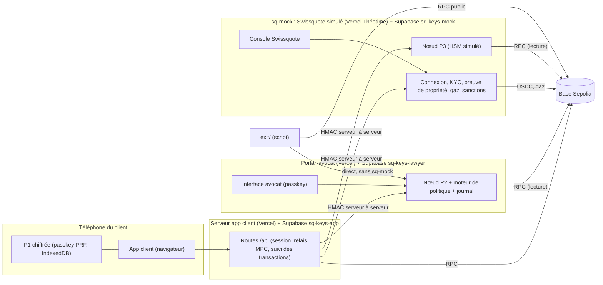

# CDC.md : SQ Keys, cahier des charges v3.0

Hackathon BSA x EPFL, Lausanne, du samedi 10 octobre 2026 à 11h au dimanche 11 octobre 2026 à 11h.
Équipe : Aaron (technique et juridique), Téo (design et front), Théotime (business case, pitch, service Swissquote simulé `sq-mock/`, script de sortie `exit/`).
**Version v3.1**, du 10 octobre 2026 à 18h50. Elle **remplace entièrement** les versions 1.x à 2.6 (Safe, ERC-4337, gardiens, phrase de secours : abandonnés). En cas de conflit, les consignes officielles de Swissquote (section 1.1) priment.

> **Changements de la v3.0 à la v3.1.** (1) **Règle d'intervention de l'avocat** écrite de façon exhaustive (sections 1 et 5.2) : il n'intervient que si un seuil est dépassé, ou pour une action de sécurité. (2) **Seuils par client, à deux volets** : montant (par transaction et par 24 h) **et** volume (nombre de transactions par heure et par 24 h) ; ajout du plafond du **nombre de transactions par 24 h** et d'une limite de demandes en attente (anti-spam) ; le destinataire inconnu devient un paramètre (`newRecipientRequiresLawyer`). (3) Section 8.8 : évolution vers un seuil adaptatif (non construit). Les sections 2.3, 8.2, 8.4, annexes B.2, D, E et F sont alignées.

> **Statut des choix.** Ce document fixe une architecture complète. Les points marqués **[À VALIDER]** sont soit une hypothèse technique à confirmer par le test du palier M0, soit une question au jury, soit une vérification juridique. Ils sont regroupés en section 15. Aucun chiffre n'est attribué à Swissquote sans source.

---

## 0. Pour l'agent codeur : à lire en premier

Tu construis un prototype de wallet en auto-garde pour Swissquote, sur **EVM (Base Sepolia, testnet)**, avec une **clé répartie en 3 parts (MPC, seuil 2 sur 3)**. Tu implémentes ce document sans poser de questions : tout ce qui manque est listé en section 15 avec une valeur par défaut.

**Règles absolues**
1. **Testnet uniquement.** Aucun fonds réel.
2. **Aucun secret dans le code, un commit, un log ou un message** : clé privée, part de clé (keyshare), clé de chiffrement, clé d'API, secret partagé. Les valeurs vivent dans `.env.local` (ignoré par Git) et dans les variables des projets Vercel. Les scripts de génération écrivent les secrets directement dans le fichier sans jamais les afficher.
3. **Séparation des parts** :
   - l'app client n'a **jamais** accès à la part de Swissquote ni à celle de l'avocat ;
   - le portail avocat n'a **jamais** accès à la part du client ni à celle de Swissquote ;
   - `sq-mock` n'a **jamais** accès à la part du client ni à celle de l'avocat ;
   - les clés `service_role` de Supabase ne sont **jamais** dans une variable `NEXT_PUBLIC_`.
4. **Aucune cryptographie maison.** Primitives et bibliothèques établies uniquement : `@silencelaboratories/dkls-wasm-ll-web` et `@silencelaboratories/dkls-wasm-ll-node` (MPC), `viem` (Ethereum), `@simplewebauthn/server` et `@simplewebauthn/browser` (WebAuthn), API WebCrypto du navigateur et module `node:crypto` (AES-256-GCM, HKDF, HMAC-SHA256, scrypt), `jose` (jetons de session), `canonicalize` (JSON canonique RFC 8785), `@supabase/supabase-js`, `@noble/curves`.
5. **Versions figées** : après installation, écris les versions exactes dans `package.json` (sans `^` ni `~`). Les deux paquets MPC sont en `1.2.0`.
6. **Langue** : anglais pour l'app, les textes d'écran, les documents juridiques affichés, le README, les commentaires de code, les messages de commit et les messages d'erreur d'API. Ce CDC reste en français. Les textes d'écran exacts sont en annexe F : copie-les.
7. **Honnêteté** : tout ce qui est simulé est signalé dans l'interface (pastille « Simulated ») et dans le README. Rien n'est affirmé « sécurisé à 100 % », « inviolable » ou « conforme FINMA ».
8. **Si une approche bloque plus de 30 minutes**, arrête-toi et applique le plan B prévu (section 3.9) ou propose-en un.
9. **Un palier n'est commencé que si le précédent est commité, déployé et vérifié** (section 12). À la fin de chaque palier : `npm run build`, tests, commit, push, déploiement CLI `npx vercel --prod` du projet concerné, puis vérification sur l'URL de production.

**Qui construit quoi** (une branche par personne, jamais de force-push)

| Dossier | Contenu | Responsable | Branche |
|---|---|---|---|
| racine du dépôt | App client (Next.js) | Aaron (agent codeur) | `main` |
| `components/ui/`, `app/console/` | Composants visuels, console Swissquote simulée | Téo | `teo/ui` |
| `lawyer/` | Portail avocat (Next.js) | Aaron (agent codeur) | `main` |
| `sq-mock/` | Service Swissquote simulé | Théotime | `theotime/sq` |
| `exit/` | Script de sortie sans Swissquote | Théotime | `theotime/sq` |
| `shared/` | Code partagé (MPC, types), recopié dans chaque projet | Aaron | `main` |
| `spike/` | Test du palier 0 (jetable) | Aaron | `main` |

**Déploiement** : le dépôt appartient à `ARgos2070` et n'a pas d'intégration GitHub avec Vercel. Chaque projet se déploie par la CLI depuis son dossier (`npx vercel --prod`). Le dossier `.vercel/` de chaque projet est ignoré par Git.

---

## 1. Résumé exécutif

**Le produit en une phrase.** SQ Keys est le wallet en auto-garde que Swissquote pourrait lancer : le client signe avec son téléphone et son visage, **un avocat de son choix** protège ses gros mouvements, et **Swissquote ne peut jamais agir seul**.

**Le modèle de garde : MPC à seuil 2 sur 3.** La clé du wallet n'existe jamais en entier, ni à la création, ni à la signature, ni à la récupération. Elle est produite et utilisée par un protocole de calcul multipartite (DKLs23, implémentation Silent Shard de Silence Laboratories). Il n'y a aucune phrase de secours.

**Les trois détenteurs**

| Part | Détenteur | Où elle vit | Rôle |
|---|---|---|---|
| P1 | Le client | Son téléphone, chiffrée par sa passkey (biométrie) | Signature de tous les jours |
| P2 | L'avocat du client | Nœud du portail avocat (serveur), autorité liée à la passkey de l'avocat | Co-signature sous contrôle d'une politique ; récupération |
| P3 | Swissquote | `sq-mock` (processus et base séparés, HSM simulé) | Récupération uniquement |

**Qui peut signer** (il faut toujours 2 parts)

| Paire | Usage |
|---|---|
| P1 + P2 | Toutes les transactions du client (petites et grosses) |
| P2 + P3 | Récupération quand le client a perdu son téléphone |
| P1 + P3 | Chemin d'urgence si l'avocat est indisponible (option, désactivé par défaut) |
| Une part seule | Ne peut **jamais** signer, même pour 1 USDC (contrainte cryptographique) |

**Le mécanisme de seuil (part contrôlée par politique).** La part de l'avocat n'est pas libérée à chaque fois par un humain.
- **Sous les seuils** : le moteur de politique libère P2 **automatiquement**. L'avocat n'est ni notifié ni sollicité. Pour le client, c'est instantané.
- **Dès qu'un seuil est dépassé** : P2 n'est pas libérée. L'avocat reçoit la demande dans son portail, l'examine et l'approuve ou la refuse avec sa passkey. Si personne ne répond en 48 h, la transaction est abandonnée : rien n'est écrit sur la blockchain.

**Les seuils sont propres à chaque client, à deux volets (par défaut du prototype)**

| Volet | Seuil | Défaut |
|---|---|---|
| Montant | par transaction | 5 USDC |
| Montant | cumulé sur 24 h glissantes | 10 USDC |
| Volume | nombre de transactions par heure | 3 |
| Volume | nombre de transactions sur 24 h glissantes | 6 |

Un voleur de téléphone ne peut donc pas contourner le seuil de montant en multipliant les petites transactions : le cumul de montant **et** le nombre de transactions l'arrêtent.

**Quand l'avocat intervient (liste exhaustive).** Jamais en dehors de ces cas :
1. un **seuil est dépassé** (l'un des quatre ci-dessus) ;
2. le destinataire n'est **pas encore approuvé** (réglage `newRecipientRequiresLawyer`, activé par défaut, désactivable par l'avocat pour ce client) ;
3. une **application inconnue** ou une autorisation **illimitée** (démo d'application) ;
4. une **action de sécurité** : modification de la politique par l'avocat lui-même, récupération du wallet, sortie sans Swissquote.

**La promesse au client.**
1. Tes clés, ton contrôle : ni Swissquote ni ton avocat ne peuvent déplacer tes fonds seuls.
2. Un voleur qui prend ton téléphone ne peut sortir que de petites sommes, vers des destinataires déjà connus.
3. Si tu perds ton téléphone, tu récupères tes fonds sans phrase à retenir, par une vérification d'identité, ton avocat et Swissquote.
4. Si Swissquote disparaît, tu récupères tes fonds avec ton avocat (kit de sortie).

**Les deux applications.** L'**app client** (sq-keys) et le **portail avocat** (sq-keys-lawyer) sont deux applications, deux sites, deux bases de données distincts. L'avocat n'accède au portail que par le lien d'invitation envoyé par le client, puis se connecte avec sa passkey.

**Ce qui est réel et ce qui est simulé** : voir section 3.8. Réel : le MPC (génération de clé, signatures), les transactions sur Base Sepolia, les passkeys, la politique, les approbations. Simulé : l'identité Swissquote (connexion, KYC, selfie), le HSM, la liste de sanctions, l'avocat (joué par Théotime), le compte bancaire.

### 1.1 Consignes officielles de Swissquote (prioritaires)

**Le défi** : construire le wallet en auto-garde que Swissquote pourrait lancer demain, où le client détient ses clés sans perdre la sécurité, la simplicité et la conformité d'une banque suisse. **Contraintes** : pas de cryptographie réinventée (bibliothèques établies) ; simuler est permis si c'est honnête et signalé ; **un détenteur de part simulé tourne dans un processus séparé avec son propre stockage, et l'app client ne détient jamais sa part** ; blockchain de test acceptée. **Précisions orales du lancement** : Swissquote veut permettre à ses clients des opérations qu'il n'autorise pas sur sa plateforme (par exemple la DeFi), sous leur seule responsabilité ; l'app avertit mais n'interdit pas ; le seul refus porte sur les sanctions.

**La démo doit montrer une histoire de bout en bout** : créer un wallet, se connecter et signer une transaction envoyée sur la blockchain, perdre le wallet ou ses clés, récupérer l'accès.

| Sujet obligatoire | Où dans ce document |
|---|---|
| 1. Modèle de garde et de menaces | Section 2 |
| 2. Architecture | Section 3 |
| 3. Création du wallet | Section 4 |
| 4. Authentification, petite et grosse transaction | Sections 5 et 8 |
| 5. Récupération, dont la sortie si Swissquote disparaît et le bonus « téléphone et e-mail volés » | Section 6 |
| 6. Business case | Section 10 |
| Notions juridiques : garde, règle de voyage, paiement d'un tiers | Section 9 |
| Bonus (jusqu'à 10 points chacun) : transactions sans gaz ; interaction conforme avec les applications | Sections 3.6, 5.5 et 8.2 |
| Outils d'IA utilisés | Section 13.2 |

**Notation** : implémentation technique 35 ; sécurité et modèle de garde 20 ; faisabilité juridique 15 ; business case 15 ; expérience et pitch 15 ; bonus +20. **Rendu** : lien GitHub public sur DoraHacks au plus tard dimanche à 11h (objectif : soumettre à 10h30).

---

## 2. Modèle de garde et de menaces (sujet obligatoire 1)

### 2.1 Pourquoi un MPC 2 sur 3

| | Avantage | Inconvénient |
|---|---|---|
| Clé jamais entière | Aucune phrase à retenir (une bonne partie des clients ne la garde pas bien), aucun point unique de vol | Protocole interactif : plusieurs parties doivent être en ligne pour créer la clé et signer |
| Seuil 2 sur 3 | Tolère la perte d'une part ; aucune part seule ne suffit | Deux défaillances simultanées bloquent (section 2.4) |
| Trois détenteurs distincts | Le client, un professionnel de confiance et la banque se contrôlent | Dépendance à un avocat joignable pour les gros montants |
| Même courbe que Bitcoin (secp256k1) | Voie de production vers Bitcoin sans changer de modèle (non construit) | Le moteur de politique doit connaître chaque chaîne |
| Écarté : Safe + gardiens sociaux | | Trop de friction pour un client bancaire, délai d'attaque de plusieurs jours, EVM seulement |

### 2.2 Les questions du jury, une par une

| Question | Réponse |
|---|---|
| **Qui peut voler les fonds ?** | Personne seul : il faut 2 parts. Voleur du téléphone : une part + des plafonds (2.3). Voleur du téléphone et de l'e-mail : même chose, l'e-mail ne contient aucune part. |
| **Qui peut bloquer le client ?** | Aucune défaillance isolée. Téléphone perdu : P2+P3. Avocat injoignable : les petites opérations continuent (P2 est libérée par la politique tant que le portail tourne) et les grosses attendent. Swissquote disparu : P1+P2 via le kit de sortie. Deux défaillances simultanées bloquent (2.4). |
| **Swissquote peut-il déplacer les fonds seul ?** | Non. Il a 1 part sur 3. |
| **Swissquote avec un partenaire ?** | **Avec l'avocat, oui : P2+P3 forment 2 parts. C'est exactement la récupération.** C'est la zone grise signalée par Swissquote. Ce qui la borne (2.5) : un avocat choisi et indépendant, une vérification d'identité préalable, un délai pendant lequel le client peut annuler, l'approbation par passkey de l'avocat, un journal vérifiable. Position juridique et limites : section 9.1. |
| **L'avocat compromis ?** | Il a 1 part, il ne peut rien seul. S'il collabore avec Swissquote : récupération frauduleuse possible (2.5). S'il collabore avec un voleur de téléphone : plafonds levés (2.4). |
| **Swissquote compromis ?** | Il a 1 part, il ne peut rien seul. Avec l'avocat : voir ci-dessus. |
| **Le client compromis (téléphone volé et déverrouillé) ?** | Il a 1 part. Sans l'avocat, il est limité aux plafonds de la politique (2.3). |

### 2.3 Ce qu'un voleur de téléphone peut faire

Le voleur doit d'abord déverrouiller P1 : biométrie ou code de l'appareil (passkey). S'il y arrive :
- **Petites sorties automatiques** : au plus **5 USDC par transaction**, **10 USDC cumulés par 24 h**, **3 transactions par heure** et **6 transactions par 24 h**, **uniquement vers des destinataires déjà approuvés par l'avocat** (réglage par défaut). Envoyer des centaines de micro-transactions ne contourne rien : le cumul de montant et le nombre de transactions les arrêtent. Au-delà de **5 demandes en attente**, les nouvelles demandes sont refusées pour ne pas inonder l'avocat. **Risque résiduel à connaître : jusqu'à 10 USDC par 24 h (6 transactions au plus) vers des destinataires de la liste blanche.**
- **Vers un nouveau destinataire, ou au-dessus des plafonds** : demande à l'avocat, qui voit le montant et l'adresse et peut appeler le client. Refus ou silence : rien ne part.
- **Changer les plafonds ou la liste blanche** : impossible depuis l'app client ; seul l'avocat modifie la politique, avec sa passkey.
- **Récupérer le wallet sur son propre appareil** : il lui faut P2+P3, donc la vérification d'identité de Swissquote (selfie, question bancaire) puis l'approbation de l'avocat. Il échoue.

### 2.4 Pannes et risques résiduels (à dire honnêtement)

1. **Téléphone perdu et Swissquote disparu** : seule P2 reste. Les fonds sont perdus, sauf si le client a créé un **kit de sortie** (P1 chiffrée par une phrase de passe qu'il choisit, hors téléphone). Avec le kit, P1+P2 récupèrent. Le kit est recommandé à l'onboarding.
2. **Téléphone perdu et avocat injoignable** : P3 seule ne suffit pas. Option : chemin d'urgence P1+P3 si le client a encore son téléphone (3.7) ; sinon, attente.
3. **Avocat piraté ou complice avec un voleur de téléphone** : plus aucun plafond. Le serveur de l'avocat est la pièce critique : c'est lui qui libère P2 sous le seuil. C'est le prix de la libération automatique.
4. **Avocat et Swissquote complices** : ils peuvent détourner les fonds par la voie de récupération. Atténuations : le client est alerté (portail, appel Swissquote simulé, ancien appareil), le délai laisse le temps d'annuler, tout est journalisé, chaque nœud applique le délai indépendamment.
5. **Serveur de l'app client compromis** : il ne détient aucune part et ne peut pas signer. Il peut refuser le service ou servir un code piégé au navigateur (limite classique d'une application web). Atténuation : le détail de chaque transaction est recalculé et affiché par le navigateur à partir de la transaction elle-même, et les nœuds de l'avocat et de Swissquote recalculent ce qu'ils signent (section 8.3).
6. **Pas de cryptographie propre** : si la bibliothèque a une faille, tout le modèle est touché. L'audit Trail of Bits de février 2024 couvre la génération de clé, la signature et le refresh ; la récupération d'une part perdue (« quorum change ») n'est pas marquée auditée.

### 2.5 Ce qui borne la récupération (P2+P3)

Pour qu'Avocat et Swissquote puissent déplacer des fonds sans le client, **toutes** ces conditions doivent tomber :
1. une demande de récupération existe, créée depuis un compte Swissquote authentifié ;
2. Swissquote a vérifié l'identité du client (selfie, question bancaire) et enregistré la vérification ;
3. un nouveau wallet a été créé par une nouvelle génération de clé (la destination est calculée par les nœuds eux-mêmes, jamais fournie par l'appelant) ;
4. l'avocat a approuvé avec sa passkey, avec un challenge lié à l'ancienne et à la nouvelle adresse ;
5. le délai a expiré (24 h en production, 2 min en démo), **vérifié par les deux nœuds indépendamment** ;
6. personne n'a annulé (le client depuis un appareil enregistré, ou l'avocat).

Limite à dire : un voleur qui détient l'ancien téléphone déverrouillé peut annuler une récupération légitime. L'avocat peut relancer.

### 2.6 Autres limites

- Pas de preuve formelle de la sécurité du prototype ; il n'a pas été audité.
- Les messages du protocole MPC passent par un relais (le serveur de l'app) sans chiffrement de bout en bout entre parties dans le prototype, la bibliothèque ne gérant pas la sécurité du transport. En production : canaux chiffrés de bout en bout entre les parties. [À VALIDER : niveau 2 optionnel en 3.5]
- Licence : voir 9.7.

---

## 3. Architecture technique (sujet obligatoire 2)

### 3.1 Les composants

| Composant | Dossier | Projet Vercel | Base de données | Rôle |
|---|---|---|---|---|
| **App client** | racine | `sq-keys` → https://sq-keys-iota.vercel.app | Supabase `sq-keys-app` (Aaron) | Interface client ; partie P1 dans le navigateur ; **coordinateur** des échanges MPC ; aucune part de clé |
| **Portail avocat** | `lawyer/` | `sq-keys-lawyer` → https://sq-keys-lawyer.vercel.app | Supabase `sq-keys-lawyer` (compte de Téo) | Interface avocat ; **nœud P2** ; moteur de politique ; approbations ; journal |
| **Swissquote simulé** | `sq-mock/` | `sq-keys-mock` (compte de Théotime) | Supabase `sq-keys-mock` (Théotime) | Connexion, KYC, compte bancaire, preuve de propriété, **nœud P3**, vérification d'identité, gaz, sanctions, console |
| **Sortie** | `exit/` | aucun (script) | aucune | Récupération sans Swissquote (P1 + P2) |
| **Chaîne** | | | | Base Sepolia (chain id 84532), USDC de test |

Les URL de production sont fixes. Les **passkeys sont liées au domaine** : `sq-keys-iota.vercel.app` pour le client, `sq-keys-lawyer.vercel.app` pour l'avocat. Les URL se lisent dans des variables d'environnement, jamais en dur. Si un nom Vercel est pris, le nouveau nom s'applique partout via les variables.

### 3.2 Schéma (Mermaid)



**Qui parle à qui**
- Le **navigateur du client** parle à l'**app client** uniquement (et à la chaîne en lecture seule via les routes serveur).
- L'**app client** parle au nœud de l'**avocat** et à **sq-mock** (serveur à serveur, requêtes signées HMAC). Elle relaie les messages MPC. **Elle ne voit jamais une part.**
- Le **portail avocat** ne parle à personne d'autre que sa base, la chaîne (lecture) et, pour notifier l'acceptation d'une invitation, l'app client.
- **sq-mock** ne parle qu'à sa base et à la chaîne. Il ne rappelle pas l'app.
- `exit/` parle **directement** au nœud de l'avocat, sans `sq-mock` ni l'app.

### 3.3 Où naît et où vit chaque part

| Part | Naît | Vit | Chiffrement au repos |
|---|---|---|---|
| P1 | Dans le navigateur du client, pendant la génération de clé (DKG) | IndexedDB du navigateur (`sqkeys`), sous forme chiffrée | AES-256-GCM, clé dérivée (HKDF-SHA256) de la sortie PRF de la passkey du client |
| P2 | Dans le nœud de l'avocat (route serveur du portail), pendant le DKG | Table `shares` de Supabase `sq-keys-lawyer` | AES-256-GCM, clé `LAWYER_SHARE_ENC_KEY` (variable serveur ; HSM/KMS en production) |
| P3 | Dans `sq-mock`, pendant le DKG | Table `shares` de Supabase `sq-keys-mock` | AES-256-GCM, clé `SQ_SHARE_ENC_KEY` (variable serveur ; HSM en production) |

**Remarques à écrire dans le README et à dire au jury**
1. Pour que la part de l'avocat soit libérée automatiquement sous le seuil, elle doit vivre sur un **serveur toujours en ligne**. Elle ne peut donc pas rester dans la seule passkey de l'avocat, qui ne signe qu'en sa présence. Le **nœud P2** est opéré pour l'avocat et sa libération est soumise à la politique ; la **passkey de l'avocat** lui donne l'autorité d'approuver au-dessus du seuil, de modifier la politique et de valider une récupération. [À VALIDER avec le jury]
2. Une passkey et un TPM **ne stockent pas** une part MPC : ils ne font que signer des défis. P1 est donc chiffrée avec une clé dérivée de la passkey (extension WebAuthn PRF) : sans la biométrie, la part est illisible. Le niveau de liaison matérielle dépend de la plateforme (passkeys synchronisées ou non). Support PRF : large sur Android, correct sur iOS 18 (bugs sur les premières versions), récent sur Windows Hello (source Corbado, à tester sur l'appareil de démo).
3. **Où naît chaque part** : les six étapes du parcours (section 4) restent celles du pitch, mais la génération de clé ne peut avoir lieu qu'une seule fois, quand les trois parties sont en ligne. Les étapes 3 à 6 préparent cette génération.

### 3.4 Bibliothèques

| Besoin | Bibliothèque | Détail |
|---|---|---|
| MPC navigateur | `@silencelaboratories/dkls-wasm-ll-web@1.2.0` | Party P1. Appeler l'initialisation du module WASM avant tout (contexte sécurisé HTTPS). |
| MPC serveur | `@silencelaboratories/dkls-wasm-ll-node@1.2.0` | Nœuds P2, P3, `exit/`. Le fichier `.wasm` doit être inclus dans le déploiement Vercel (`outputFileTracingIncludes`). |
| Chaîne | `viem` | Adresse, transactions EIP-1559, signature de message EIP-191, vérification. |
| Courbe | `@noble/curves` | Décompression de la clé publique. |
| WebAuthn | `@simplewebauthn/server`, `@simplewebauthn/browser` | Passkey de l'avocat (inscription, authentification, vérification des assertions) ; création de la passkey du client. L'extension PRF du client s'appelle directement via `navigator.credentials`. |
| Sessions | `jose` | Jetons JWT signés dans des cookies `HttpOnly`, `Secure`, `SameSite=Lax`. |
| JSON canonique | `canonicalize` | Journal d'audit. |
| Base | `@supabase/supabase-js` | Uniquement côté serveur, avec la clé `service_role`. |
| Framework | Next.js (App Router), TypeScript, Tailwind | |
| Tests | `vitest` | Politique, journal, conversions. |

**Licence** : les deux paquets MPC sont sous licence « SLL » (Silence Laboratories Non-Commercial Use License). Voir 9.7.

### 3.5 Le protocole MPC et son transport

**Parties et identifiants.** Génération de clé : `participants = 3`, `threshold = 2`. Identifiants de parties : **P1 = 0 (client), P2 = 1 (avocat), P3 = 2 (Swissquote)**. Chaque part sérialise son identifiant (`keyshare.partyId`).

**API réelle (types de la version 1.2.0)** : `KeygenSession(participants, threshold, partyId, seed?)`, `.createFirstMessage()`, `.handleMessages(msgs, commitments?, seed?)`, `.calculateChainCodeCommitment()`, `.keyshare()`, `KeygenSession.initKeyRotation(oldshare)`, `KeygenSession.initKeyRecovery(oldshare, lostShares)`, `KeygenSession.initLostShareRecovery(participants, threshold, partyId, publicKey, lostShares)`, `Keyshare.toBytes()/fromBytes()/publicKey/partyId`, `SignSession(keyshare, "m")`, `.createFirstMessage()`, `.handleMessages(msgs)`, `.lastMessage(hash32)`, `.combine(msgs)` qui renvoie `[R, S]`, `Message(payload, from, to?)`. Les sessions se sérialisent (`toBytes()/fromBytes()`), ce qui permet un traitement **sans état en mémoire** sur Vercel.

**Déroulement de la génération de clé (DKG)** : tableau de référence tiré de la documentation de la bibliothèque. Chaque ligne est une ronde ; le coordinateur attend les messages des trois parties avant de passer à la suivante.

| Ronde | Chaque partie appelle | Produit | Destinataires |
|---|---|---|---|
| 1 | `createFirstMessage()` | 1 message de diffusion | Les 2 autres parties |
| 2 | `handleMessages(messages de diffusion reçus)` | Messages point à point | Chaque autre partie (`to_id`) |
| (engagement) | `calculateChainCodeCommitment()` | Un engagement (32 octets) | Les 3 parties reçoivent le tableau des 3 engagements, indexé par identifiant de partie |
| 3 | `handleMessages(messages point à point reçus)` | Messages point à point | Chaque autre partie |
| 4 | `handleMessages(messages point à point reçus, engagements)` | 1 message de diffusion | Les 2 autres parties |
| 5 | `handleMessages(messages de diffusion reçus)` | rien | : la session est terminée, appeler `keyshare()` |

À la fin, les trois parties comparent la **clé publique** (`keyshare.publicKey`) : le coordinateur vérifie qu'elle est identique, dérive l'adresse (3.6) et seulement alors commande l'enregistrement des parts. [À VALIDER par le test : forme exacte de `commitments`, interprétation de `to_id`.]

**Déroulement d'une signature (DSG), paire de parties.** Seuls les deux signataires participent.

| Ronde | Chaque signataire appelle | Produit |
|---|---|---|
| 1 | `new SignSession(keyshare, "m")` puis `createFirstMessage()` | 1 message de diffusion |
| 2 | `handleMessages(diffusion reçue)` | message point à point |
| 3 | `handleMessages(point à point reçu)` | message point à point |
| 4 | `handleMessages(point à point reçu)` | rien : la pré-signature est prête |
| 5 | `lastMessage(hash32)` | 1 message de diffusion |
| 6 | `combine(message reçu)` | `[R, S]` (deux fois 32 octets) |

**Règles impératives**
- **Une pré-signature ne sert qu'une fois.** Une `SignSession` n'est jamais réutilisée, jamais rejouée, jamais persistée après `lastMessage`. La réutilisation expose la clé entière.
- `new SignSession(...)` consomme la part passée : la recharger depuis les octets à chaque signature.
- **Le hachage est fourni à la ronde 5.** Chaque nœud serveur **calcule lui-même** le hachage de la transaction qu'il a reçue et vérifiée (8.3) ; il n'accepte jamais un hachage fourni par l'appelant.
- Le résultat `[R, S]` n'a pas de bit de récupération : le calculer en testant `yParity` 0 et 1 avec `viem.recoverAddress`, retenir celui qui redonne l'adresse du wallet, et normaliser `S` en valeur basse (si `S` > n/2, remplacer par n - S et inverser `yParity`). Toujours **vérifier la signature avant de la diffuser**.
- Si `handleMessages` lève l'erreur `AbortProtocolAndBanParty`, lire `banParty`, marquer la session `failed`, écrire une alerte, ne pas réessayer sur la même session.
- Libérer la mémoire WASM (`.free()`) des objets non consommés en cas d'erreur.
- Paire quelconque : le test du palier M0 vérifie les trois paires (P1+P2 = identifiants 0 et 1, P1+P3 = 0 et 2, P2+P3 = 1 et 2). Si la bibliothèque exige des identifiants de signature renumérotés de 0 à t-1, le pilote de session fait la correspondance et la documente. [À VALIDER]

**Transport (pas de WebSocket sur Vercel).** Les nœuds serveur sont des fonctions sans état :
- Chaque appel `step` charge la session sérialisée depuis la base du nœud (chiffrée AES-256-GCM), exécute une ronde, enregistre la session et répond avec les messages sortants.
- Le **navigateur appelle l'app client** (`POST /api/mpc/{sessionId}/step`). L'**app client** orchestre : elle transmet les messages entrants aux nœuds (requêtes serveur à serveur signées HMAC, section 3.10) et renvoie au navigateur les messages qui lui sont destinés. Le navigateur n'attend donc qu'**un aller-retour par ronde**.
- Les messages sont des octets encodés en base64. Enveloppe : `{ sessionId, round, from, to, payload }`. Durée de vie d'une session : 10 minutes (génération de clé et signature), 30 minutes (récupération). Une session expirée est supprimée.
- Durées attendues : une signature complète doit rester sous 10 secondes (test du palier M0). Les routes MPC déclarent `maxDuration = 60`.
- **Niveau 1 (obligatoire)** : TLS, authentification HMAC entre serveurs, cookie de session pour le navigateur. **Niveau 2 (optionnel, première coupe)** : chiffrement AES-256-GCM des charges utiles entre parties avec des clés dérivées d'un échange ECDH P-256 effectué pendant l'invitation, pour que le relais ne lise pas les messages.

### 3.6 Adresse, transactions et gaz

- **Adresse** : clé publique MPC (compressée, 33 octets) → décompression avec `@noble/curves` (`secp256k1.ProjectivePoint.fromHex(pk).toHex(false)`) → `viem.publicKeyToAddress`. C'est une adresse Ethereum ordinaire (EOA) : pas de contrat, pas d'ERC-4337, pas de bundler.
- **Jeton** : USDC de test sur Base Sepolia. Adresse du contrat dans la variable `USDC_ADDRESS` ; valeur attendue `0x036CbD53842c5426634e7929541eC2318f3dCF7e` **[À VALIDER dans la documentation de Circle]**. 6 décimales, toujours manipulées en **entiers** (5 USDC = `5000000`).
- **Transactions** : type EIP-1559, `chainId = 84532`. Construites par le navigateur avec `viem`, nonce et frais fournis par la route `GET /api/chain/prepare`.
- **Messages signés** (preuve de propriété) : EIP-191, `viem.hashMessage`, puis signature MPC, puis encodage `r || s || v` avec `v = 27 + yParity`. La vérification côté `sq-mock` est une récupération d'adresse ordinaire (`verifyMessage`).
- **Gaz sans achat d'ETH par le client** (bonus) : **Swissquote finance le gaz**. `sq-mock` envoie un petit montant d'ETH de test au wallet à l'activation, puis le recharge quand le solde passe sous un seuil. **Qui paie** : le compte « gaz » de `sq-mock` (clé `SQ_GAS_PRIVATE_KEY`, stockée uniquement dans `sq-mock`). **Contre les abus** : adresses connues seulement (lien client confirmé par preuve de propriété), 1 recharge par adresse et par 24 h, montant fixe (0,0003 ETH), recharge seulement si le solde est inférieur à 0,0001 ETH, 5 créations de compte par IP et par heure, refus des adresses sanctionnées, plafond de recharges global par jour. Ce n'est pas un paymaster ERC-4337 : c'est un préfinancement du gaz, dit clairement dans le README. Les frais du chemin de récupération sont couverts de la même manière.

### 3.7 Chemins de signature : résumé

| Chemin | Parties | Qui libère la 2ᵉ part | Statut |
|---|---|---|---|
| Transaction sous le seuil | P1 + P2 | Le moteur de politique, automatiquement | Obligatoire |
| Transaction au-dessus du seuil | P1 + P2 | L'avocat (passkey) | Obligatoire |
| Récupération | P2 + P3 | L'avocat (passkey) et Swissquote (identité vérifiée + délai) | Obligatoire |
| Sortie sans Swissquote | P1 + P2 | L'avocat (passkey), toujours manuel | Obligatoire |
| Urgence sans l'avocat | P1 + P3 | Swissquote (identité + délai + plafond) | **Option, désactivée par défaut** (`EMERGENCY_PATH_ENABLED=false`), première coupe |

### 3.8 Réel et simulé

| Élément | Statut | Détail |
|---|---|---|
| MPC (DKG, signatures) | **Réel** | DKLs23, signatures ECDSA valides vérifiables on-chain |
| Transactions USDC | **Réel** | Base Sepolia |
| Passkeys et biométrie | **Réel** | WebAuthn ; PRF sur l'appareil de démo |
| Moteur de politique, approbations, journal | **Réel** | Dans le portail avocat |
| Séparation des processus et des bases | **Réel** | Trois projets Vercel, trois projets Supabase |
| Connexion Swissquote, KYC, selfie, question bancaire | **Simulé** | `sq-mock`, mot de passe de démonstration |
| HSM de Swissquote et de l'avocat | **Simulé** | Clé AES en variable d'environnement |
| Liste de sanctions | **Simulé** | Liste locale d'adresses de test |
| Avocat | **Joué** | Théotime, sur un autre appareil ou profil. À dire au jury. |
| Compte bancaire | **Simulé** | Solde en CHF dans `sq-mock` |
| Appel téléphonique de Swissquote au client | **Simulé** | Entrée dans la console |

### 3.9 Plan B si le test du palier M0 échoue

Si la génération de clé à trois parties, la signature par paire ou le transport HTTP ne fonctionnent pas à l'échéance du palier M0 (section 12), on remplace le MPC par un **Safe 2-sur-3 sur la chaîne** avec les mêmes rôles : propriétaires = passkey du client (signataire WebAuthn de Safe), clé EOA du nœud de l'avocat, clé EOA du nœud de Swissquote ; seuil 2 ; le moteur de politique pilote la signature du nœud de l'avocat ; la récupération est un `swapOwner` signé par les deux autres propriétaires ; gaz via Candide (AbstractionKit). Les écrans, le moteur de politique et le portail restent identiques ; seuls l'intérieur de `lib/sqkeys.ts` et les nœuds changent. Limite à dire : le Safe n'est qu'EVM et n'est pas du « vrai » MPC.

### 3.10 Authentification entre services

- **Navigateur → app client** : cookie de session JWT (`jose`), `HttpOnly; Secure; SameSite=Lax`, 8 h. Toute route modifiant l'état vérifie le cookie et, pour les routes sensibles, un en-tête `x-sqkeys-csrf` égal à un jeton de la session.
- **Serveur → serveur** : chaque requête porte `x-sq-ts` (horodatage ISO), `x-sq-nonce` (16 octets aléatoires en hex) et `x-sq-sig` = HMAC-SHA256(secret de la paire, `méthode \n chemin \n horodatage \n nonce \n SHA256(corps)`). Le récepteur rejette si l'écart d'horloge dépasse 60 s ou si le nonce a déjà été vu (table `seen_nonces` avec suppression après 10 min). Un secret par paire de services :
  - `APP_TO_LAWYER_SECRET` (app → avocat) ;
  - `APP_TO_SQ_SECRET` (app → sq-mock) ;
  - `exit/` n'a pas de secret de paire : il s'authentifie par le jeton à usage unique de la demande de sortie (annexe A.2).
- Aucune route interne n'envoie d'en-tête CORS. Les navigateurs n'appellent jamais `lawyer` ou `sq-mock` pour les routes serveur à serveur.
- Les secrets sont échangés **en main propre** (jamais par messagerie).

---

## 4. Création du wallet (sujet obligatoire 3)

### 4.1 Le parcours validé par le jury, étape par étape

| # | Étape (pitch) | Ce qui se passe réellement | Écran |
|---|---|---|---|
| 1 | Le client crée son compte avec ses identifiants Swissquote | Connexion simulée dans `sq-mock` ; KYC simulé (pièce, selfie, question bancaire, 2 s). `sq-mock` renvoie une **référence pseudonyme** `sq_ref` (UUID) propre à l'app. Le numéro de client Swissquote **reste dans `sq-mock`**. | C1, C2 |
| 2 | Il crée son compte sur SQ Keys, relié à la base client Swissquote | Création de l'enregistrement `accounts` (`sq_ref`, statut `created`) dans Supabase `sq-keys-app`. Acceptation des documents (conditions, risques, récupération, confidentialité) avec date et version. | C3 |
| 3 | Il crée sa part avec sa passkey sur son appareil | Création d'une passkey WebAuthn **avec l'extension PRF** sur le domaine de l'app ; la clé de chiffrement de P1 est dérivée de la sortie PRF ; l'appareil est enregistré dans `devices`. **P1 elle-même n'existe pas encore** : elle naîtra à l'étape 6. | C4 |
| 4 | Il invite son avocat | L'app crée une invitation (jeton aléatoire de 32 octets, durée 7 jours, usage unique) et l'enregistre côté avocat sous forme de **hachage**. Elle affiche un lien `https://sq-keys-lawyer.vercel.app/invite/{jeton}` à envoyer à l'avocat. Statut du compte : `awaiting_lawyer`. | C5 |
| 5 | L'avocat crée son compte et sa passkey | L'avocat ouvre le lien, saisit son nom et son cabinet, crée sa passkey (WebAuthn, domaine du portail), accepte son rôle. Le portail prépare le nœud P2 pour ce client et notifie l'app. | L1, L2 |
| 6 | La 3ᵉ part revient à Swissquote | Quand l'avocat a accepté, l'app lance la **génération de clé à trois** : navigateur du client (P1), nœud de l'avocat (P2), nœud de Swissquote (P3). Chaque part naît dans son environnement et n'en sort jamais. Le navigateur chiffre P1 avec la clé PRF et l'enregistre dans IndexedDB. | C6 |

> **Order changed by team decision (client app):** the lawyer invitation (step 4, C5) now comes BEFORE the passkey (step 3, C4). Order shown to the client: C3, C5, C4, C6. Step 6 creates the three shares together on one visible screen. Details and contract impact: `docs/CONTRACT_CHANGE.md`.

**Après l'étape 6**, l'app termine l'activation :
1. calcul de l'adresse du wallet et vérification de la clé publique commune ;
2. **preuve de propriété** : le client signe le message « I confirm I own the wallet [address]. Client [sq_ref]. [date]. » (signature P1+P2 sous politique AUTO) ; `sq-mock` vérifie la signature et enregistre le lien adresse ↔ client (annexe A.3) ;
3. recharge de gaz par `sq-mock` ;
4. statut du compte `active`, affichage de l'écran d'accueil C7.

Si l'avocat n'a pas encore accepté, le compte reste `awaiting_lawyer` : le wallet n'existe pas et le client voit l'état de l'invitation. Il peut régénérer le lien.

### 4.2 Le lien avec l'identité Swissquote et le secret bancaire

- `sq-mock` conserve `client_id` (numéro Swissquote) ↔ `sq_ref` ↔ adresse du wallet. C'est le **seul** endroit où ce lien existe (art. 47 LB).
- L'app client ne connaît que `sq_ref` et l'adresse. Elle ne stocke ni nom, ni numéro de client. Le prénom affiché vient de la session.
- Le portail avocat connaît `sq_ref`, un nom d'affichage fourni par le client (peut être un pseudonyme) et l'adresse. Il ne connaît pas le numéro de client Swissquote.
- L'app retrouve l'adresse d'un client par `POST /api/resolve-account` de `sq-mock` (jamais par une copie locale d'identité).

### 4.3 Écrans de création (voir section 7 pour le détail)
C1 Connexion Swissquote · C2 Vérification (KYC) · C3 Documents · C4 Créer ma clé (passkey) · C5 Inviter mon avocat · C6 Création du wallet (progression) · C7 Accueil. Côté avocat : L1 Invitation · L2 Création du compte et de la passkey.

### 4.4 Cas limites
- **Passkey sans PRF** : l'appareil n'est pas compatible. Message clair ; pas de repli silencieux. Repli de démonstration (si le test du palier M0 le montre nécessaire) : clé de chiffrement non extractable WebCrypto stockée dans IndexedDB, avec porte WebAuthn au niveau de l'app ; **signalé dans l'interface comme « reduced protection »**. [À VALIDER]
- **Génération de clé interrompue** (onglet fermé, réseau) : la session expire après 10 minutes, rien n'est enregistré, le client recommence ; aucune part n'est conservée par un nœud tant que le coordinateur n'a pas validé la clé publique commune.
- **Invitation expirée ou déjà utilisée** : refus, nouveau lien possible.
- **Un seul avocat par client** dans ce prototype. Le changement d'avocat est hors périmètre (à dire).

---

## 5. Authentification et signature (sujet obligatoire 4)

### 5.1 Qui prouve quoi

| Action | Preuve exigée |
|---|---|
| Ouvrir l'app | Connexion Swissquote (identifiants simulés) → cookie de session |
| Débloquer P1 | Passkey du client : biométrie ou code de l'appareil (`userVerification: "required"`) + sortie PRF |
| Signer une transaction | P1 débloquée + P2 libérée (politique ou avocat) |
| Approuver côté avocat | Passkey de l'avocat : l'assertion WebAuthn porte un **challenge lié à la demande** (5.4) |
| Changer la politique | Passkey de l'avocat uniquement |

### 5.2 Petite et grosse transaction : le même chemin cryptographique

La différence n'est pas le nombre de parts (toujours 2), mais **qui libère P2** :

| | Sous le seuil | Au-dessus du seuil ou destinataire inconnu |
|---|---|---|
| Parts utilisées | P1 + P2 | P1 + P2 |
| Qui libère P2 | Le moteur de politique, immédiatement | L'avocat, après examen |
| Notification à l'avocat | Aucune | Oui, dans le portail |
| Délai pour le client | Quelques secondes | Jusqu'à 48 h (3 min en démo) ; ensuite la transaction est abandonnée |

**Règle d'intervention de l'avocat.** L'avocat est sollicité **uniquement** dans les cas listés en section 1 (seuil dépassé, destinataire non approuvé si le réglage est actif, application inconnue ou illimitée, action de sécurité). Sinon, P2 est libérée sans lui.

### 5.3 Déroulement d'une transaction (de bout en bout)

1. **Saisie** : le client entre un montant en USDC et une adresse (écran C8). L'app appelle `tx/check` : le moteur de politique **prévisualise** la décision (sans rien réserver) et l'écran annonce « Instant » ou « Needs your lawyer's approval », avec les raisons.
2. **Confirmation** : le client confirme (C9, récapitulatif complet : montant, destinataire, frais, raison éventuelle). L'app crée la demande (`tx/propose`). Le nœud de l'avocat **évalue** la demande et enregistre une **décision** (8.4) :
   - `AUTO` : décision valable 2 minutes, réservation du montant dans les plafonds ;
   - `LAWYER` : création d'une demande d'approbation dans le portail ; le client voit « Waiting for your lawyer » (C10) ;
   - `REFUSED` : refus immédiat (sanctions, type non autorisé) ; message explicatif.
3. **Approbation (si `LAWYER`)** : l'avocat ouvre la demande, voit montant, destinataire, raisons, historique récent de ce destinataire, et approuve ou refuse avec sa passkey. Approbation : décision `LAWYER_APPROVED` valable 30 minutes (3 min en démo). Refus ou silence de 48 h : demande close, rien n'est écrit sur la blockchain.
4. **Signature** : tant que la décision est valable, le navigateur construit la transaction complète (nonce, frais) et ouvre une **session de signature** P1+P2. Le biométrique du client débloque P1. Le nœud de l'avocat vérifie (8.3) que la transaction correspond à la décision et ne rejoint la signature que si c'est le cas.
5. **Vérification et envoi** : le navigateur calcule `(r, s, yParity)`, vérifie que la signature redonne l'adresse du wallet, puis envoie la transaction brute à l'app, qui la diffuse sur Base Sepolia. Le statut passe à `confirmed` après réception.

### 5.4 Liaison de l'approbation à la transaction

Le challenge WebAuthn de l'avocat n'est pas aléatoire : `challenge = SHA-256( "sqkeys-approval-v1" || requestId || intentHash || "approve" )` (ou `"refuse"`). Le portail vérifie l'assertion (signature de la passkey, compteur, origine, `rpId`) puis que le challenge correspond exactement à la demande affichée. L'avocat ne peut donc pas approuver autre chose que ce qu'il a vu, et l'assertion est conservée dans le journal comme preuve.

`intentHash = SHA-256( canonicalize({ v:1, chainId, from, kind, token, to, amount }) )`, avec les montants en chaînes d'entiers décimaux.

### 5.5 Autres signatures
- **Preuve de propriété** (message) : politique AUTO si le message correspond exactement au modèle (8.2, règle R3), sans montant.
- **Autorisation d'une application (démo dApp)** : approbation USDC (`approve`) vers une adresse de « dApp » de démonstration. Simulation affichée avant signature : « This lets [app] spend up to X USDC from your wallet », avertissement si illimitée. L'app **avertit mais n'interdit pas** (consigne de Swissquote). Au-dessus du seuil ou application inconnue : approbation de l'avocat.

---

## 6. Récupération (sujet obligatoire 5, le cœur)

### 6.1 Principe
Il n'y a pas de phrase. Perdre une part ne perd pas les fonds, tant que deux parts subsistent. Pour **remplacer** P1, le chemin par défaut du prototype est **sûr et auditable** : on crée un **nouveau wallet** (nouvelle génération de clé entre le nouvel appareil, l'avocat et Swissquote) et **P2 + P3 signent le transfert des fonds** de l'ancien wallet vers le nouveau. **L'adresse du wallet change** ; l'historique de l'ancienne adresse reste.

Variante **« même adresse »** (non retenue par défaut) : la bibliothèque propose `initKeyRecovery` / `initLostShareRecovery` pour reconstituer une part perdue sans changer l'adresse. Elle n'est pas marquée auditée. Le test du palier M0 la teste ; si elle fonctionne, elle peut être proposée comme option signalée « non auditée ». [À VALIDER avec le jury : une récupération qui change l'adresse est-elle acceptable ?]

### 6.2 Scénario 1 : le client a perdu son téléphone (P2 + P3)

| # | Qui | Quoi |
|---|---|---|
| 1 | Client, nouveau téléphone | Ouvre l'app, se connecte avec ses identifiants Swissquote, choisit « I lost my phone » (écran R1). L'app crée une `recovery` (`identity_pending`). |
| 2 | Alertes | **Pas d'e-mail** (un attaquant peut le contrôler). Alertes : portail avocat (« Recovery requested »), appel Swissquote simulé au numéro enregistré (entrée dans la console), notification sur les appareils enregistrés du client. |
| 3 | Swissquote | Vérification d'identité simulée (R2) : pièce, selfie, question bancaire. Résultat enregistré dans `sq-mock`, avec journal. Si échec : fin, alerte à l'avocat. **Dès que l'identité est vérifiée, le nœud de l'avocat refuse toute nouvelle décision pour l'ancien wallet** (les décisions déjà actives expirent) jusqu'à l'annulation ou la fin de la récupération : les fonds ne bougent pas pendant le délai. |
| 4 | Nouvel appareil | Création de la passkey (PRF) sur le nouvel appareil ; **nouvelle génération de clé** à trois (nouveau P1', nouveau P2', nouveau P3'), liée à la `recovery`. Nouvelle adresse B. Les nœuds n'ouvrent cette génération que si l'identité est vérifiée. |
| 5 | Avocat | Reçoit la demande (« Move all funds from A to B »). Il vérifie le client **par un autre canal** (appel, simulé en démo) et approuve ou refuse avec sa passkey ; challenge lié à `(recoveryId, A, B)`. |
| 6 | Délai | `release_after = identité vérifiée + délai`. **24 h en production, 2 minutes en démo.** Pendant le délai : le client et l'avocat peuvent annuler. Chaque nœud (avocat et Swissquote) vérifie le délai **indépendamment** avant de participer. |
| 7 | Exécution | Une fois l'approbation et le délai remplis, l'app orchestre une signature **P2 + P3** (sans navigateur) d'un transfert USDC de A vers B pour le solde entier. Les deux nœuds **calculent eux-mêmes** la destination (adresse dérivée de leur propre nouvelle part) et le montant (solde lu sur la chaîne). |
| 8 | Fin | Le compte pointe vers B ; l'ancien wallet est archivé ; l'ancien appareil est révoqué ; les parts anciennes sont marquées obsolètes. Le client voit ses fonds sur le nouvel appareil. |

**Durée pour le client** : de quelques minutes (démo) à environ 24 h (production), plus le temps de réponse de l'avocat.

### 6.3 Scénario 3 (bonus officiel) : l'attaquant a volé le téléphone et l'e-mail

| Ce que l'attaquant tente | Ce qui l'arrête |
|---|---|
| Se connecter à l'app avec l'e-mail | La connexion se fait avec les identifiants Swissquote ; l'e-mail ne contient aucune part. Si l'e-mail permettait de réinitialiser le mot de passe Swissquote (hors périmètre du prototype), l'attaquant n'irait pas plus loin que la vérification d'identité |
| Vider le wallet avec P1 | Plafonds de la politique (2.3) ; l'avocat voit tout au-dessus |
| Lancer une récupération | Vérification d'identité de Swissquote échouée (pas le bon visage ni la bonne réponse bancaire) → l'avocat est alerté, rien ne continue |
| Changer la politique | Impossible depuis l'app ; passkey de l'avocat exigée |
| Annuler une récupération légitime | Possible depuis l'ancien téléphone déverrouillé (limite 2.5) ; l'avocat relance |

**Démo en direct** : sur la console de Swissquote, Théotime règle le prochain contrôle d'identité à « échec ». Le « voleur » (Aaron, avec le téléphone du client) tente une récupération : refus, alerte visible côté avocat, aucune transaction.

### 6.4 Scénario 2 : Swissquote disparaît (P1 + P2) : le kit de sortie

**Préparation (recommandée à l'onboarding, bouton « Create exit kit » dans Security)** : le client choisit une phrase de passe (12 caractères minimum). L'app, après biométrie, exporte P1 chiffrée par une clé dérivée de la phrase de passe (scrypt + AES-256-GCM) dans un fichier `sqkeys-exit-kit.json` qu'il conserve hors du téléphone. **P1 seule, même déchiffrée, ne signe rien** : le kit ne contourne donc ni l'avocat ni les plafonds. Ce n'est pas une phrase de secours.

**Exécution (`exit/`)** : `npm run exit -- --kit sqkeys-exit-kit.json --to 0x... --lawyer-url https://sq-keys-lawyer.vercel.app`.
1. Le script déchiffre P1 (phrase de passe saisie dans le terminal), lit l'adresse du wallet dans le kit et le solde sur la chaîne (RPC public).
2. Il demande au portail de l'avocat, **directement**, une sortie : `POST /api/exit/request`. L'avocat voit « Exit request without Swissquote » avec l'adresse de destination, vérifie le client par un autre canal et approuve avec sa passkey (toujours manuel, jamais AUTO).
3. Le script reçoit un jeton de sortie à usage unique, ouvre une signature P1 + P2 directement avec le nœud de l'avocat (route `exit`), signe un transfert USDC de tout le solde vers l'adresse de destination, vérifie et diffuse.
4. Prérequis : de l'ETH de test dans le wallet pour le gaz (le script le vérifie et l'indique).
Aucune route de l'app ni de `sq-mock` n'est utilisée. [Délai de sûreté pour la sortie : 2 min en démo, 24 h en production, appliqué par le nœud de l'avocat.]

### 6.5 Scénario 4 (option) : l'avocat est indisponible (P1 + P3)
Désactivé par défaut. Si `EMERGENCY_PATH_ENABLED=true` : le client, **avec son téléphone**, demande un virement d'urgence ; Swissquote vérifie l'identité, applique un délai (24 h, 2 min en démo), un plafond bas (20 USDC par 7 jours), alerte l'avocat (qui peut contester auprès de Swissquote) ; signature P1 + P3. **Limite à dire** : ce chemin contourne l'avocat ; un voleur de téléphone n'a qu'à tromper la vérification d'identité de Swissquote, d'où le plafond bas, le délai et l'alerte. Première chose à couper.

### 6.6 Comment on empêche un attaquant d'utiliser le même chemin
- **Identité d'abord** : aucune génération de clé de récupération ne s'ouvre sans vérification d'identité de Swissquote enregistrée.
- **Destination non contrôlée par l'appelant** : les nœuds dérivent la destination de leur propre nouvelle part.
- **Deux délais indépendants** : un seul nœud compromis ne raccourcit pas le délai.
- **Approbation de l'avocat liée à `(recoveryId, A, B)`** par challenge WebAuthn.
- **Usage unique** : une décision, une session de signature, un hachage ; verrouillage atomique en base (8.5).
- **Alertes** par plusieurs canaux hors e-mail ; annulation possible à tout moment avant l'exécution.
- **Journal** vérifiable (8.6).

### 6.7 Remplacer un appareil sans perdre le téléphone (hors périmètre, à dire)
Ajouter un second appareil ou changer d'avocat ne fait pas partie du prototype : un nouveau wallet suit le même chemin que la récupération.

---

## 7. Les deux applications

### 7.1 Principes
- Deux applications séparées, deux domaines, deux bases. Elles ne partagent ni cookie ni session.
- L'avocat ne voit **pas** les opérations courantes du client (celles décidées `AUTO`). Il voit uniquement : les demandes d'approbation (au-dessus du seuil, nouveau destinataire, application inconnue), les demandes de récupération et de sortie, la politique du client, et son propre journal. **Limite à dire** : le serveur du portail enregistre toutes les décisions (y compris `AUTO`), parce qu'il doit appliquer les plafonds et prouver que P2 n'a jamais été utilisée sans raison. L'interface de l'avocat ne les affiche pas ; seuls des **totaux** (nombre de décisions automatiques et somme des 24 dernières heures) sont visibles. Le client voit tout son journal. Le cabinet pourrait y accéder techniquement : à écrire dans les documents juridiques.
- Toutes les pastilles, bandeaux et textes sont en anglais (annexe F).

### 7.2 App client (SQ Keys Client) : écrans

| Id | Écran | Contenu | Actions |
|---|---|---|---|
| C1 | Connexion | Identifiant et mot de passe Swissquote (simulé), bandeau « Simulated Swissquote login » | Se connecter |
| C2 | Vérification | Étapes KYC simulées avec progression (pièce, selfie, question bancaire) | Continuer |
| C3 | Documents | Cases non pré-cochées : conditions, avertissement sur les risques, conditions de récupération, confidentialité (liens vers les pages C20) | Accepter et continuer |
| C4 | Créer ma clé | Explique Face ID / empreinte / code ; création de la passkey PRF ; appareil détecté | Créer ma clé |
| C5 | Inviter mon avocat | Champ « nom de l'avocat » (facultatif) ; lien d'invitation ; bouton copier / partager ; statut de l'invitation (mise à jour toutes les 5 s) ; régénérer le lien | Copier, partager, régénérer |
| C6 | Création du wallet | Progression en 6 étapes (la clé se crée, aucune part ne quitte son détenteur) ; erreurs lisibles | : |
| C7 | Accueil | Solde USDC (et ETH de gaz en petit), adresse avec copie, dernières activités, bannières (récupération en cours, demande en attente) | Envoyer, Recevoir, Depuis Swissquote |
| C8 | Envoyer | Montant, adresse destinataire, indication instantanée / avocat avec raisons (aperçu) | Continuer |
| C9 | Confirmer | Récapitulatif complet : montant, destinataire, frais de réseau (payés par Swissquote), « signing needs Face ID », raison | Confirmer avec Face ID, Annuler |
| C10 | En attente de l'avocat | Statut de la demande, minuteur (48 h), message clair, bouton annuler | Annuler |
| C11 | Résultat | Succès (hachage, lien explorateur) ou abandon / refus avec explication | : |
| C12 | Recevoir | Adresse, copie, code QR | : |
| C13 | Depuis Swissquote | Solde du compte (CHF), montant, transfert vers le wallet (plafond 10 USDC / 3 par jour) | Transférer |
| C14 | Activité | Liste des transactions et des événements de sécurité (journal du client) | : |
| C15 | Sécurité | Appareils, avocat (statut), politique en lecture seule (plafonds, destinataires approuvés), kit de sortie, alertes | Créer le kit, Révoquer un appareil |
| C16 | Autoriser une application (démo) | Application de démonstration, simulation en langage clair, avertissement si illimitée | Autoriser, Annuler |
| C17 | Perte du téléphone (R1) | Explique les étapes et le délai | Commencer |
| C18 | Vérification d'identité (R2) | Étapes simulées | Vérifier |
| C19 | Suivi de la récupération (R3) | Chronologie : identité, avocat, délai (minuteur), exécution ; bouton **Annuler** aussi visible que **Continuer** | Annuler |
| C20 | Pages légales | Conditions, risques, récupération, confidentialité, cookies, mentions | : |
| C21 | Console Swissquote (Téo) | Back-office simulé : clients, preuves, récupérations, alertes, appels, **réglage du prochain contrôle d'identité** (pass / fail) | : |

### 7.3 Portail avocat (SQ Keys Lawyer) : écrans

| Id | Écran | Contenu | Actions |
|---|---|---|---|
| L1 | Invitation | Qui invite (nom d'affichage), ce que le rôle implique, ce qu'il ne permet pas (pas de fonds, pas d'accès aux opérations courantes), durée de validité | Continuer |
| L2 | Création du compte | Nom, cabinet ; création de la passkey (Face ID / clé de sécurité) ; acceptation du rôle ; consentement sur les données traitées | Créer et accepter |
| L3 | Connexion | Connexion par passkey (réservée aux avocats déjà inscrits) | Se connecter |
| L4 | Tableau de bord | Clients représentés, demandes en attente (compteur), dernières décisions | : |
| L5 | Demandes | Liste filtrable (en attente, approuvées, refusées, expirées) avec type et ancienneté | Ouvrir |
| L6 | Détail d'une demande de transfert | Montant, destinataire, raisons (nouveau destinataire, montant, plafond journalier, nombre de transactions), historique avec ce destinataire, plafonds actuels, case « ajouter aux destinataires approuvés » (cochée par défaut) | Approuver (passkey), Refuser (passkey) |
| L7 | Détail d'une récupération ou d'une sortie | Ancienne et nouvelle adresses, état de la vérification d'identité de Swissquote, minuteur du délai, conseil de contacter le client par un autre canal | Approuver, Refuser, Annuler |
| L8 | Politique d'un client | **Seuils par client** : plafond par transaction, plafond cumulé sur 24 h, nombre de transactions par heure, nombre de transactions par 24 h ; interrupteur « un destinataire inconnu demande mon approbation » ; destinataires approuvés (ajouter / révoquer) ; TTL des demandes ; version et historique | Enregistrer (passkey) |
| L9 | Journal | Décisions, refus, accès, avec empreinte du journal et résultat de la vérification d'intégrité ; totaux des décisions automatiques (sans détail) | Vérifier l'intégrité |
| L10 | Pages légales | Rôle de l'avocat, données, confidentialité | : |

### 7.4 Comment les deux apps se parlent
- L'app client n'appelle le portail que par les routes **nœud** et **politique** (3.10) ; le portail appelle l'app uniquement pour `POST /api/internal/lawyer-accepted`.
- Le client voit le statut d'une demande en l'interrogeant (`GET /api/tx/{id}`, toutes les 3 s) ; l'avocat voit ses demandes en actualisant sa liste toutes les 5 s. Notifications push navigateur : hors périmètre (première coupe).
- Aucun cookie partagé. Les identifiants de session sont indépendants.

---

## 8. Le moteur de politique (critique)

### 8.1 Où il vit et ce qu'il garantit
Dans le **portail avocat**, côté serveur, dans le même nœud que la part P2. Il garantit :
1. **Calcul déterministe** : fonction pure `evaluatePolicy(input, state, policy)`, entiers uniquement, aucune dépendance à l'heure sauf `now` passé en paramètre (horloge de la base).
2. **Liaison** : une décision porte sur une **intention** (type, jeton, destinataire, montant) ; la signature ne peut porter que sur une transaction **recalculée par le nœud** à partir de cette intention.
3. **Usage unique et expiration** : une décision sert une seule fois, dans sa durée de validité.
4. **Traçabilité** : chaque évaluation, décision et usage de P2 est écrit dans un journal chaîné par empreinte (8.6) ; un contrôle vérifie qu'aucun usage de P2 n'existe sans décision valable.

### 8.2 Les règles
Valeurs par défaut, **propres à chaque client** (`policies`, une ligne par client) et modifiables par l'avocat (sauf mention). Deux volets : **montant** (`perTxCapBase`, `dailyCapBase`) et **volume** (`hourlyCount`, `dailyCount`). **Tout est en unités de base** : 1 USDC = `1000000`.

| Paramètre | Défaut prototype | Production indicative |
|---|---|---|
| `perTxCapBase` | 5 000 000 (5 USDC) | 1 000 CHF équivalent (à valider) |
| `dailyCapBase` (somme des décisions AUTO sur 24 h glissantes) | 10 000 000 (10 USDC) | : |
| `hourlyCount` (nombre de décisions AUTO sur 60 min glissantes) | 3 | : |
| `dailyCount` (nombre de décisions AUTO sur 24 h glissantes) | 6 | : |
| `newRecipientRequiresLawyer` | `true` | : |
| `maxPendingApprovals` (demandes en attente par client) | 5 | : |
| `autoDecisionTtlSeconds` | 120 | : |
| `lawyerDecisionTtlSeconds` | 1 800 (démo : 600) | : |
| `requestTtlSeconds` (attente de l'avocat) | 172 800 (48 h) (démo : 180) | : |
| `perTxCapBase = 0` | Tout passe par l'avocat (mode « manuel total ») | : |

Ordre d'évaluation (la première règle qui s'applique décide ; les règles R5 à R8b sont **toutes évaluées** pour lister toutes les raisons) :

| Règle | Condition | Résultat | Code de raison |
|---|---|---|---|
| R0 | `to` dans la liste de sanctions (`sanctioned_addresses`) | `REFUSED` | `SANCTIONED_ADDRESS` |
| R0b | demandes `PENDING` du client ≥ `maxPendingApprovals` | `REFUSED` | `TOO_MANY_PENDING` |
| R1 | type différent de `usdc_transfer`, `usdc_approve`, `ownership_proof`, `sweep_recovery`, `sweep_exit` | `REFUSED` | `KIND_NOT_ALLOWED` |
| R2 | montant non entier, négatif, ou nul (sauf `ownership_proof`) | `REFUSED` | `INVALID_AMOUNT` |
| R3 | `ownership_proof` et message conforme au modèle | `AUTO` | `OWNERSHIP_PROOF` |
| R4 | `usdc_approve` : montant illimité (≥ 2^255) ou application hors liste approuvée → `LAWYER` ; application approuvée et montant ≤ `perTxCapBase` → `AUTO` | | `UNLIMITED_APPROVAL`, `UNKNOWN_APP` |
| R5 | `usdc_transfer` vers un destinataire dont le statut n'est pas `approved`, **si** `newRecipientRequiresLawyer` | `LAWYER` | `NEW_RECIPIENT` |
| R6 | `amount > perTxCapBase` (strict) | `LAWYER` | `AMOUNT_ABOVE_THRESHOLD` |
| R7 | `sum24hAuto + amount > dailyCapBase` (strict) | `LAWYER` | `DAILY_CAP` |
| R8 | `count1hAuto + 1 > hourlyCount` | `LAWYER` | `VELOCITY` |
| R8b | `count24hAuto + 1 > dailyCount` | `LAWYER` | `DAILY_COUNT` |
| R9 | rien ne s'applique | `AUTO` | `WITHIN_POLICY` |
| R10 | `sweep_recovery`, `sweep_exit` | jamais `AUTO` : traités par le flux de récupération / sortie (6.2, 6.4) | : |

**Vecteurs de test imposés** (politique par défaut, destinataire approuvé, aucune décision récente) :

| Cas | Entrée | Attendu |
|---|---|---|
| T1 | transfert 5 000 000 | `AUTO` |
| T2 | transfert 5 000 001 | `LAWYER` (`AMOUNT_ABOVE_THRESHOLD`) |
| T3 | transfert 1 000 000 vers destinataire inconnu | `LAWYER` (`NEW_RECIPIENT`) |
| T4 | 2 transferts de 5 000 000 puis un 3ᵉ de 1 | `AUTO`, `AUTO`, `LAWYER` (`DAILY_CAP`) |
| T5 | 3 transferts de 1 000 000 en 60 min, puis un 4ᵉ | `AUTO` × 3, `LAWYER` (`VELOCITY`) |
| T6 | destinataire dans la liste de sanctions | `REFUSED` |
| T7 | `approve` illimité | `LAWYER` (`UNLIMITED_APPROVAL`) |
| T8 | `perTxCapBase = 0`, transfert 1 | `LAWYER` |
| T9 | montant `0` pour un transfert | `REFUSED` (`INVALID_AMOUNT`) |
| T10 | deux évaluations simultanées de 6 000 000 chacune (plafond 10 000 000) | une seule `AUTO`, l'autre `LAWYER` (verrou, 8.5) |
| T11 | 6 transferts de 1 000 000 espacés de plus d'une heure, puis un 7ᵉ dans les 24 h | `AUTO` × 6, `LAWYER` (`DAILY_COUNT`) |
| T12 | 100 demandes de 1 unité en 5 minutes | 3 `AUTO` (`VELOCITY` au 4ᵉ), les suivantes `LAWYER` jusqu'à 5 en attente, puis `REFUSED` (`TOO_MANY_PENDING`) |
| T13 | `newRecipientRequiresLawyer = false`, transfert de 1 000 000 vers un destinataire inconnu | `AUTO` (sanctions et plafonds restent actifs) |

### 8.3 Ce que le nœud vérifie avant de signer (intégrité)
Quand un signataire ouvre une session de signature, le nœud de l'avocat reçoit la **transaction complète non signée** (champs EIP-1559) et :
1. retrouve la décision associée (par `requestId`) : doit être `AUTO` ou `LAWYER_APPROVED`, non utilisée, non expirée, du même client ;
2. **analyse** la transaction : `chainId = 84532`, `to` = contrat USDC attendu, `value = 0`, `data` = appel `transfer(address,uint256)` (sélecteur `0xa9059cbb`) ou `approve(address,uint256)` (`0x095ea7b3`), sans autre donnée ; extrait destinataire et montant ;
3. recalcule l'`intentHash` et exige l'égalité avec celui de la décision ;
4. exige que `from` (dérivé de sa part) soit l'adresse du client ;
5. calcule **lui-même** le hachage (`keccak256` de la transaction EIP-1559 sérialisée) ; c'est ce hachage qu'il fournit à `lastMessage` ;
6. exécute `consume_decision` (8.5) **avant** de produire son dernier message ; si la fonction échoue, il ne participe pas.

Pour une preuve de propriété : le nœud reçoit le message, vérifie qu'il suit exactement le modèle (adresse, `sq_ref`, date de moins de 10 minutes) et calcule `hashMessage`.

Le nœud de Swissquote applique la même discipline pour les chemins de récupération et d'urgence (annexe A.3).

### 8.4 Décisions
Une **décision** est créée à l'évaluation. Correspondance entre `outcome` et `status` (annexe B.2) :
- `AUTO` → `status=ACTIVE`, valide `autoDecisionTtlSeconds` ;
- `LAWYER` → `status=PENDING` (en attente de l'avocat, jusqu'à `requestTtlSeconds`) ; après approbation : `outcome=LAWYER_APPROVED`, `status=ACTIVE`, valide `lawyerDecisionTtlSeconds` ; refus : `status=REFUSED` ; silence : `status=EXPIRED` ;
- `REFUSED` → `status=REFUSED` ;
- après usage par `consume_decision` : `status=USED` ; annulation : `CANCELLED`.

Seules les décisions `AUTO` de type `usdc_transfer` et `usdc_approve` comptent dans `sum24hAuto`, `count1hAuto` et `count24hAuto` ; elles comptent **dès leur création** (réservation), même avant usage. Une réservation non utilisée à expiration est libérée. Les preuves de propriété ne comptent pas.

### 8.5 Atomicité et courses
- `commit_decision(...)` (annexe B.2) est une **fonction Postgres** appelée après l'évaluation en TypeScript (`evaluatePolicy` reste l'unique source des règles). Elle prend un verrou consultatif, vérifie que l'état lu (version de l'état du client et dernière empreinte du journal) n'a pas changé, puis insère la décision, la réservation et la ligne d'audit. En cas de changement, elle échoue avec `STALE_STATE` et le code **réévalue** (3 essais). Cela empêche que deux demandes simultanées dépassent le plafond (test T10) sans dupliquer les règles en SQL.
- `consume_decision(decision_id, session_id, digest)` : `UPDATE decisions SET status='USED', used_at=now() WHERE id=$1 AND status='ACTIVE' AND valid_until > now() RETURNING *`, puis `INSERT` dans `share_uses` avec contrainte d'unicité sur `decision_id`. Une seconde utilisation échoue.
- Les horodatages viennent de `now()` de la base, jamais de l'appelant.

### 8.6 Journal d'audit et vérification
- Table `audit_log` : chaque ligne contient `prev_hash` et `entry_hash = SHA-256( prev_hash || canonicalize(entrée) )`. Entrées : `POLICY_EVALUATED` (entrées et sorties complètes, version de la politique), `LAWYER_DECIDED` (hachage de l'assertion WebAuthn), `SHARE_USED` (décision, session, hachage de transaction), `POLICY_CHANGED`, `RECIPIENT_ADDED` / `RECIPIENT_REVOKED`, `RECOVERY_*`, `EXIT_*`.
- `GET /api/audit/verify` (portail) : (1) recalcule toute la chaîne ; (2) pour chaque `share_uses`, vérifie l'existence d'une décision du même client, valide à l'instant d'usage, unique ; (3) **réévalue** chaque `POLICY_EVALUATED` avec `evaluatePolicy` et compare le résultat enregistré ; (4) renvoie `{ ok, checkedEntries, firstFailure? }`. Le script `lawyer/scripts/verify-audit.ts` fait la même chose en ligne de commande.
- Le client peut exporter son journal (écran C14) ; l'avocat voit l'empreinte et le résultat de la vérification (L9).

### 8.7 Panne du moteur
Si le portail est indisponible, aucune part P2 n'est utilisée : les transactions attendent, puis expirent. Aucun repli qui contourne la politique n'existe ; le chemin d'urgence P1+P3 (6.5) est l'option prévue, désactivée par défaut.

### 8.8 Évolution : seuil adaptatif (non construit)
Les seuils sont déjà **propres à chaque client** et modifiables par l'avocat avec sa passkey (chaque changement crée une nouvelle `version` de politique et une ligne de journal). Pistes d'amélioration, hors prototype : proposition automatique de seuils à l'avocat à partir de l'historique du client (médiane et pics sur 30 jours), seuil plus bas la nuit ou à l'étranger, abaissement automatique des seuils après une alerte, montants en CHF avec taux de change. Le modèle de données (`policies.version`, journal chaîné, décisions) permet de les ajouter sans changer le protocole de signature.

---

## 9. Volet juridique suisse (responsable : Aaron)

Préparé par des étudiants pour un prototype, à partir des textes publics de la section 14. **Ne remplace pas l'avis d'un juriste.** Chaque affirmation porte un statut : **[Vérifié]** (lu dans la source), **[À vérifier]**, **[Hypothèse]**.

### 9.1 Garde ou logiciel
- **Critère** [Vérifié, consignes de Swissquote et rapport annuel FINMA 2018] : la garde dépend de qui peut déplacer les fonds. Chez un fournisseur hors garde, le client a seul accès à ses clés ; le fournisseur n'a ni pouvoir de disposition juridique ni pouvoir de disposition de fait. Si Swissquote peut déplacer les fonds seul, c'est de la garde, avec les règles d'une banque.
- **Notre position [Hypothèse] : logiciel, pas garde.** Swissquote détient **une** part sur trois et ne peut rien signer seul. Le client contrôle P1, qui n'a pas de copie chez Swissquote ni chez l'avocat.
- **Zone grise : Swissquote avec l'avocat.** Ces deux parts forment un seuil. Notre réponse honnête : c'est la récupération, et elle n'est possible qu'avec (a) une vérification d'identité de Swissquote, (b) l'approbation par passkey d'un avocat **choisi et indépendant**, (c) un délai pendant lequel le client peut annuler, (d) des délais appliqués par chacun des deux nœuds, (e) un journal vérifiable, (f) des alertes au client hors e-mail. Le risque restant est celui de la **collusion de deux professionnels indépendants** ; il est comparable à celui d'un coffre à deux clés. La qualification par la FINMA reste à vérifier [À vérifier].
- **Contexte** [À vérifier] : communication FINMA 01/2026 (conservation de cryptoactifs) ; révision de la LEFin (consultation du 22 octobre 2025 au 6 février 2026), stade actuel à vérifier. Un wallet hors garde éviterait les exigences de capital et de ségrégation.
- **Sortie sans Swissquote** : le kit de sortie montre que Swissquote ne bloque pas durablement l'accès (6.4).
- **Absence de conseil** : l'app avertit mais n'interdit pas (consigne de Swissquote). Seul refus : les sanctions, c'est Swissquote qui refuse ses propres services (gaz, préparation). Pas de recommandation d'applications (pas de conseil au sens de la LSFin) [À vérifier].

### 9.2 Le rôle de l'avocat ou du notaire
- Il choisit d'accepter ; il détient l'autorité d'approuver, pas des fonds. Le **nœud P2 est opéré pour lui** : en production, le cabinet ou un prestataire.
- **Statut [À vérifier]** : un avocat ou notaire qui participe au contrôle de fonds de clients peut être qualifié d'**intermédiaire financier** au sens de la loi sur le blanchiment (LBA), avec affiliation à un organisme d'autorégulation (OAR) ou à la FINMA. Le rôle exact (co-signataire sous politique) doit être qualifié avec la profession. Droit cantonal du notariat variable.
- **Secret professionnel de l'avocat** [À vérifier : art. 321 CP, art. 13 LLCA] : s'applique à ce que l'avocat apprend de son client ; compatible avec l'architecture (l'avocat ne reçoit que ce que le client lui transmet) mais à aligner avec la politique de confidentialité.
- **Dans le prototype**, l'avocat est joué par Théotime et nous le disons au jury.

### 9.3 Règle de voyage et vérification de propriété (communication FINMA 02/2019)
- [Vérifié] L'art. 10 OBA-FINMA impose de transmettre les données du donneur d'ordre et du bénéficiaire, y compris sur la blockchain, sans exception pour les wallets non surveillés. Faute de système fiable pour transmettre ces données, une banque ne paie vers ou depuis un wallet externe que s'il appartient à **son propre client**, vérifié par des **mesures techniques appropriées**, que la FINMA ne définit pas : signature de message, micro-transaction, protocole AOPP.
- **Notre réponse** : preuve par signature de message, automatique, vérifiée par `sq-mock` (récupération d'adresse ECDSA ordinaire), enregistrée avec l'identifiant client. La signature est produite par les parts P1 + P2 (politique `OWNERSHIP_PROOF`). Les virements entre le compte Swissquote et le wallet sont ainsi conformes, sans micro-transaction.
- **« Seul détenteur de la clé privée »** (aide en ligne de Swissquote, pour accepter un dépôt) [Hypothèse] : la clé n'existe jamais en entier ; le client contrôle la part qui déclenche toute signature courante. À défendre comme « contrôle exclusif de la signature courante », pas comme détention d'une clé complète. Point à poser au jury si le temps le permet.
- **Quand le client paie un tiers depuis son wallet, Swissquote est-il l'institution émettrice ?** Notre position [Hypothèse] : **non**. Le client signe depuis son propre wallet, Swissquote ne détient pas les fonds, ne reçoit pas d'ordre et ne peut pas exécuter le transfert seul. La règle de voyage vise les transferts qui passent par Swissquote, c'est-à-dire entre le compte Swissquote et le wallet ; d'où la preuve de propriété. **Nuance** : en finançant le gaz et en fournissant l'interface, Swissquote participe techniquement ; d'où le refus de financer le gaz des adresses sanctionnées.
- Seuil de 1 000 CHF de l'art. 51a OBA-FINMA [À vérifier sur Fedlex ; source secondaire].

### 9.4 Blanchiment et sanctions
- Swissquote reste soumise à la LBA et à l'OBA-FINMA pour ce qui passe par ses comptes.
- Les listes du SECO visent des personnes et des entités ; nous n'y avons trouvé aucune adresse de wallet [À vérifier]. L'OFAC, l'UE et le Royaume-Uni publient des adresses. Le prototype utilise une liste locale simulée.
- Sanctions suisses contre la Russie dans le secteur crypto (en vigueur depuis le 26 février 2026, source secondaire) [À vérifier].

### 9.5 Protection des données (nLPD)
- Devoir d'informer (art. 19) ; protection dès la conception (art. 7) : la biométrie de signature ne quitte jamais l'appareil.
- Selfie du KYC (Swissquote) : donnée biométrique sensible (art. 5, let. c, ch. 4), donc consentement et analyse d'impact (art. 22). Dans le prototype, simulé : aucune image n'est stockée.
- **L'avocat** traite des données du client (nom d'affichage, adresse, historique de ses demandes) : information à l'invitation, consentement du client à la transmission, minimisation (pas de numéro de client Swissquote).
- Registre (art. 12), annonce des violations (art. 24), communication à l'étranger (art. 16 et 17), droits d'accès et de remise (art. 25 et 28).
- Blockchain publique et non effaçable : à dire dans la politique de confidentialité.

### 9.6 Secret bancaire et sous-traitance
- Le lien entre une adresse et un client est couvert par le secret bancaire [Vérifié : art. 47 LB]. Il n'est stocké que chez Swissquote (`sq-mock`). L'app et le portail utilisent une **référence pseudonyme** `sq_ref`.
- Sous-traitance (Supabase, Vercel) : circulaire FINMA 2018/3, statut à vérifier [À vérifier]. L'app voit des adresses et des IP. Le nœud P2 chez un prestataire est une externalisation à qualifier.

### 9.7 Licence de la bibliothèque MPC
Les paquets `@silencelaboratories/dkls-wasm-ll-web` et `-node` (v1.2.0) sont sous la licence **« Silence Laboratories' Non-Commercial Use License Agreement » (SLL)** [Vérifié dans le dépôt et dans l'archive npm]. Elle exige une licence commerciale si l'usage « a une application commerciale voulue ou non » et ne couvre pas l'usage interne d'entreprise ; elle couvre la recherche et l'expérimentation personnelles ou non lucratives. **Conséquences** : (1) fichier `NOTICE` et mention dans le README (copyright, licence, code public) ; (2) business case : « licence commerciale de Silence Laboratories requise en production, ou bibliothèque alternative » ; (3) un repli Safe (3.9) évite cette dépendance.

### 9.8 Documents juridiques de l'application (en anglais, droit suisse)
1. **Terms of use** : logiciel d'auto-garde ; le client agit sous sa responsabilité (dont vis-à-vis des applications tierces) ; pas de conseil ; limitation de responsabilité (art. 100 CO) ; droit suisse et for.
2. **Risk warning** : volatilité, irréversibilité, perte totale, vol du téléphone, collusion avocat + Swissquote, indisponibilité de l'avocat, panne de Swissquote, blockchain publique.
3. **Recovery terms** : rôles de l'avocat et de Swissquote, vérification d'identité, délai, annulation, nouvelle adresse, kit de sortie, perte totale si deux défaillances.
4. **Lawyer information** : rôle, absence de pouvoir sur les fonds, données traitées, journal.
5. **Privacy policy**, 6. **Cookies** (art. 45c LTC : uniquement des cookies nécessaires, donc une ligne en pied de page et pas de bannière), 7. **Legal notice** : projet étudiant présenté à Swissquote, sans lien officiel.

### 9.9 Checklist de conformité de l'application (20 points)
| # | Point | Application |
|---|---|---|
| 1 | Politique de confidentialité | Texte réel, accessible depuis l'onboarding et les paramètres |
| 2 | Conditions d'utilisation | Acceptation explicite à l'onboarding (C3) |
| 3 | Remboursement | Pas d'achat dans l'app ; transactions irréversibles ; paragraphe dans les conditions |
| 4 | Politique de cookies | Art. 45c LTC ; cookies nécessaires seulement |
| 5 | Bannière de cookies | Pas de bannière sans cookies non nécessaires ; ligne en pied de page |
| 6 | Consentements | Cases non pré-cochées, séparées, date et version enregistrées (`consents`) |
| 7 | Minimisation | Biométrie sur l'appareil ; pas d'identité dans l'app ni chez l'avocat |
| 8 | Audit des services tiers | Tableau dans le README : Vercel, Supabase, RPC ; données ; pays |
| 9 | Aucun dark pattern | « Annuler la récupération » aussi visible que « Continuer » |
| 10 | Aucun frais caché | Frais de réseau affichés avant signature (payés par Swissquote) |
| 11 | Aucun faux avis | Aucun témoignage inventé |
| 12 | Aucune affirmation non prouvée | Pas de « inviolable », « 100 % sécurisé », « conforme FINMA » |
| 13 | Texte alternatif | Images porteuses de sens décrites |
| 14 | Contraste | WCAG AA ; couleurs doublées d'un texte ou d'une icône |
| 15 | Clavier | Toutes les actions au clavier, focus visible |
| 16 | Éditeur | Projet étudiant, contact ; pas de FINMA comme autorité de l'app |
| 17 | Âge | Réservé aux clients Swissquote majeurs déjà vérifiés |
| 18 | E-mails | Aucun e-mail transactionnel dans le prototype ; sécurité jamais par e-mail |
| 19 | Licences | Ressources libres ou créées par nous ; pas de logo Swissquote ; licence SLL (9.7) |
| 20 | Suppression des données | Demande de suppression, avec explication : blockchain non effaçable, conservation légale |

### 9.10 Ce qu'on montre au jury sur le juridique
Une slide : garde ou logiciel, 1 part sur 3, ce que Swissquote ne peut pas faire seul, la zone grise Swissquote + avocat et ses bornes. La preuve de propriété automatique. Le filtrage des sanctions formulé correctement. La liberté du client vis-à-vis des applications, sans conseil. La licence de la bibliothèque. La checklist en annexe du README.

---

## 10. Business case (responsable : Théotime)

Un paragraphe concret suffit, selon les consignes de Swissquote. **Aucun chiffre attribué à Swissquote sans source.**
- **Problème** : le client qui veut l'auto-garde ou la DeFi quitte Swissquote aujourd'hui, avec ses actifs. [Information reçue : la grande majorité des clients crypto ne détient que du Bitcoin ; à faire confirmer par le jury avant tout usage en public.]
- **Positionnement** : à côté du « Wallet » en garde, SQ Keys garde le client dans l'écosystème, à un pas de son compte, sans que Swissquote détienne ses fonds.
- **Ce que Swissquote gagne** : rétention des clients et des actifs ; revenus sur la passerelle compte ↔ wallet (change, transferts) ; **service « avocat de confiance »** (offre premium) ; moins de coûts de conformité qu'une garde (FINMA 01/2026) ; moins de support sur les pertes d'accès et les vérifications d'adresses.
- **Le rôle économique de l'avocat** : il peut facturer au client un abonnement de supervision ; Swissquote peut référencer des cabinets partenaires (sans commission qui le rende prescripteur) ; pour le client, une assurance « tiers de confiance » plutôt qu'une phrase de 12 mots.
- **Coûts** : gaz financé (coût par opération sur Base, à sourcer), infrastructure des nœuds, support, **licence commerciale Silence Laboratories** en production (ou alternative), qualification juridique du rôle de l'avocat.
- **Bitcoin** : DKLs23 est du ECDSA sur la courbe secp256k1, la même que Bitcoin ; les mêmes parts peuvent signer une transaction Bitcoin. Hors prototype ; voie de production à dire en une phrase (section 11.3). [À VALIDER avec le jury : Bitcoin dans le prototype ou chemin crédible ?]
- **Point d'attention** : ne pas faire de la DeFi « recommandée » avec commission un pilier, car Swissquote deviendrait prescripteur.

---

## 11. Démo et pitch

### 11.1 L'histoire (5 minutes, en anglais)

| Min | Scène | Ce qu'on montre |
|---|---|---|
| 0:00 | Problème | Un client Swissquote veut garder ses clés ; aujourd'hui il part. |
| 0:30 | Le modèle | Slide : 3 parts, 2 pour signer, qui peut quoi (tableau 1) ; ce que Swissquote ne peut pas faire seul. |
| 1:00 | **Scène 1, signature normale** | Client (Honor Magic) : Face ID, envoi de 2 USDC vers un destinataire connu : **instantané**. L'avocat n'a rien reçu. |
| 1:45 | **Scène 2, au-dessus du seuil** | Envoi de 8 USDC (ou nouveau destinataire) : « Waiting for your lawyer ». Sur l'écran de l'avocat (Théotime) : notification, détail, approbation par passkey ; le client reçoit la confirmation. Transaction sur l'explorateur. |
| 2:45 | **Scène 3, récupération** | « Téléphone perdu » : nouvel appareil, connexion Swissquote, vérification d'identité, approbation de l'avocat, **délai de 2 minutes (compte à rebours)**, transfert P2 + P3 vers le nouveau wallet. Les fonds sont sur le nouvel appareil. |
| 3:45 | **Bonus attaquant** | Console : « prochain contrôle : échec ». Le voleur (téléphone + e-mail) tente la récupération : refus, alerte chez l'avocat, aucune transaction. Il essaie de vider : plafonds et avocat. |
| 4:15 | Sortie sans Swissquote | Vidéo de secours V4 (ou démonstration si le temps le permet) : `exit/` avec le kit. |
| 4:30 | Juridique, business, Bitcoin | Une slide chacune, une phrase. |
| 5:00 | Fin | Ce qui est réel / simulé, et la suite. |

**Vidéos de secours (30 s chacune)** : V1 création complète, V2 scène 1, V3 scène 2, V4 scène 3 et sortie, V5 attaquant. À enregistrer la nuit sur le déploiement final.

### 11.2 Sécurité de la démo
- Deux appareils ou deux profils séparés pour le client et l'avocat ; passkeys créées à l'avance sur les domaines de production.
- Le délai de 2 minutes est un réglage de démo, annoncé comme tel ; en production : 24 h.
- Un compte de secours déjà créé (wallet, avocat, solde) pour reprendre en cas d'échec de la création en direct.
- Jamais d'action irréversible non répétée devant le jury ; la récupération se fait sur un compte préparé.
- Les secrets ne sont jamais à l'écran.

### 11.3 Questions probables du jury

| Question | Réponse courte |
|---|---|
| L'avocat signe-t-il chaque transaction ? | Non : sous le seuil, une politique libère sa part ; il n'intervient que pour les gros montants, les nouveaux destinataires, les changements de règles et les récupérations. |
| L'avocat compromis ? | Une part sur trois, il ne peut rien seul. Avec un voleur de téléphone, il peut lever les plafonds : c'est le risque que nous nommons. |
| Swissquote + avocat peuvent-ils déplacer les fonds ? | Oui, c'est la récupération : identité vérifiée, avocat approuve par passkey, délai pendant lequel le client annule, alertes hors e-mail, journal vérifiable. |
| Si l'avocat est en vacances ? | Les petites opérations continuent ; les grosses expirent après 48 h sans rien écrire sur la chaîne ; chemin d'urgence en option. |
| Si Swissquote disparaît ? | Kit de sortie : P1 + P2, sans Swissquote (`exit/`). |
| Téléphone perdu et Swissquote disparu ? | Sans kit, les fonds sont perdus : deux défaillances simultanées. Nous le disons. |
| Est-ce du vrai MPC ? | Oui : DKLs23, implémentation Silent Shard, audit Trail of Bits 2024 sur la génération de clé, la signature et le refresh ; ce qui est simulé est listé (3.8). Licence non commerciale : licence commerciale en production. |
| Pourquoi EVM ? Et Bitcoin ? | “Most Swissquote crypto clients hold Bitcoin, so we designed for it. The same three shares sign on Bitcoin's curve, so the custody model carries over; we built the EVM path end to end in 24 hours and left the Bitcoin transaction layer as the next step.” [À VALIDER : formulation si le chiffre n'est pas confirmé] |
| Qui paie le gaz, et les abus ? | Swissquote finance le gaz ; adresses connues seulement, 1 recharge / 24 h / adresse, seuil, montant fixe, plafond global, sanctions refusées (3.6). |
| Pourquoi l'adresse change à la récupération ? | Remplacer une part sans changer l'adresse existe dans la bibliothèque mais n'est pas auditée ; nous préférons le chemin audité. |

---

## 12. Planning et paliers

**Contraintes** : il est samedi 18h30 ; soumission dimanche 10h30 (objectif) ; environ 16 h, dont du repos. Les paliers sont nommés **M0 à M4** (pour ne pas les confondre avec les parts P1 à P3). Chaque palier est commité, déployé par la CLI et vérifié sur téléphone avant le suivant. Lignes en gras : points de contrôle.

### 12.1 Vue d'ensemble

| Heure | Palier | Aaron (agent codeur) | Téo | Théotime |
|---|---|---|---|---|
| 18h30 à 20h00 | **M0 : test (spike)** | `spike/` : DKG à 3 parties, signature de chaque paire, transport HTTP sur Vercel, transaction réelle sur Base Sepolia, PRF sur le Honor Magic, test de la récupération de part | Écrans C1 à C7 et L1 à L10 (maquettes branchées sur des mocks de `lib/sqkeys.ts`) ; crée le projet Supabase `sq-keys-lawyer` | `sq-mock/` socle : connexion, KYC, `sq_ref`, compte bancaire, console |
| **20h00** | **Décision** | MPC réel (suite) ou plan B Safe (3.9) | | |
| 20h00 à 22h30 | **M1 : création du wallet** | `shared/mpc`, nœuds P2 et P3, orchestration, DKG de bout en bout, adresse, preuve de propriété, gaz, écrans C1 à C7 branchés | Écrans C8 à C16 | `sq-mock` : nœud P3, preuve de propriété, `resolve-account`, gaz, sanctions ; `exit/` en parallèle si le temps le permet |
| 22h30 à 01h00 | **M2 : signature et politique** | Portail avocat, moteur de politique, décisions, approbations par passkey, journal, transactions P1 + P2 sous et au-dessus du seuil | L2 à L10 | Transfert Swissquote → wallet, console, contenu du business case |
| **01h00 à 01h30** | **Répétition n° 1, à trois** | Avec ce qui marche | | |
| 01h30 à 05h00 | Repos | | | |
| 05h00 à 07h30 | **M3 : récupération et sortie** | Identité (simulée), nouvelle génération de clé, délai, approbation, exécution P2 + P3, annulation, alertes ; kit de sortie | C17 à C19, console, textes juridiques | `exit/` (CLI), vidéos V1 à V3, README partie business |
| 07h30 à 08h30 | **M4 : intégration et finitions** | Chemin de bout en bout, corrections, journal vérifié, bandeaux « Simulated » | Passes d'accessibilité et de texte | Vidéos V4 et V5 |
| **08h30** | **Gel du code** | | | |
| 08h30 à 10h15 | Répétitions n° 2 et n° 3, README final, vérification des vidéos de secours, soumission | | | |
| **10h15 à 10h30** | **Soumission DoraHacks** | | | |

### 12.2 Ordre de coupe en cas de retard
1. Chemin d'urgence P1 + P3 (déjà désactivé).
2. Chiffrement de transport de niveau 2.
3. Kit de sortie dans l'app (reste : `exit/` testé avec un kit généré par script).
4. Annulation de récupération par le client (reste : refus de l'avocat).
5. Application de démonstration (C16) et approbations d'applications.
6. Page journal détaillée (reste : vérification d'intégrité).
7. Récupération « même adresse » (non prévue de toute façon).

**Ne se coupent jamais** : le MPC réel ou le plan B, la création du wallet, la signature sous et au-dessus du seuil avec l'avocat, la récupération P2 + P3 avec refus de l'attaquant, la preuve de propriété, `exit/` (au moins en vidéo).

### 12.3 Dépendances
- **M1 dépend de M0** : le test détermine les adaptateurs WASM, le transport et le plan (MPC ou plan B).
- **M2 dépend de M1** : le portail avocat réutilise le nœud de l'avocat, la base `sq-keys-lawyer` et la signature P1 + P2 de M1.
- **M3 dépend de M2** (politique et approbations par passkey) **et de `sq-mock`** (nœud de Swissquote, vérification d'identité, délai).
- **`exit/` dépend du nœud de l'avocat (M2) et du kit de sortie (M3).**
- **Les écrans de Téo ne dépendent que du contrat `lib/sqkeys.ts`** (annexe D) et avancent en parallèle sur les mocks.
- Les paliers sont nommés M0 à M4 pour ne pas les confondre avec les parts P1 à P3.

---

## 13. Livrables et outils d'IA

### 13.1 README (en anglais, rédigé à partir de ce document)
Description, captures et lien de démonstration ; **modèle de garde et de menaces** ; schéma d'architecture avec les parties simulées ; garde et règle de voyage ; ce que Swissquote y gagne ; bonus traités (gaz sans ETH pour le client, interactions conformes avec les applications) ; tableau réel / simulé ; tableau des services tiers ; checklist de conformité ; limites et risques résiduels ; instructions d'installation et de déploiement ; **licences, dont SLL (NOTICE)** ; outils d'IA utilisés.

### 13.2 Outils d'IA utilisés (à compléter par chacun)
| Outil | Qui | Usage |
|---|---|---|
| Claude (conversation) | Aaron | Cahier des charges, vérification juridique, choix d'architecture, relecture |
| Claude Code | Aaron, Théotime | Génération et test du code des projets |
| Google Stitch | Téo | Maquettes d'écrans |
| DeepSeek | Aaron | Exploration d'options MPC ; ses propositions ont été vérifiées et en partie rejetées (signature factice) |
| Autres | : | : |

---

## 14. Sources (consultées les 8 et 10 octobre 2026)

**Techniques**
- Silence Laboratories, dépôt DKLs23 : https://github.com/silence-laboratories/dkls23 (README, licence SLL)
- Silence Laboratories, bindings WASM : https://docs.silencelaboratories.com/trio/cookbook/wasm-bindings/introduction
- Paquets npm `@silencelaboratories/dkls-wasm-ll-web` et `-node`, version 1.2.0 (types lus dans l'archive)
- Trail of Bits, revue d'une des premières bibliothèques DKLs23 : https://blog.trailofbits.com/2025/06/10/what-we-learned-reviewing-one-of-the-first-dkls23-libraries-from-silence-laboratories/
- DKLs23 : https://eprint.iacr.org/2023/765
- Corbado, extension PRF de WebAuthn et support par plateforme : https://www.corbado.com/blog/passkeys-prf-webauthn
- viem (https://viem.sh), SimpleWebAuthn (https://simplewebauthn.dev), Base (https://docs.base.org), Circle USDC testnet (https://developers.circle.com/stablecoins/usdc-contract-addresses)

**Juridiques**
- FINMA, communication sur la surveillance 02/2019 (paiements sur la blockchain)
- FINMA, rapport annuel 2018 (fournisseurs de wallets hors garde)
- FINMA, communication 01/2026 (conservation de cryptoactifs)
- Fedlex : LBA, OBA-FINMA (art. 10, art. 51a), LEFin, LSFin, nLPD, LTC art. 45c, art. 47 LB, art. 321 CP, LLCA art. 13
- PFPDT : https://www.edoeb.admin.ch
- Circulaire FINMA 2018/3 (externalisation)
- SECO, sanctions : https://www.seco.admin.ch

**Swissquote**
- Description officielle du défi (document remis le 10 octobre 2026) ; aide en ligne du « Wallet » de Swissquote.

---

## 15. Points ouverts : validation, jury, test

### 15.1 À poser au jury
| # | Question |
|---|---|
| J1 | Le nœud P2 opéré pour l'avocat (libération automatique sous le seuil) vous convient-il, plutôt que la part dans le seul appareil de l'avocat ? |
| J2 | Une récupération qui change l'adresse (nouveau wallet + transfert) est-elle acceptable ? |
| J3 | Faut-il du Bitcoin dans le prototype, ou un chemin crédible suffit-il ? Le chiffre « la grande majorité des clients n'a que du Bitcoin » est-il exact ? |
| J4 | La licence non commerciale de la bibliothèque pose-t-elle un problème pour le concours ? |
| J5 | « Seul détenteur de la clé privée » : une clé répartie en trois parts, dont une seule contrôlée par le client, vous suffit-elle pour l'acceptation des dépôts ? |
| J6 | Le chemin d'urgence P1 + P3 sans l'avocat est-il souhaité ? |

### 15.2 À trancher par le test du palier M0 (échéance 20h00)
| # | Test | Critère de réussite |
|---|---|---|
| S1 | DKG à trois parties par échanges HTTP (sans WebSocket) | Même clé publique pour les trois parties ; adresse dérivée |
| S2 | Signature P1+P2, P1+P3, P2+P3 | Chaque paire produit une transaction USDC acceptée par Base Sepolia |
| S3 | Mapping des identifiants de parties pour une paire quelconque | Documenté |
| S4 | Latence d'une signature complète sur Vercel | Moins de 10 secondes |
| S5 | WASM web dans Next.js (navigateur) et WASM node dans une fonction Vercel | Fonctionne en production, fichier `.wasm` inclus |
| S6 | PRF sur le Honor Magic (Chrome Android) et sur un second appareil | La passkey débloque P1 |
| S7 | Récupération de part perdue (`initLostShareRecovery`) | Conserve la clé publique ; sinon, chemin « nouveau wallet » seul |
| S8 | Recalcul de `yParity` et normalisation de S | Signature valide |

Règle de décision : si S1, S2, S4 ou S5 échouent à 20h00, plan B (3.9).

### 15.3 À vérifier par Aaron (juridique et technique)
Qualification de l'avocat ou du notaire (LBA, OAR, secret professionnel) ; part de Swissquote et garde (FINMA) ; seuil de l'art. 51a OBA-FINMA ; adresse USDC de Base Sepolia chez Circle ; support PRF sur l'appareil de démo.

### 15.4 Hypothèses du CDC que l'agent codeur ne modifie pas sans accord
Seuil 2 sur 3 ; identifiants de parties 0, 1, 2 ; destinataire de récupération calculé par les nœuds ; délais appliqués par les deux nœuds ; usage unique des décisions ; pas de phrase de secours ; versions figées des paquets MPC.

---

# ANNEXES (référence pour l'agent codeur)

## Annexe A : routes API

**Conventions**
- Corps et réponses en JSON, `Content-Type: application/json`. Octets en base64 (messages MPC) ou hex préfixé `0x` (adresses, hachages, signatures). Montants : **chaînes d'entiers décimaux en unités de base** (`"5000000"`).
- Erreurs : `{ "error": { "code": "SNAKE_UPPER", "message": "English text without internal details" } }`. Codes HTTP : 400 entrée invalide, 401 non authentifié, 403 interdit, 404 introuvable, 409 conflit d'état, 410 expiré, 429 limite atteinte, 500 interne.
- « Session » = cookie JWT de l'app client (3.10). « HMAC » = authentification serveur à serveur (3.10). « Passkey avocat » = assertion WebAuthn liée à la demande (5.4).
- Toute route qui modifie l'état est rejetée si le corps dépasse 64 Ko. Limites : connexion 10 par IP et par 10 min ; invitation 5 par compte et par heure ; création de compte 5 par IP et par heure.
- `WireMessage` = `{ "from": 0|1|2, "to": 0|1|2|null, "payload": "<base64>" }` (`to: null` = diffusion).
- États de compte : `created`, `awaiting_lawyer`, `ready_for_keys`, `creating_wallet`, `active`, `recovering`.

### A.1 App client (racine, `/api/...`)

**Authentification et compte**
| Route | Auth | Entrée | Sortie / logique |
|---|---|---|---|
| `POST /auth/login` | : | `{clientId, password}` | Appelle `sq-mock /api/login`. Crée la session. → `{displayName, kycStatus, accountStatus}`. 401 `INVALID_CREDENTIALS`. |
| `POST /auth/logout` | session | : | Efface le cookie. |
| `GET /me` | session | : | `{accountStatus, walletAddress\|null, lawyer:{status:"none"\|"invited"\|"accepted", displayName?}, devices:[{id,label,createdAt,current}], recovery:{id,status}\|null, exitKitCreatedAt\|null}` |
| `POST /kyc` | session | : | Appelle `sq-mock /api/kyc`. → `{kycStatus:"verified", simulated:true}` |
| `POST /account/register` | session | `{consents:[{document:"terms"\|"risk"\|"recovery"\|"privacy", version}]}` | Crée `accounts` (idempotent par `sq_ref`), enregistre `consents`. → `{accountId}`. Les 4 documents sont obligatoires. |
| `POST /device/register` | session | `{credentialId, label, prfSupported}` | Enregistre l'appareil. 400 `PRF_NOT_SUPPORTED` si `prfSupported=false` (sauf `ALLOW_NO_PRF=true`). → `{deviceId}` |

**Avocat**
| Route | Auth | Entrée | Sortie / logique |
|---|---|---|---|
| `POST /lawyer/invite` | session | `{clientDisplayName, lawyerNameHint?}` | Statut `created` → `awaiting_lawyer`. Génère un jeton (32 octets aléatoires, hex), calcule SHA-256, enregistre `invitations` (7 jours) et appelle `POST {LAWYER_URL}/api/invite/register` (HMAC) avec `{sqRef, clientDisplayName, tokenHash, expiresAt}`. → `{inviteUrl, expiresAt}`. Le jeton n'est affiché qu'une fois. |
| `GET /lawyer/status` | session | : | `{status, lawyerDisplayName?, firm?, expiresAt?}` |
| `POST /internal/lawyer-accepted` | HMAC (`APP_TO_LAWYER_SECRET`, sens inverse accepté) | `{sqRef, lawyerDisplayName, firm}` | Statut → `ready_for_keys`. Alerte client « Your lawyer accepted ». |

**Création du wallet (MPC)**
| Route | Auth | Entrée | Sortie / logique |
|---|---|---|---|
| `POST /wallet/create/start` | session | : | Exige `ready_for_keys`. Crée `mpc_sessions` (`kind=dkg`, expire dans 10 min). Appelle `POST {LAWYER_URL}/api/node/dkg/open` et `POST {SQ_URL}/api/node/dkg/open` avec `{sessionId, sqRef, purpose:"initial"}`. Statut → `creating_wallet`. → `{sessionId, partyId:0, participants:3, threshold:2}` |
| `POST /mpc/{sessionId}/step` | session | `{round, messages:WireMessage[], commitment?}` | Relais selon 3.5. Vérifie que la session appartient au compte et n'a pas expiré. Transmet aux nœuds `POST /api/node/session/{sessionId}/step` (HMAC), agrège les réponses, renvoie `{round, messages:WireMessage[] (destinés à P1), commitments?:string[], done?:boolean, publicKey?:hex}`. 410 si expirée. 409 si la ronde reçue n'est pas la suivante attendue. |
| `POST /wallet/create/finish` | session | `{sessionId, publicKey}` | **Le navigateur n'appelle cette route qu'après avoir enregistré P1 chiffrée dans IndexedDB.** Demande à chaque nœud la clé publique de sa part et exige l'égalité avec `publicKey`. Alors `POST /api/node/dkg/commit` aux deux nœuds (ils enregistrent leur part). Calcule l'adresse. Enregistre `accounts.wallet_address`, `public_key`. → `{address}`. Le statut reste `creating_wallet` jusqu'au lien. |
| `POST /wallet/link/start` | session | : | Crée une `tx_request` `kind=ownership_proof`, appelle `POST {LAWYER_URL}/api/policy/request` (règle R3, décision `AUTO`). Message : `I confirm I own the wallet {address}. Client {sqRef}. {ISO date}.` → `{requestId, message}` ; le navigateur signe ensuite avec une session de signature P1 + P2 (`sign/start` avec `message`). |
| `POST /wallet/link/submit` | session | `{requestId, signature}` | Transmet à `sq-mock /api/ownership-proof` ; si vérifié, appelle `sq-mock /api/gas/drip`, statut → `active`. → `{verified, address}` |

**Transactions**
| Route | Auth | Entrée | Sortie / logique |
|---|---|---|---|
| `GET /balance` | session | : | `{usdcBase, ethWei}` (RPC serveur) |
| `GET /chain/prepare` | session | `?kind=usdc_transfer\|usdc_approve&to=0x..&amount=..` | `{chainId, nonce, gas, maxFeePerGas, maxPriorityFeePerGas, to, value:"0", data}` : champs de la transaction EIP-1559 à signer (`to` = USDC, `data` = appel encodé). |
| `POST /tx/check` | session | `{kind, to, amount}` | Appelle `sq-mock /api/compliance/screen` puis `POST {LAWYER_URL}/api/policy/preview`. → `{outcome:"instant"\|"lawyer"\|"refused", reasons:string[]}`. Ne réserve rien. |
| `POST /tx/propose` | session | `{kind, to, amount, spender?}` | Crée `tx_requests` ; appelle `POST {LAWYER_URL}/api/policy/request`. → `{requestId, outcome:"AUTO"\|"LAWYER"\|"REFUSED", reasons, validUntil?, approvalExpiresAt?}` |
| `GET /tx/{requestId}` | session | : | `{status, outcome, reasons, validUntil, approvalExpiresAt, txHash?}` ; interroge le portail pour le statut de l'approbation. États : `evaluating`, `pending_lawyer`, `approved`, `signing`, `broadcast`, `confirmed`, `refused`, `expired`, `cancelled`, `failed`. |
| `POST /tx/{requestId}/cancel` | session | : | Annule une demande en attente (appelle le portail). |
| `POST /tx/{requestId}/sign/start` | session | `{unsignedTx:{chainId,nonce,gas,maxFeePerGas,maxPriorityFeePerGas,to,value,data}}` ou, pour la preuve de propriété, `{message}` | Exige `approved`/`AUTO` valide. Ouvre une session de signature auprès du nœud de l'avocat : `POST {LAWYER_URL}/api/node/sign/open`. Le nœud vérifie (8.3). → `{sessionId, partyId:0, signers:[0,1]}`. 409 `DECISION_NOT_VALID`, 422 `TX_MISMATCH`. |
| `POST /tx/{requestId}/broadcast` | session | `{rawTransaction}` | Vérifie que la transaction est celle qui a été signée, que le signataire récupéré est l'adresse du wallet, puis `eth_sendRawTransaction`. → `{txHash}`. |
| `GET /activity` | session | `?limit=` | Journal du client : transactions et événements de sécurité. |

**Swissquote**
| Route | Auth | Entrée | Sortie |
|---|---|---|---|
| `GET /swissquote/account` | session | : | `{cashChf}` (via `sq-mock /api/bank-account`) |
| `POST /swissquote/transfer` | session | `{amountUsdc}` | `sq-mock /api/transfer-to-wallet`. → `{txHash}`. 403 `OWNERSHIP_NOT_PROVEN`, 429 `CAP_REACHED`. |

**Récupération**
| Route | Auth | Entrée | Sortie / logique |
|---|---|---|---|
| `POST /recovery/start` | session | : | Crée `recoveries` (`identity_pending`) ; statut compte → `recovering` ; appelle `sq-mock /api/recovery/identity/start` et `{LAWYER_URL}/api/recovery/request` (alerte avocat) ; crée une alerte pour les appareils enregistrés ; `sq-mock /api/alerts/call` (appel simulé). → `{recoveryId}` |
| `POST /recovery/{id}/identity` | session | `{selfie:"simulated", bankingAnswer}` | Appelle `sq-mock /api/recovery/identity/verify`. → `{verified}`. Si faux : statut `failed`, alerte à l'avocat. |
| `POST /recovery/{id}/wallet/start` | session | : | Exige identité vérifiée et un appareil enregistré avec PRF (`POST /device/register` sur le nouvel appareil). Ouvre une génération de clé avec `purpose:"recovery"`, `recoveryId`. → `{sessionId, partyId:0, participants:3, threshold:2}` (étapes par `/mpc/{id}/step`). |
| `POST /recovery/{id}/wallet/finish` | session | `{sessionId, publicKey}` | Comme `wallet/create/finish`, mais enregistre `new_wallet_address` ; crée la demande d'approbation (`{LAWYER_URL}/api/recovery/request`, avec `oldAddress`, `newAddress`) ; enregistre le délai chez `sq-mock` ; statut `awaiting_approval_and_delay`. |
| `GET /recovery/{id}` | session | : | `{status, oldAddress, newAddress?, identityVerifiedAt?, releaseAfter?, lawyerStatus, cancelledBy?}` |
| `POST /recovery/{id}/cancel` | session (appareil enregistré) | : | Annule auprès des deux nœuds. `cancelled_by="client"`. |
| `POST /recovery/{id}/execute` | session | : | Exige approbation de l'avocat, délai écoulé, non annulée. **Orchestre seule** la signature P2 + P3 (6 rondes) d'un transfert USDC du solde entier de l'ancienne adresse vers la nouvelle : construit la transaction (nonce, frais, `amount` = solde), l'envoie aux deux nœuds `sign/open` (chacun valide : `from` = ancienne adresse, `to` = adresse dérivée de sa nouvelle part, `amount` = solde lu sur la chaîne), exécute les rondes, vérifie, diffuse. `maxDuration = 60`. → `{txHash}`. Puis compte → nouvelle adresse, ancien appareil révoqué. |

**Divers**
| Route | Auth | Entrée | Sortie |
|---|---|---|---|
| `POST /exit-kit/mark` | session | : | Enregistre `exit_kit_created_at`. Le kit est créé et chiffré dans le navigateur ; il ne transite jamais par le serveur. |
| `POST /dapp/simulate` | session | `{spender, amount}` | `{appName\|null, known, unlimited, plainText}` (texte de simulation en anglais, annexe F). |
| `GET /alerts` | session | : | Alertes non lues et récentes. |
| `POST /alerts/{id}/read` | session | : | |

### A.2 Portail avocat (`lawyer/`, `/api/...`)

**Invitation et passkey**
| Route | Auth | Entrée | Sortie / logique |
|---|---|---|---|
| `POST /invite/register` | HMAC | `{sqRef, clientDisplayName, tokenHash, expiresAt}` | Crée `clients` (statut `invited`) et `invitations`. |
| `POST /invite/inspect` | : (jeton) | `{token}` | Hache le jeton, retrouve l'invitation. → `{valid, clientDisplayName, expiresAt}`. Limite par IP. |
| `POST /webauthn/register/options` | jeton | `{token, displayName, firm}` | Options d'inscription (`@simplewebauthn/server`), `rpID` = domaine du portail, `userVerification:"required"`, challenge stocké 5 min. |
| `POST /webauthn/register/verify` | jeton | `{token, response}` | Vérifie, crée `lawyers` + `lawyer_passkeys`, marque l'invitation acceptée (usage unique), lie le client au juriste, crée la politique par défaut, ouvre la session, appelle `POST {APP_URL}/api/internal/lawyer-accepted`. → `{lawyerId}` |
| `POST /webauthn/login/options` | : | `{}` | Options d'authentification (découverte de la passkey). |
| `POST /webauthn/login/verify` | : | `{response}` | Vérifie, ouvre la session (JWT, 8 h). |

**Interface de l'avocat** (session ; actions marquées « passkey » exigent une assertion dont le challenge est calculé par le serveur)
| Route | Entrée | Sortie / logique |
|---|---|---|
| `GET /lawyer/me` | : | Profil, nombre de clients, demandes en attente. |
| `GET /lawyer/clients` | : | Clients : nom d'affichage, adresse, statut. |
| `GET /lawyer/requests?status=` | : | Liste (sans les décisions `AUTO`). |
| `GET /lawyer/requests/{id}` | : | Détail : type, montant, destinataire, raisons, historique avec ce destinataire, plafonds, minuteur. |
| `POST /lawyer/requests/{id}/challenge` | `{decision:"approve"\|"refuse"}` | Options WebAuthn avec challenge `SHA-256("sqkeys-approval-v1" ‖ requestId ‖ intentHash ‖ decision)` (5.4). |
| `POST /lawyer/requests/{id}/decide` | `{decision, addRecipient?:boolean, response}` | Passkey. Vérifie l'assertion et le challenge ; met à jour la demande ; si approbation : décision `LAWYER_APPROVED` (validité `lawyerDecisionTtlSeconds`), destinataire ajouté si demandé ; journal `LAWYER_DECIDED`. Pour une récupération ou une sortie : déclenche les états correspondants. |
| `GET /lawyer/clients/{id}/policy` | : | Politique et destinataires. |
| `POST /lawyer/clients/{id}/policy/challenge` | `{policy}` | Challenge lié au hachage canonique de la nouvelle politique. |
| `PUT /lawyer/clients/{id}/policy` | `{policy, response}` | Passkey. Nouvelle version de politique, journal `POLICY_CHANGED`. |
| `GET /lawyer/journal` | `?limit=` | Décisions, refus, récupérations, empreinte du journal, totaux des décisions automatiques. |
| `GET /audit/verify` | : | Vérification d'intégrité (8.6) → `{ok, checkedEntries, firstFailure?}` |

**Nœud et politique** (HMAC, `APP_TO_LAWYER_SECRET`)
| Route | Entrée | Sortie / logique |
|---|---|---|
| `POST /policy/preview` | `{sqRef, kind, to, amount, spender?}` | Évalue sans réserver. → `{outcome, reasons}` |
| `POST /policy/request` | `{sqRef, requestId, kind, to, amount, spender?, message?}` | `evaluatePolicy` + `commit_decision` (8.5). `AUTO` → décision valide 120 s ; `LAWYER` → `approval_requests` (expire à `requestTtlSeconds`) ; `REFUSED`. → `{decisionId, outcome, reasons, validUntil?, approvalRequestId?, approvalExpiresAt?}` |
| `GET /policy/request/{requestId}` | `?sqRef=` | Statut courant de la demande et de la décision (expiration calculée à la lecture). |
| `POST /policy/cancel` | `{requestId}` | Annule une demande en attente. |
| `POST /node/dkg/open` | `{sessionId, sqRef, purpose:"initial"\|"recovery", recoveryId?}` | Crée la session de génération de clé (état chiffré). Pour `recovery` : exige une demande de récupération connue. |
| `POST /node/session/{sessionId}/step` | `{round, messages:WireMessage[], commitments?}` | Charge la session, exécute la ronde (3.5), enregistre. → `{messages, commitment?, done?, publicKey?}`. Rejette les sessions expirées. |
| `POST /node/dkg/commit` | `{sessionId, publicKey}` | Enregistre la part chiffrée (`shares`) si `publicKey` correspond. → `{address}` |
| `POST /node/sign/open` | `{sessionId, requestId, signers:[0,1], unsignedTx? \| message?, purpose:"tx"\|"ownership"\|"recovery_sweep"}` | Applique 8.3 (décision valide, analyse de la transaction, `consume_decision`). Crée la session de signature. 409 `DECISION_NOT_VALID`, 422 `TX_MISMATCH`. |
| `POST /recovery/request` | `{recoveryId, sqRef, oldAddress, newAddress?, kind:"start"\|"final"}` | `start` : alerte l'avocat. `final` : crée la demande d'approbation de récupération (expire 48 h) ; le nœud n'acceptera `sign/open` de purpose `recovery_sweep` que si approuvée, délai écoulé, non annulée. |
| `POST /recovery/status` | `{recoveryId}` | `{status, lawyerDecision, releaseAfter}` |
| `POST /recovery/cancel` | `{recoveryId}` | Annule. |

**Sortie sans Swissquote** (utilisées par `exit/`, sans HMAC ; protégées par jeton à usage unique et limitation par IP)
| Route | Entrée | Sortie / logique |
|---|---|---|
| `POST /exit/request` | `{address, to}` | 404 si l'adresse n'est pas connue du nœud. Crée une demande d'approbation de type `exit` (toujours manuelle). → `{exitId, pollToken}` (jeton aléatoire, haché en base) |
| `GET /exit/{exitId}` | `?token=` | `{status:"pending"\|"approved"\|"refused"\|"expired", releaseAfter?}` |
| `POST /exit/{exitId}/sign/open` | `{token, unsignedTx}` | Exige approbation, délai écoulé, usage unique du jeton. Le nœud valide : `from` = adresse du client, `to` du transfert = `to` de la demande, `amount` = solde. → `{sessionId, signers:[0,1]}` |
| `POST /exit/{exitId}/step` | `{token, sessionId, round, messages}` | Ronde de signature P2. |

### A.3 Swissquote simulé (`sq-mock/`, `/api/...`, HMAC `APP_TO_SQ_SECRET` sauf console)

**Services**
| Route | Entrée | Sortie / logique |
|---|---|---|
| `POST /login` | `{clientId, password}` | Mot de passe haché (scrypt). → `{sqRef, displayName, kycStatus}`. Crée `sq_ref` à la première connexion (UUID, stable). |
| `POST /kyc` | `{sqRef}` | Simule pièce, selfie, question bancaire (2 s). `kyc_status="verified"`. → `{kycStatus, simulated:true}` |
| `GET /bank-account` | `?sqRef=` | `{cashChf}` |
| `POST /ownership-proof` | `{sqRef, address, message, signature}` | Message exactement `I confirm I own the wallet {address}. Client {sqRef}. {ISO date}.`, adresse et `sqRef` corrects, date de moins de 10 minutes. Vérifie la signature avec `viem.verifyMessage` (ECDSA, récupération d'adresse). Stocke la preuve et crée le lien. → `{verified, method:"ECDSA"}` |
| `POST /resolve-account` | `{sqRef}` | `{address}` si lien ; sinon 404. |
| `POST /transfer-to-wallet` | `{sqRef, amountUsdc}` | Exige preuve vérifiée ; 10 USDC maximum par transfert, 3 par jour ; le compte de démonstration envoie l'USDC (`viem`) ; débite `cash_chf` (1 USDC = 0,88 CHF simulé). → `{txHash}` |
| `POST /gas/drip` | `{address}` | Règles 3.6 : lien connu, 1 / 24 h, montant fixe, solde < seuil, adresse non sanctionnée, plafond global. → `{txHash}` ou `{skipped:"REASON"}` |
| `POST /compliance/screen` | `{address}` | Liste locale simulée (`sanctioned_addresses`). → `{sanctioned, listVersion}` |
| `POST /compliance-alert` | `{account, target, reason}` | Journalise un refus. |
| `POST /alerts/call` | `{sqRef, reason}` | Journalise un « appel Swissquote » simulé au client. |

**Récupération et nœud P3**
| Route | Entrée | Sortie / logique |
|---|---|---|
| `POST /recovery/identity/start` | `{sqRef, recoveryId}` | Crée `identity_checks` (`pending`). |
| `POST /recovery/identity/verify` | `{recoveryId, selfie, bankingAnswer}` | Résultat = réglage de la console pour ce client (`pass` par défaut) **et** réponse bancaire correcte (valeur de démonstration). Enregistre `identity_verified_at`, `release_after = identity_verified_at + RECOVERY_DELAY_SECONDS`. → `{verified}`. Journal. |
| `POST /recovery/cancel` | `{recoveryId}` | Marque annulée. |
| `GET /recovery/status` | `?recoveryId=` | `{identityVerified, releaseAfter, cancelled}` |
| `POST /node/dkg/open` | `{sessionId, sqRef, purpose, recoveryId?}` | Pour `recovery` : **refuse** si l'identité n'est pas vérifiée. |
| `POST /node/session/{sessionId}/step` | `{round, messages, commitments?}` | Comme le nœud de l'avocat. |
| `POST /node/dkg/commit` | `{sessionId, publicKey}` | Enregistre sa part chiffrée. |
| `POST /node/sign/open` | `{sessionId, recoveryId, signers:[1,2], unsignedTx}` | Exige : identité vérifiée, `now ≥ release_after`, non annulée, usage unique. Valide la transaction : `from` = ancienne adresse du client, `to` du transfert = adresse **dérivée de sa propre nouvelle part**, `amount` = solde USDC lu sur la chaîne. Calcule le hachage lui-même. |

**Console (protégée par `CONSOLE_PASSWORD`, lecture seule sauf le réglage)**
`GET /console/clients`, `/console/proofs`, `/console/recoveries`, `/console/alerts`, `/console/calls` ; `POST /console/identity-outcome {clientId, outcome:"pass"|"fail"}`.

**Migration** : `sq-mock/` existe peut-être déjà avec un en-tête `x-sq-shared-secret`. Remplacer par la vérification HMAC de `shared/hmac.ts` et ajouter les routes ci-dessus.

### A.4 `exit/` (script, `npm run exit`)
Arguments : `--kit <fichier>`, `--to <adresse>`, `--lawyer-url <url>`, `--rpc <url>` (défaut RPC public). Étapes : 6.4. Aucune dépendance à l'app ni à `sq-mock`. README du dossier en anglais avec un exemple complet.

---

## Annexe B : tables (PostgreSQL / Supabase)

Règles : **RLS activé sur toutes les tables, aucune politique** (seul le serveur, avec la clé `service_role`, y accède). Horodatages `timestamptz default now()`. Identifiants `uuid default gen_random_uuid()`. Montants `numeric(78,0)` en unités de base. Un projet Supabase par service.

### B.1 App client (`sq-keys-app`)
```sql
create table accounts (
  id uuid primary key default gen_random_uuid(),
  sq_ref text unique not null,
  status text not null check (status in ('created','awaiting_lawyer','ready_for_keys','creating_wallet','active','recovering')),
  wallet_address text unique,
  public_key text,
  exit_kit_created_at timestamptz,
  created_at timestamptz not null default now(),
  updated_at timestamptz not null default now()
);
create table consents (
  id bigserial primary key,
  account_id uuid not null references accounts(id) on delete cascade,
  document text not null check (document in ('terms','risk','recovery','privacy')),
  version text not null,
  accepted_at timestamptz not null default now()
);
create table devices (
  id uuid primary key default gen_random_uuid(),
  account_id uuid not null references accounts(id) on delete cascade,
  credential_id text unique not null,
  label text not null,
  prf_supported boolean not null,
  created_at timestamptz not null default now(),
  revoked_at timestamptz
);
create table invitations (
  id uuid primary key default gen_random_uuid(),
  account_id uuid not null references accounts(id) on delete cascade,
  token_hash text unique not null,
  status text not null default 'pending' check (status in ('pending','accepted','expired','revoked')),
  expires_at timestamptz not null,
  created_at timestamptz not null default now()
);
create table mpc_sessions (
  id uuid primary key default gen_random_uuid(),
  account_id uuid not null references accounts(id) on delete cascade,
  kind text not null check (kind in ('dkg','recovery_dkg','sign','recovery_sweep')),
  request_ref uuid,
  status text not null default 'open' check (status in ('open','done','failed','expired')),
  round int not null default 0,
  signers int[],
  expires_at timestamptz not null,
  created_at timestamptz not null default now()
);
create table tx_requests (
  id uuid primary key default gen_random_uuid(),
  account_id uuid not null references accounts(id) on delete cascade,
  kind text not null check (kind in ('usdc_transfer','usdc_approve','ownership_proof')),
  to_address text,
  amount_base numeric(78,0),
  status text not null,
  outcome text check (outcome in ('AUTO','LAWYER','REFUSED')),
  reasons jsonb not null default '[]',
  intent_hash text,
  unsigned_tx jsonb,
  tx_hash text,
  valid_until timestamptz,
  approval_expires_at timestamptz,
  created_at timestamptz not null default now(),
  updated_at timestamptz not null default now()
);
create table recoveries (
  id uuid primary key default gen_random_uuid(),
  account_id uuid not null references accounts(id) on delete cascade,
  status text not null check (status in ('identity_pending','identity_verified','awaiting_approval_and_delay','executing','completed','cancelled','failed')),
  old_address text not null,
  new_address text,
  new_credential_id text,
  identity_verified_at timestamptz,
  release_after timestamptz,
  cancelled_by text check (cancelled_by in ('client','lawyer','system')),
  sweep_tx_hash text,
  created_at timestamptz not null default now(),
  completed_at timestamptz
);
create table alerts (
  id uuid primary key default gen_random_uuid(),
  account_id uuid not null references accounts(id) on delete cascade,
  kind text not null,
  message text not null,
  created_at timestamptz not null default now(),
  read_at timestamptz
);
create table seen_nonces (nonce text primary key, seen_at timestamptz not null default now());
create index on tx_requests(account_id, created_at desc);
```
Aucune table ne contient de part de clé, de nom, de numéro de client Swissquote ni d'image.

### B.2 Portail avocat (`sq-keys-lawyer`)
```sql
create table lawyers (id uuid primary key default gen_random_uuid(), display_name text not null, firm text, created_at timestamptz not null default now());
create table lawyer_passkeys (
  id uuid primary key default gen_random_uuid(),
  lawyer_id uuid not null references lawyers(id) on delete cascade,
  credential_id text unique not null,
  public_key text not null,
  counter bigint not null default 0,
  transports text[],
  created_at timestamptz not null default now()
);
create table clients (
  id uuid primary key default gen_random_uuid(),
  sq_ref text unique not null,
  lawyer_id uuid references lawyers(id),
  display_name text not null,
  status text not null check (status in ('invited','accepted','active','revoked')),
  wallet_address text unique,
  created_at timestamptz not null default now()
);
create table invitations (
  id uuid primary key default gen_random_uuid(),
  client_id uuid not null references clients(id) on delete cascade,
  token_hash text unique not null,
  expires_at timestamptz not null,
  accepted_at timestamptz
);
create table webauthn_challenges (
  id uuid primary key default gen_random_uuid(),
  purpose text not null, subject text, challenge text not null,
  expires_at timestamptz not null
);
create table policies (
  client_id uuid primary key references clients(id) on delete cascade,
  version int not null default 1,
  per_tx_cap_base numeric(78,0) not null default 5000000,
  daily_cap_base numeric(78,0) not null default 10000000,
  hourly_count int not null default 3,
  daily_count int not null default 6,
  new_recipient_requires_lawyer boolean not null default true,
  max_pending_approvals int not null default 5,
  auto_decision_ttl_seconds int not null default 120,
  lawyer_decision_ttl_seconds int not null default 1800,
  request_ttl_seconds int not null default 172800,
  updated_at timestamptz not null default now()
);
create table recipients (
  client_id uuid not null references clients(id) on delete cascade,
  address text not null,
  status text not null check (status in ('approved','revoked')),
  approved_at timestamptz not null default now(),
  primary key (client_id, address)
);
create table approved_apps (address text primary key, name text not null);
create table sanctioned_addresses (address text primary key, list_version text not null);
create table policy_state (client_id uuid primary key references clients(id) on delete cascade, state_version int not null default 0);
create table approval_requests (
  id uuid primary key default gen_random_uuid(),
  client_id uuid not null references clients(id) on delete cascade,
  kind text not null check (kind in ('transfer','approve','recovery','exit')),
  external_ref text not null,
  intent jsonb not null,
  intent_hash text not null,
  reasons jsonb not null default '[]',
  status text not null default 'pending' check (status in ('pending','approved','refused','expired','cancelled')),
  expires_at timestamptz not null,
  decided_at timestamptz,
  decided_by uuid references lawyers(id),
  assertion_hash text,
  created_at timestamptz not null default now()
);
create table decisions (
  id uuid primary key default gen_random_uuid(),
  client_id uuid not null references clients(id) on delete cascade,
  request_ref text not null,
  approval_request_id uuid references approval_requests(id),
  intent_hash text not null,
  outcome text not null check (outcome in ('AUTO','LAWYER','LAWYER_APPROVED','REFUSED')),
  status text not null check (status in ('PENDING','ACTIVE','USED','EXPIRED','CANCELLED','REFUSED')),
  amount_base numeric(78,0),
  policy_version int not null,
  reasons jsonb not null default '[]',
  valid_until timestamptz,
  used_at timestamptz,
  created_at timestamptz not null default now()
);
create table share_uses (
  id uuid primary key default gen_random_uuid(),
  decision_id uuid unique not null references decisions(id),
  session_id uuid not null,
  digest text not null,
  used_at timestamptz not null default now()
);
create table shares (
  client_id uuid not null references clients(id) on delete cascade,
  generation int not null default 1,
  party_id int not null,
  public_key text not null,
  address text not null,
  keyshare_enc bytea not null, nonce bytea not null, key_version int not null,
  status text not null default 'active' check (status in ('pending','active','obsolete')),
  created_at timestamptz not null default now(),
  primary key (client_id, generation)
);
create table node_sessions (
  session_id uuid primary key, client_id uuid not null,
  kind text not null check (kind in ('dkg','sign')),
  state_enc bytea not null, nonce bytea not null,
  round int not null default 0, extra jsonb,
  expires_at timestamptz not null
);
create table recovery_cases (
  recovery_id uuid primary key, client_id uuid not null references clients(id),
  old_address text not null, new_address text,
  status text not null, release_after timestamptz, lawyer_decision text,
  created_at timestamptz not null default now()
);
create table exit_requests (
  id uuid primary key default gen_random_uuid(),
  client_id uuid not null references clients(id),
  to_address text not null, token_hash text not null,
  status text not null default 'pending', release_after timestamptz,
  used_at timestamptz, created_at timestamptz not null default now()
);
create table audit_log (
  id bigserial primary key,
  ts timestamptz not null default now(),
  actor text not null, action text not null, client_id uuid,
  payload jsonb not null,
  prev_hash text not null, entry_hash text not null unique
);
create table seen_nonces (nonce text primary key, seen_at timestamptz not null default now());
```
**Fonctions SQL**
- `commit_decision(p_client uuid, p_expected_state_version int, p_expected_prev_hash text, p_decision jsonb, p_audit jsonb)` : `perform pg_advisory_xact_lock(hashtext('audit'))` ; `select state_version ... for update` sur `policy_state` ; si la version ou l'empreinte précédente du journal diffère de celles attendues → `raise exception 'STALE_STATE'` ; insère la décision et la demande d'approbation éventuelle ; incrémente `state_version` ; insère la ligne d'audit (`entry_hash` calculé en TypeScript avec `canonicalize`). Le code appelant **réessaie jusqu'à 3 fois** sur `STALE_STATE`.
- `consume_decision(p_decision uuid, p_session uuid, p_digest text)` : `update decisions set status='USED', used_at=now() where id=p_decision and status in ('ACTIVE') and valid_until > now()` ; si 0 ligne → `raise exception 'DECISION_NOT_VALID'` ; `insert into share_uses` (unicité sur `decision_id`). Le journal `SHARE_USED` est écrit par la même transaction.

### B.3 Swissquote simulé (`sq-keys-mock`)
```sql
create table clients (client_id text primary key, sq_ref uuid unique not null default gen_random_uuid(), name text not null, password_hash text not null, kyc_status text not null, kyc_checked_at timestamptz, cash_chf numeric not null, identity_outcome text not null default 'pass' check (identity_outcome in ('pass','fail')));
create table wallet_links (client_id text not null references clients(client_id), address text unique not null, linked_at timestamptz not null default now());
create table ownership_proofs (id bigserial primary key, client_id text not null, address text not null, message text not null, signature text not null, method text not null, verified boolean not null, created_at timestamptz not null default now());
create table transfers (id bigserial primary key, client_id text not null, address text not null, amount_usdc numeric not null, tx_hash text, created_at timestamptz not null default now());
create table gas_drips (id bigserial primary key, address text not null, amount_wei numeric not null, tx_hash text, created_at timestamptz not null default now());
create table sanctioned_addresses (address text primary key, list_version text not null);
create table compliance_alerts (id bigserial primary key, account text, target text, reason text, created_at timestamptz not null default now());
create table calls (id bigserial primary key, client_id text, reason text, created_at timestamptz not null default now());
create table identity_checks (recovery_id uuid primary key, client_id text not null references clients(client_id), outcome text, identity_verified_at timestamptz, release_after timestamptz, cancelled_at timestamptz, used_at timestamptz, old_address text, created_at timestamptz not null default now());
create table shares (client_id text not null, generation int not null default 1, party_id int not null default 2, public_key text not null, address text not null, keyshare_enc bytea not null, nonce bytea not null, key_version int not null, status text not null default 'active', created_at timestamptz not null default now(), primary key (client_id, generation));
create table node_sessions (session_id uuid primary key, client_id text not null, kind text not null, state_enc bytea not null, nonce bytea not null, round int not null default 0, extra jsonb, expires_at timestamptz not null);
create table audit_log (id bigserial primary key, ts timestamptz not null default now(), action text not null, payload jsonb not null, prev_hash text not null, entry_hash text unique not null);
create table seen_nonces (nonce text primary key, seen_at timestamptz not null default now());
```
**Jeu de données** : clients `client.lea` (Léa), `client.demo` (Aaron), `client.target` (cible de l'attaquant) ; mot de passe `demo1234` (haché scrypt) ; `kyc_status='verified'` ; `cash_chf=18165` ; 2 adresses de sanctions de test.

---

## Annexe C : variables d'environnement (noms seulement)

Les valeurs vivent dans `.env.local` de chaque dossier (ignoré par Git) et dans les variables du projet Vercel correspondant. Les secrets sont générés par `scripts/gen-secrets.ts` de chaque projet, qui les écrit dans `.env.local` **sans jamais les afficher**. Les secrets de paires de services et les clés `service_role` sont transmis **en main propre**.

| Projet | Publiques (`NEXT_PUBLIC_`) | Serveur uniquement |
|---|---|---|
| **App client** | `NEXT_PUBLIC_CHAIN_ID` (84532), `NEXT_PUBLIC_EXPLORER_URL`, `NEXT_PUBLIC_SQKEYS_MODE` (`mock`/`live`) | `RPC_URL`, `USDC_ADDRESS`, `SUPABASE_URL`, `SUPABASE_SERVICE_ROLE_KEY`, `SESSION_SECRET`, `LAWYER_URL`, `SQ_URL`, `APP_TO_LAWYER_SECRET`, `APP_TO_SQ_SECRET`, `ALLOW_NO_PRF`, `EMERGENCY_PATH_ENABLED`, `CONSOLE_PASSWORD` |
| **Portail avocat** | `NEXT_PUBLIC_CHAIN_ID` | `LAWYER_ORIGIN` (`https://sq-keys-lawyer.vercel.app`), `APP_URL`, `RPC_URL`, `USDC_ADDRESS`, `SUPABASE_URL`, `SUPABASE_SERVICE_ROLE_KEY`, `SESSION_SECRET`, `LAWYER_SHARE_ENC_KEY`, `LAWYER_SHARE_ENC_KEY_VERSION`, `APP_TO_LAWYER_SECRET`, `REQUEST_TTL_SECONDS`, `LAWYER_DECISION_TTL_SECONDS`, `AUTO_DECISION_TTL_SECONDS`, `RECOVERY_DELAY_SECONDS`, `EXIT_DELAY_SECONDS` |
| **sq-mock** | : | `SQ_SUPABASE_URL`, `SQ_SUPABASE_SERVICE_ROLE_KEY`, `APP_TO_SQ_SECRET`, `SQ_SHARE_ENC_KEY`, `SQ_SHARE_ENC_KEY_VERSION`, `SQ_GAS_PRIVATE_KEY`, `SQ_DEMO_WALLET_PRIVATE_KEY`, `RPC_URL`, `CHAIN_ID`, `USDC_ADDRESS`, `RECOVERY_DELAY_SECONDS`, `GAS_DRIP_WEI`, `GAS_DRIP_MIN_BALANCE_WEI`, `GAS_DRIP_DAILY_CAP`, `CONSOLE_PASSWORD` |
| **exit/** | : | aucune obligatoire ; options `--rpc`, `--lawyer-url` |

**Valeurs de démonstration** : `REQUEST_TTL_SECONDS=180`, `LAWYER_DECISION_TTL_SECONDS=600`, `RECOVERY_DELAY_SECONDS=120`, `EXIT_DELAY_SECONDS=120`. **Production indicative** : 172800, 1800, 86400, 86400.

**Clés de chiffrement des parts** (`*_SHARE_ENC_KEY`) : 32 octets aléatoires en base64, générés par le script ; `*_KEY_VERSION` permet la rotation (la version est stockée avec chaque part).

---

## Annexe D : contrat entre le front et la logique

### D.1 App client : `lib/sqkeys.ts`
Le front de Téo n'importe **que** ce fichier. Dès le palier M0, l'agent codeur crée `lib/sqkeys.ts` avec une implémentation **mock** réaliste (délais simulés, états variés) activée par `NEXT_PUBLIC_SQKEYS_MODE=mock`, puis remplace les corps par les vrais appels (`live`) sans changer les signatures. Montants à l'interface : chaînes décimales USDC (`"5.00"`) ; conversion en unités de base par `toBase`/`fromBase`.

```ts
export type AccountStatus = 'created' | 'awaiting_lawyer' | 'ready_for_keys' | 'creating_wallet' | 'active' | 'recovering';
export type WalletStep = 'preparing' | 'creating_keys' | 'checking_keys' | 'saving_key_on_device' | 'linking_wallet' | 'funding_gas' | 'done';
export type TxStatus = 'evaluating' | 'pending_lawyer' | 'approved' | 'signing' | 'broadcast' | 'confirmed' | 'refused' | 'expired' | 'cancelled' | 'failed';
export type Reason = 'NEW_RECIPIENT' | 'AMOUNT_ABOVE_THRESHOLD' | 'DAILY_CAP' | 'VELOCITY' | 'DAILY_COUNT' | 'TOO_MANY_PENDING' | 'UNKNOWN_APP' | 'UNLIMITED_APPROVAL' | 'SANCTIONED_ADDRESS' | 'INVALID_AMOUNT' | 'WITHIN_POLICY';
export interface Account { status: AccountStatus; address: string | null; lawyer: { status: 'none'|'invited'|'accepted'; displayName?: string }; devices: Device[]; exitKitCreatedAt: string | null; recovery: { id: string; status: string } | null; policy?: PolicyView }
export interface PolicyView { perTxCap: string; dailyCap: string; hourlyCount: number; dailyCount: number; newRecipientRequiresLawyer: boolean; approvedRecipients: string[] }
export interface TransferCheck { outcome: 'instant' | 'lawyer' | 'refused'; reasons: Reason[] }
export interface TxView { requestId: string; status: TxStatus; outcome: 'AUTO'|'LAWYER'|'REFUSED'; reasons: Reason[]; approvalExpiresAt?: string; txHash?: string; explorerUrl?: string }

// Onboarding
export function loginSwissquote(clientId: string, password: string): Promise<{ displayName: string; kycStatus: string; accountStatus: AccountStatus }>;
export function logout(): Promise<void>;
export function runKyc(onProgress: (step: 'document'|'selfie'|'banking_question') => void): Promise<void>;
export function registerAccount(consents: { document: 'terms'|'risk'|'recovery'|'privacy'; version: string }[]): Promise<void>;
export function createDevicePasskey(label: string): Promise<Device>;          // WebAuthn + PRF
export function inviteLawyer(clientDisplayName: string): Promise<{ inviteUrl: string; expiresAt: string }>;
export function getLawyerStatus(): Promise<{ status: 'none'|'invited'|'accepted'; displayName?: string; expiresAt?: string }>;
export function createWallet(onProgress: (s: WalletStep) => void): Promise<{ address: string }>;  // DKG + P1 saved + ownership proof + gas

// Wallet
export function getAccount(): Promise<Account>;
export function getBalance(): Promise<{ usdc: string; eth: string }>;
export function checkTransfer(i: { to: string; amountUsdc: string }): Promise<TransferCheck>;
export function sendUsdc(i: { to: string; amountUsdc: string }, onUpdate: (t: TxView) => void): Promise<TxView>; // resolves at confirmed/refused/expired/cancelled/failed
export function getTx(requestId: string): Promise<TxView>;
export function cancelTx(requestId: string): Promise<void>;
export function getActivity(): Promise<ActivityItem[]>;
export function getAlerts(): Promise<Alert[]>;

// Swissquote and applications
export function getSwissquoteAccount(): Promise<{ cashChf: string }>;
export function transferFromSwissquote(amountUsdc: string): Promise<{ txHash: string; explorerUrl: string }>;
export function simulateApp(i: { spender: string; amountUsdc: string | 'unlimited' }): Promise<{ appName: string | null; known: boolean; unlimited: boolean; plainText: string }>;
export function approveApp(i: { spender: string; amountUsdc: string | 'unlimited' }, onUpdate: (t: TxView) => void): Promise<TxView>;

// Security
export function createExitKit(passphrase: string): Promise<Blob>;            // built in the browser, never sent to the server
export function revokeDevice(deviceId: string): Promise<void>;

// Recovery (new phone)
export function startRecovery(): Promise<{ recoveryId: string }>;
export function verifyIdentity(recoveryId: string, i: { bankingAnswer: string }): Promise<{ verified: boolean }>;
export function createRecoveryWallet(recoveryId: string, onProgress: (s: WalletStep) => void): Promise<{ newAddress: string }>;
export function getRecovery(recoveryId: string): Promise<{ status: string; oldAddress: string; newAddress?: string; releaseAfter?: string; lawyerStatus: 'pending'|'approved'|'refused'; identityVerified: boolean; cancelledBy?: string }>;
export function cancelRecovery(recoveryId: string): Promise<void>;
export function executeRecovery(recoveryId: string): Promise<{ txHash: string; explorerUrl: string }>;

// Helpers
export const toBase: (usdc: string) => string;   // "5.00" -> "5000000"
export const fromBase: (base: string) => string; // "5000000" -> "5.00"
```
Les fonctions rejettent avec `SqKeysError { code, message }` (codes de l'annexe A).

### D.2 Portail avocat : `lawyer/lib/lawyerApi.ts`
```ts
export function inspectInvitation(token: string): Promise<{ valid: boolean; clientDisplayName: string; expiresAt: string }>;
export function acceptInvitation(token: string, i: { displayName: string; firm: string }): Promise<void>;   // creates the passkey
export function login(): Promise<void>;
export function getMe(): Promise<{ displayName: string; clients: number; pendingRequests: number }>;
export function getClients(): Promise<ClientView[]>;
export function getRequests(status?: 'pending'|'approved'|'refused'|'expired'): Promise<RequestSummary[]>;
export function getRequest(id: string): Promise<RequestDetail>;
export function decide(id: string, decision: 'approve'|'refuse', opts?: { addRecipient?: boolean }): Promise<void>;  // passkey assertion inside
export function getPolicy(clientId: string): Promise<PolicyEdit>;
export function updatePolicy(clientId: string, p: PolicyEdit): Promise<void>;                                   // passkey assertion inside
export function getJournal(limit?: number): Promise<JournalView>;
export function verifyAudit(): Promise<{ ok: boolean; checkedEntries: number; firstFailure?: string }>;
```

---

## Annexe E : scénarios de test

Chaque ligne est un test que l'agent codeur exécute (unitaire avec `vitest`, ou manuel documenté dans `TESTS.md` avec la commande et le résultat attendu).

### E.1 Unitaires
| # | Test | Attendu |
|---|---|---|
| U1 | `evaluatePolicy` : vecteurs T1 à T13 (8.2) | Résultats listés |
| U2 | `toBase`/`fromBase` | `"5.00"`↔`"5000000"`, refuse 7 décimales et négatifs |
| U3 | Chaîne d'audit : modification d'une ligne | `verifyAudit` renvoie `ok=false` avec `firstFailure` |
| U4 | Réévaluation du journal | Résultat enregistré = résultat recalculé |
| U5 | Analyse de transaction du nœud | Rejette : mauvais `chainId`, `value ≠ 0`, `to ≠ USDC`, sélecteur inconnu, données supplémentaires |
| U6 | Modèle du message de propriété | Rejette : mauvaise adresse, mauvais `sqRef`, date de plus de 10 min |
| U7 | HMAC | Rejette : signature fausse, horodatage décalé de plus de 60 s, nonce rejoué |
| U8 | Recalcul de `yParity` et normalisation de S | La signature récupère l'adresse du wallet |

### E.2 Intégration
| # | Test | Attendu |
|---|---|---|
| I1 | DKG à trois via les routes HTTP | Même clé publique ; 3 parts enregistrées ; adresse dérivée |
| I2 | Signature P1+P2 d'un transfert USDC de 1 | Transaction confirmée sur Base Sepolia ; signataire = adresse du wallet |
| I3 | Signature P2+P3 (sweep) | Idem |
| I4 | Une `SignSession` réutilisée | Échoue ; aucune pré-signature rejouée |
| I5 | Décision utilisée deux fois | La seconde échoue (`DECISION_NOT_VALID`) |
| I6 | Transaction différente de la décision (montant ou destinataire modifié après approbation) | 422 `TX_MISMATCH`, aucun usage de P2 |
| I7 | Décision expirée | 409 |
| I8 | Deux demandes simultanées dépassant le plafond | Une seule `AUTO` (T10) |
| I8b | 100 demandes en rafale (T12) | 3 `AUTO`, 5 `PENDING`, le reste `REFUSED` ; aucun appel à P2 hors `AUTO` |
| I9 | `/api/audit/verify` après I1 à I8 | `ok=true` ; aucun `share_uses` sans décision |

### E.3 Bout en bout (sur la production, sur téléphone)
| # | Scénario | Attendu |
|---|---|---|
| E1 | Création complète (6 étapes) avec avocat (deux appareils) | Compte `active`, adresse affichée, gaz reçu, lien Swissquote visible dans la console |
| E2 | Envoi de 2 USDC vers un destinataire approuvé | Instantané ; l'avocat ne voit aucune demande ; le journal du client montre l'opération |
| E3 | Envoi de 8 USDC | « Waiting for your lawyer » ; l'avocat approuve avec sa passkey ; confirmé sur l'explorateur |
| E4 | Envoi vers un nouveau destinataire de 1 USDC | Demande à l'avocat ; après approbation, le destinataire devient approuvé ; un second envoi de 1 USDC est instantané |
| E5 | L'avocat refuse | Statut `refused`, rien sur la chaîne |
| E6 | L'avocat ne répond pas | Après `REQUEST_TTL_SECONDS` : `expired`, rien sur la chaîne |
| E7 | Destinataire sanctionné | Refus immédiat ; entrée dans `compliance_alerts` ; pas de gaz pour cette adresse |
| E8 | Approbation d'application illimitée (démo) | Simulation en clair ; avertissement ; passe par l'avocat |
| E9 | Transfert depuis le compte Swissquote | USDC reçu ; refus sans preuve de propriété ; plafond de 10 USDC et 3 par jour |
| E10 | Récupération légitime (téléphone « perdu ») | Identité vérifiée ; nouveau wallet ; approbation de l'avocat ; délai de 2 min ; fonds transférés ; ancien appareil révoqué |
| E11 | Récupération pendant le délai : annulation par le client, puis par l'avocat | `cancelled` ; aucune transaction |
| E12 | **Attaquant** (téléphone + e-mail) : récupération avec identité en échec | Refus ; alerte côté avocat ; aucune génération de clé de récupération ; vidage au-delà des plafonds impossible |
| E13 | Sortie `exit/` avec kit, sans `sq-mock` ni app | L'avocat approuve ; fonds arrivés à l'adresse choisie |
| E14 | Abus du gaz : 2ᵉ recharge dans les 24 h, adresse inconnue, adresse sanctionnée | Refus avec motif |
| E15 | Un nœud (avocat ou Swissquote) arrêté pendant une signature | Erreur claire ; session `failed` ; aucune part corrompue |

### E.4 Sécurité
| # | Test | Attendu |
|---|---|---|
| S-1 | Recherche de secrets dans le dépôt et l'historique (`scripts/check-secrets.sh` : clés hex de 64 caractères, `service_role`, `PRIVATE_KEY=`, `-----BEGIN`) | Aucune occurrence |
| S-2 | `.env.local`, `.vercel/` dans `.gitignore` de chaque projet | Présents |
| S-3 | RLS : lecture d'une table avec la clé anonyme | Refusée |
| S-4 | Aucune variable `NEXT_PUBLIC_` ne contient un secret | Vérifié par le script |
| S-5 | Les logs ne contiennent ni part, ni clé, ni mot de passe, ni jeton d'invitation | Vérifié |
| S-6 | L'app ne peut lire aucune table du portail ou de `sq-mock`, et inversement | Bases et clés distinctes |
| S-7 | Appel direct d'une route nœud sans HMAC depuis un navigateur | 401, sans en-tête CORS |
| S-8 | Les parts P2 et P3 en base sont illisibles sans la clé de chiffrement | Vérifié sur une copie |

---

## Annexe F : textes imposés (anglais, à copier)

Règles : pas d'affirmation non prouvée (« unbreakable », « 100% secure »), pas de logo Swissquote, pas de mention de la FINMA comme autorité de l'app, chaque pastille de simulation visible.

### F.1 Bandeaux et pastilles
- Global : `Student prototype. Not an official Swissquote product. Testnet only: no real funds.`
- `Simulated Swissquote login` · `Simulated identity check` · `Simulated lawyer (played by a team member)` · `Simulated HSM`
- Démo : `Demo mode: recovery delay is 2 minutes. In production it would be 24 hours.`

### F.2 Onboarding client
- C1 : title `Sign in with your Swissquote account` · button `Sign in` · error `Wrong client ID or password.`
- C2 : title `Verifying your identity` · steps `ID document`, `Selfie`, `Banking question` · done `You are verified (simulated).`
- C3 : title `Before we start` · checkboxes `I accept the Terms of use`, `I have read the Risk warning`, `I have read the Recovery terms`, `I have read the Privacy policy` · button `Accept and continue`
- C4 : title `Create your key on this phone` · body `Your phone keeps one third of your key. Face ID, fingerprint or your device code unlocks it. It never leaves this phone.` · button `Create my key` · error `This phone cannot protect your key with a passkey. Try another phone or browser.`
- C5 : title `Invite your lawyer` · body `Your lawyer holds another third of your key. They protect large or unusual transfers and help you recover your wallet. They can never move your funds alone.` · field `Your lawyer's name (optional)` · button `Create invitation link` · after: `Send this link to your lawyer. It works once and expires in 7 days.` · status `Waiting for your lawyer…` / `Your lawyer accepted.` · button `Copy link`, `Share`, `Create a new link`
- C6 : title `Creating your wallet` · steps `Preparing`, `Creating your key (nobody ever sees the whole key)`, `Checking the key`, `Saving your part on this phone`, `Linking your wallet to your Swissquote account`, `Adding network fees`, `Done` · note `Swissquote pays the network fees.`
- C7 : `Balance` · `Send` · `Receive` · `From Swissquote` · `Network fees are paid by Swissquote.`

### F.3 Envoi
- C8 : title `Send USDC` · fields `Amount (USDC)`, `Recipient address` · instant `Instant: no approval needed.` · lawyer `Needs your lawyer's approval.` · refused `We can't process this transfer.`
- Raisons : `NEW_RECIPIENT` → `New recipient: your lawyer must approve it once.` · `AMOUNT_ABOVE_THRESHOLD` → `This amount is above your limit.` · `DAILY_CAP` → `You reached your daily limit.` · `VELOCITY` → `Too many transfers in the last hour.` · `DAILY_COUNT` → `You reached your daily number of transfers.` · `TOO_MANY_PENDING` → `Too many requests are waiting for your lawyer.` · `SANCTIONED_ADDRESS` → `Swissquote can't process transfers to this address.` · `UNKNOWN_APP` → `This app is not on the list of known apps.` · `UNLIMITED_APPROVAL` → `This lets the app spend any amount.`
- C9 : title `Review and confirm` · lines `You send`, `To`, `Network fee: paid by Swissquote` · button `Confirm with Face ID` / `Confirm with fingerprint` · secondary `Cancel`
- C10 : title `Waiting for your lawyer` · body `Your lawyer received the request. Nothing is sent yet. If there is no answer within 48 hours, the transfer is cancelled and nothing is written on the blockchain.` · button `Cancel this transfer`
- C11 : success `Sent. View on the explorer.` · refused `Your lawyer declined this transfer. Nothing was sent.` · expired `This request expired. Nothing was sent.`

### F.4 Swissquote et applications
- C13 : `Transfer from your Swissquote account` · `Limit: 10 USDC per transfer, 3 per day (demo).` · `Your wallet is verified as yours: you signed a proof of ownership.`
- C16 : title `Allow this app?` · `This lets {app} spend up to {amount} USDC from your wallet.` · unlimited `This lets {app} spend any amount, at any time, until you cancel it.` · unknown `We don't know this app. You decide, at your own risk.` · buttons `Allow`, `Cancel`

### F.5 Sécurité et récupération
- C15 : `Devices` · `Your lawyer` · `Your limits (set by your lawyer)`: `Per transfer`, `Per day`, `Transfers per hour`, `Transfers per day` · `Known recipients` · `Exit kit`: `Create exit kit` · explanation `The exit kit lets you recover your funds with your lawyer even if Swissquote disappears. Keep the file and its passphrase away from your phone. The kit alone cannot move anything.`
- C17 : title `I lost my phone` · body `We will check your identity, create a new wallet on this phone and move your funds to it. Your lawyer must approve, and there is a waiting period during which you can cancel. Your wallet address will change.` · button `Start recovery`
- C18 : title `Verifying your identity` · steps as C2 · failure `We could not verify your identity. Your lawyer was alerted.`
- C19 : timeline `Identity verified`, `Lawyer approval`, `Waiting period`, `Moving your funds`, `Done` · `Cancel recovery` (same size and prominence as `Continue`) · banner on every logged-in device: `A recovery was requested for your wallet. If this wasn't you, cancel it now.`
- Alert (lawyer portal and app): `Recovery requested for {client}. Contact the client by another channel before approving.`

### F.6 Portail avocat
- L1 : title `{client} invites you as their lawyer` · body `You will protect {client}'s wallet. You hold one third of the key and approve large or unusual transfers and recoveries. You can never move funds alone. You will not see their everyday transfers.` · button `Continue`
- L2 : fields `Your name`, `Firm` · body `Create your passkey. It identifies you every time you approve something.` · consent `I understand the role and the data I will process.` · button `Create passkey and accept`
- L6 : title `Transfer request` · lines `Amount`, `To`, `Why it needs you`, `Your limits for this client` · checkbox `Add this recipient to known recipients` (checked) · buttons `Approve with passkey`, `Decline with passkey` · note `Your approval applies to this exact amount and recipient only.`
- L7 : title `Recovery request` · lines `Old wallet`, `New wallet`, `Identity check by Swissquote: {status}`, `Waiting period ends: {time}` · advice `Contact the client by another channel (phone call) before approving.` · buttons `Approve`, `Decline`, `Cancel recovery`
- L7 sortie : title `Exit request without Swissquote` · line `Destination address`
- L9 : `Journal integrity: OK` / `Journal integrity: FAILED at entry {n}` · `Automatic decisions in the last 24 hours: {count}, total {amount} USDC` (aucun détail)
- Vide : `No pending requests.`

### F.7 Divers
- Simulation : `Simulated` · `Played by a team member`
- Erreurs réseau : `Something went wrong. Nothing was sent. Try again.`
- Pied de page : `We only use cookies that are strictly necessary.`
- Pages légales : titres `Terms of use`, `Risk warning`, `Recovery terms`, `Privacy policy`, `Cookies`, `Legal notice` ; textes rédigés par Aaron (9.8) et copiés tels quels.

---

## Annexe G : organisation du dépôt et du code partagé

```
/ (racine = app client, projet Vercel sq-keys)
  CDC.md  README.md  NOTICE  TESTS.md
  app/            pages et routes de l'app client
  components/ui/  composants visuels (Téo)
  app/console/    console Swissquote simulée (Téo)
  lib/
    sqkeys.ts  sqkeys.mock.ts   contrat front (annexe D.1)
    shared/                    copie générée de /shared (ne pas éditer)
    mpc/ (client.ts, p1store.ts, orchestrator.ts)
    chain/ (tx.ts, usdc.ts)
    server/ (hmac.ts, session.ts, db.ts, guards.ts)
  shared/         SOURCE du code partagé : mpc-common.ts (messages, pilote de session, calculs de hachage, signature), hmac.ts, types.ts, share-crypto.ts (AES-256-GCM)
  lawyer/         portail avocat (projet Vercel sq-keys-lawyer) ; src/shared/ généré
    app/ (pages L1 à L10, api/...)   lib/ (policy.ts, nodes.ts, audit.ts, webauthn.ts, lawyerApi.ts)   scripts/ (gen-secrets.ts, verify-audit.ts)   sql/
  sq-mock/        service Swissquote simulé (projet Vercel sq-keys-mock) ; src/shared/ généré
  exit/           script de sortie ; shared/ généré
  spike/          test du palier M0 (supprimable)
  scripts/        sync-shared.ts, check-secrets.sh
  .gitignore      .env*, .vercel/, node_modules, *.keyshare, sqkeys-exit-kit.json
```

**Code partagé.** Un déploiement CLI depuis un sous-dossier n'envoie pas les fichiers extérieurs. `shared/` est donc la source, et `npm run sync-shared` (script `scripts/sync-shared.ts`) le **recopie** dans `lib/shared/`, `lawyer/src/shared/`, `sq-mock/src/shared/` et `exit/shared/`. Les copies sont commitées ; un contrôle (`npm run check-shared`) échoue si elles diffèrent de la source. Aucune modification directe des copies.

**Commandes par projet** : `npm run dev`, `npm run build`, `npm test`, `npx vercel --prod`.

**Gestion de Git** : une branche par personne (3 branches), commits en anglais, pas de force-push, fusion dans `main` par Aaron après vérification. Le dépôt est public : aucune donnée sensible, aucun kit de sortie, aucune part de clé.

**Ce que l'agent codeur écrit en dernier** : `TESTS.md` (résultats des tests de l'annexe E avec dates), `README.md` (13.1), `NOTICE` (9.7).